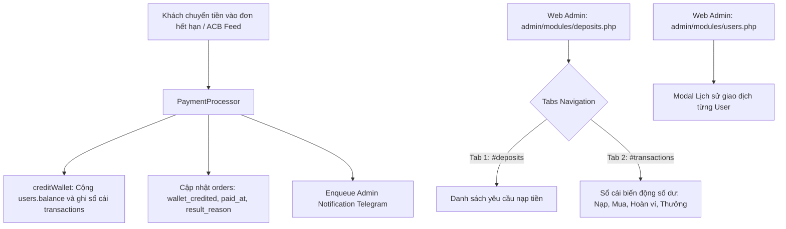

# Kế hoạch Triển khai Đối soát và Hiển thị Biến động Số dư gộp trang Nạp tiền (Web Admin)

## 1. Phân tích & Yêu cầu của Admin

### 1.1. Hiện trạng
- **Trang Đơn hàng (`admin/modules/orders.php`):** Tiền chuyển vào đơn hết hạn được cộng ví nhưng bảng `orders` không cập nhật `wallet_credited` hay `paid_at`. Đơn vẫn hiển thị như đơn hủy chưa nhận tiền.
- **Trang Nạp tiền (`admin/modules/deposits.php`):** Chỉ lấy dữ liệu từ bảng `deposits`, không hiển thị các khoản tiền chuyển theo mã đơn hàng `OD...`.
- **Bảng `transactions`:** Lưu trữ đầy đủ toàn bộ biến động số dư (`deposit`, `purchase`, `refund`, `referral_reward`, `adjustment`) nhưng chưa có giao diện trên Web Admin.

### 1.2. Quyết định thiết kế theo yêu cầu Admin
- **Không tạo trang menu riêng**: Gộp chức năng "Biến động số dư" trực tiếp vào trang **Nạp tiền** ([`admin/modules/deposits.php`](admin/modules/deposits.php)).
- **Mô hình 2 Tab mượt mà (JavaScript / Hash Routing / AJAX)**:
  - **Tab 1 (`#deposits`)**: Yêu cầu nạp tiền (Bảng `deposits` hiện tại, xử lý duyệt nạp).
  - **Tab 2 (`#transactions`)**: Sổ cái biến động số dư (Bảng `transactions JOIN users`, hiển thị mọi dòng tiền vào/ra, hoàn ví đơn đóng, mua hàng, nạp tiền).
- **Lưu vết đối soát đơn hàng**: Cập nhật `orders.wallet_credited`, `orders.paid_at`, `orders.result_reason` trong [`core/PaymentProcessor.php`](core/PaymentProcessor.php).
- **Modal Lịch sử giao dịch tại trang Người dùng**: Cho phép mở modal xem ngay các giao dịch của user tại [`admin/modules/users.php`](admin/modules/users.php).

---

## 2. Kiến trúc chi tiết



### 2.1. Cải tiến Core: Lưu vết vào bảng `orders`
Trong [`core/PaymentProcessor.php:273`](core/PaymentProcessor.php:273):
Khi `$order['status'] !== 'pending'`:
- Gọi `creditWallet($order, $amount, 'closed_order_payment')`.
- Thực hiện cập nhật bảng `orders`:
  ```sql
  UPDATE orders
  SET wallet_credited = wallet_credited + ?,
      paid_at = COALESCE(paid_at, NOW()),
      result_reason = CASE
          WHEN result_reason = 'expired' THEN 'expired_paid_to_wallet'
          ELSE CONCAT(result_reason, '_paid_to_wallet')
      END
  WHERE id = ?
  ```
- Kết quả: Khi Admin vào [`admin/modules/orders.php`](admin/modules/orders.php) tra cứu đơn hàng, trường **Tiền cộng vào ví** sẽ hiển thị đầy đủ số tiền khách đã nạp, thời gian thanh toán được ghi nhận và trạng thái thể hiện rõ tiền đã được cộng ví.

---

### 2.2. Giao diện trang Nạp tiền & Biến động số dư (`admin/modules/deposits.php`)
Chuyển đổi giao diện thành mô hình 2 Tab tương tự chuẩn tab của Kho hàng ([`admin/modules/stocks.php`](admin/modules/stocks.php:344)):

1. **Thanh điều hướng Tab (`.stock-tabs` hoặc `.deposit-tabs`)**:
   - `Tab 1`: **Yêu cầu nạp tiền** (`#deposits` / `?tab=deposits`)
   - `Tab 2`: **Biến động số dư** (`#transactions` / `?tab=transactions`)
   - Sử dụng hash routing (`window.location.hash`) và lưu trạng thái tab giúp chuyển đổi tức thì không cần tải lại trang.

2. **Nội dung Tab 1: Yêu cầu nạp tiền**:
   - Giữ nguyên bộ lọc và bảng dữ liệu từ bảng `deposits`.
   - Giữ nguyên luồng POST duyệt nạp tiền thủ công.

3. **Nội dung Tab 2: Biến động số dư (`transactions`)**:
   - Truy vấn bảng `transactions t JOIN users u ON u.id = t.user_id`.
   - Các cột hiển thị:
     - `ID`
     - `Khách hàng` (Telegram ID, Họ tên, @Username)
     - `Loại giao dịch` (Badge màu ngữ nghĩa: `deposit` xanh lá, `purchase` xanh dương, `refund` cam, `referral_reward` tím, `adjustment` xám)
     - `Số tiền` (Xanh lá `+...` cho tiền vào ví, Đỏ `-...` cho tiền trừ ví)
     - `Số dư trước / sau` (Nếu có ghi nhận)
     - `Mã tham chiếu` (Hiển thị link/mã đơn `OD...`, mã nạp `NAP...`, mã ref)
     - `Ghi chú / Lý do`
     - `Thời gian`
   - Bộ lọc cho Tab 2:
     - Tìm kiếm theo Telegram ID / Tên khách
     - Lọc theo loại giao dịch (`deposit`, `purchase`, `refund`, `referral_reward`, `adjustment`)
     - Lọc theo mã tham chiếu
     - Lọc theo ngày từ - đến
   - Hỗ trợ AJAX load / pagination mượt mà.

---

### 2.3. Modal Lịch sử giao dịch tại trang Người dùng (`admin/modules/users.php`)
- Tại mỗi dòng khách hàng trong [`admin/modules/users.php`](admin/modules/users.php:107):
  - Bên cạnh nút "Điều chỉnh số dư", thêm nút "Lịch sử ví" (`data-open-user-history`).
  - Khi click: Mở Modal hiển thị 20 giao dịch gần nhất của người dùng đó (truy vấn nhanh qua AJAX hoặc nạp sẵn JSON nhẹ).
  - Hoặc có liên kết nhanh chuyển thẳng sang trang Nạp tiền Tab 2 đã điền sẵn Telegram ID của khách: `?page=deposits&tab=transactions&telegram_id=...#transactions`.

---

### 2.4. Đa ngôn ngữ (i18n) & Tiêu chuẩn giao diện
- Khai báo đầy đủ các khóa từ điển trong [`languages/vi.php`](languages/vi.php) và [`languages/en.php`](languages/en.php):
  - `admin_deposit_tab_requests`: "Yêu cầu nạp tiền" / "Deposit requests"
  - `admin_deposit_tab_transactions`: "Biến động số dư" / "Balance history"
  - `admin_tx_type_deposit`: "Nạp tiền" / "Deposit"
  - `admin_tx_type_purchase`: "Mua hàng" / "Purchase"
  - `admin_tx_type_refund`: "Hoàn tiền / Cộng ví" / "Refund"
  - `admin_tx_type_referral_reward`: "Thưởng giới thiệu" / "Referral reward"
  - `admin_tx_type_adjustment`: "Admin điều chỉnh" / "Adjustment"
  - `admin_tx_amount`: "Số tiền" / "Amount"
  - `admin_tx_balance_before`: "Số dư trước" / "Balance before"
  - `admin_tx_balance_after`: "Số dư sau" / "Balance after"
  - `admin_tx_reference`: "Tham chiếu" / "Reference"
  - `admin_tx_note`: "Ghi chú" / "Note"
  - `admin_users_view_history`: "Lịch sử ví" / "Wallet history"
- Tuân thủ quy ước AGENTS.md:
  - Chiều cao control, button, input đồng nhất.
  - Form trong toolbar căn flexbox thẳng hàng.
  - Table bọc trong `.table-wrap` chống tràn trên mobile.
  - Không hard-code chuỗi giao diện.

---

## 3. Kế hoạch công việc (Todo List)
- [ ] Cập nhật [`PaymentProcessor::processOrder()`](core/PaymentProcessor.php:273) lưu vết `wallet_credited`, `paid_at`, `result_reason` vào bảng `orders` khi tiền vào đơn đóng.
- [ ] Bổ sung khóa ngôn ngữ vi/en cho Tab Biến động số dư và các loại giao dịch trong [`languages/vi.php`](languages/vi.php) và [`languages/en.php`](languages/en.php).
- [ ] Tái cấu trúc [`admin/modules/deposits.php`](admin/modules/deposits.php) thành 2 Tab (Yêu cầu nạp tiền & Biến động số dư) kèm bộ lọc và AJAX hash routing.
- [ ] Bổ sung liên kết xem nhanh lịch sử ví từ trang Người dùng [`admin/modules/users.php`](admin/modules/users.php) sang Tab Biến động số dư.
- [ ] Kiểm tra hiển thị responsive, kiểm tra cú pháp PHP lint và chạy test bộ gõ/thanh toán.
