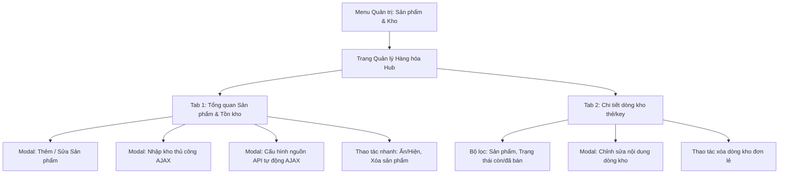

# Kế hoạch tối ưu hóa giao diện Admin: Ứng dụng Tabs & Modals và Hợp nhất Sản phẩm & Kho hàng

## 1. Đánh giá tổng quan và Câu hỏi chiến lược

### Có nên gộp trang "Sản phẩm" và "Kho hàng" vào chung 1 trang không?
**Câu trả lời của chuyên gia: RẤT NÊN GỘP.**

#### Lý do nghiệp vụ và kỹ thuật:
1. **Bản chất nghiệp vụ gắn liền:** Trong mô hình bán sản phẩm số (digital goods), Sản phẩm và Tồn kho (kho thủ công & nguồn API) là hai mặt của cùng một thực thể. Việc tách rời khiến quản trị viên phải liên tục chuyển qua chuyển lại giữa 2 trang: tạo sản phẩm ở trang Sản phẩm -> nhảy sang trang Kho hàng để nạp thẻ hoặc cấu hình nguồn API.
2. **Loại bỏ form chiếm diện tích:** Trang [`admin/modules/products.php`](admin/modules/products.php) hiện tại đặt form thêm/sửa sản phẩm rất dài (mô tả đa ngôn ngữ, hướng dẫn sử dụng, giá, cấu hình) ngay trên đầu bảng danh sách. Khi chuyển form này vào **Modal Thêm/Sửa Sản phẩm**, trang sẽ cực kỳ thoáng, người quản trị nhìn thấy ngay toàn bộ danh mục sản phẩm và trạng thái kho.
3. **Kế thừa kiến trúc AJAX/Modal đã xây dựng:** Trang [`admin/modules/stocks.php`](admin/modules/stocks.php) vừa được nâng cấp hoàn thiện hệ thống Tabs, Modal nhập kho và Modal cấu hình nguồn API theo chuẩn AJAX. Việc hợp nhất chỉ đơn giản là đưa danh sách sản phẩm và modal sửa sản phẩm vào hệ sinh thái Tabs/Modals này, giúp tái sử dụng mã nguồn 100%.

---

## 2. Đánh giá toàn bộ các trang Admin cho Tabs và Modals

| Trang Admin | Hiện trạng UX/UI | Giải pháp Tabs / Modals tối ưu | Mức độ ưu tiên |
| :--- | :--- | :--- | :--- |
| **Sản phẩm & Kho hàng** ([`admin/modules/products.php`](admin/modules/products.php), [`admin/modules/stocks.php`](admin/modules/stocks.php)) | Tách rời 2 menu; form sản phẩm choán hết màn hình; thao tác rời rạc giữa định nghĩa sản phẩm và nạp kho. | **Hợp nhất thành 1 trang duy nhất:** - **Tab 1: Tổng quan sản phẩm & Kho:** Tích hợp xem giá, tồn kho, thao tác Thêm/Sửa (Modal), Nhập kho (Modal), Nguồn API (Modal). - **Tab 2: Chi tiết dòng kho:** Lọc thẻ/key/tài khoản, sửa/xóa dòng kho (Modal). | **Cao nhất (P0)** |
| **Đơn hàng** ([`admin/modules/orders.php`](admin/modules/orders.php)) | Bấm "Chi tiết" làm reload toàn bộ trang sang `?detail=X`, mất trạng thái lọc và tìm kiếm; phải bấm quay lại. | **Modal Chi tiết Đơn hàng:** Click "Chi tiết" mở ngay modal hiển thị thông tin thanh toán, khách hàng và nội dung thẻ/tài khoản đã giao với nút Copy 1-click. | **Cao (P1)** |
| **Nhà cung cấp** ([`admin/modules/suppliers.php`](admin/modules/suppliers.php)) | Trang rất dài và cuộn nhiều: Card trạng thái các bên + Card tỷ giá USDT + Bảng catalog NCC + Bảng so sánh giá. | **Tách 3 Tabs nghiệp vụ:** - **Tab 1: Kết nối & Số dư API:** Thẻ NCC, số dư USDT/VND, đồng bộ, tỷ giá. - **Tab 2: Danh mục hàng NCC:** Tìm kiếm, lọc còn hàng, lợi nhuận. - **Tab 3: So sánh & Gán nguồn:** Bảng so sánh giá rẻ nhất để chọn nguồn tối ưu. | **Trung bình (P2)** |
| **Cài đặt** ([`admin/modules/settings.php`](admin/modules/settings.php)) | Một trang dài gồm nhiều khối thông tin khác nhau (thông tin shop, nội dung text bot đa ngôn ngữ, migration DB, webhook). | **Tách 3 Tabs rõ ràng:** - **Tab 1: Thông tin cửa hàng:** Tên shop, Telegram chủ shop, Channel, Website. - **Tab 2: Nội dung Bot:** Tin nhắn chào mừng, hỗ trợ đa ngôn ngữ VI/EN. - **Tab 3: Kỹ thuật & Hệ thống:** Database Migration và Telegram Webhook. | **Trung bình (P2)** |
| **Khách hàng** ([`admin/modules/users.php`](admin/modules/users.php)) | Form chỉnh số dư chèn trực tiếp trên từng hàng bảng khiến bảng bị rộng ngang và dễ bấm nhầm. | **Modal Điều chỉnh số dư:** Thay thế bằng nút bấm gọn gàng, mở modal nhập số tiền điều chỉnh kèm ghi chú rõ ràng. | **Thấp (P3)** |
| **Báo cáo & Giới thiệu** ([`admin/modules/dashboard.php`](admin/modules/dashboard.php), [`admin/modules/referrals.php`](admin/modules/referrals.php), [`admin/modules/deposits.php`](admin/modules/deposits.php)) | Dashboard đã rất gọn; Nạp tiền và Giới thiệu có bảng đơn giản. | Giữ nguyên hiện trạng, chỉ chuẩn hóa styling nếu cần. | Thấp |

---

## 3. Kiến trúc chi tiết: Trang hợp nhất "Sản phẩm & Kho hàng"

### Chi tiết Tab 1: Tổng quan Sản phẩm & Tồn kho
- **Bảng dữ liệu trung tâm:**
  - Cột: Tên sản phẩm, Giá bán, Tồn kho tay, Tồn kho API, Tổng khả dụng, Đã bán ảo (fake sold), Trạng thái (Đang bán / Đã ẩn).
  - Cột thao tác tích hợp:
    - Nút **Sửa** (icon/chữ): Mở modal nạp form sửa thông tin sản phẩm (tên, giá, mô tả VI/EN, hướng dẫn, fake sold).
    - Nút **Nhập kho**: Mở modal nhập kho thủ công (textarea nhiều dòng, AJAX).
    - Nút **Nguồn API**: Mở modal cấu hình nguồn chính & dự phòng (AJAX).
    - Nút **Ẩn/Hiện**: Đổi trạng thái hiển thị nhanh.
    - Nút **Xóa**: Xóa nếu chưa phát sinh đơn.
- **Thanh công cụ phía trên bảng:**
  - Nút **+ Thêm sản phẩm**: Mở modal thêm sản phẩm mới.
  - Nút **Đồng bộ tồn kho NCC**: Kích hoạt cron/sync nhanh tồn kho API từ các nhà cung cấp.

### Chi tiết Tab 2: Chi tiết dòng kho thẻ/key
- Kế thừa toàn bộ logic chi tiết kho của [`admin/modules/stocks.php`](admin/modules/stocks.php) hiện tại.
- Cho phép xem từng dòng thẻ/key/tài khoản, lọc theo sản phẩm và trạng thái (còn hàng / đã bán).
- Có thể sửa trực tiếp hoặc xóa từng dòng khi còn chưa bán.

---

## 4. Lộ trình triển khai theo từng giai đoạn

### Giai đoạn 1: Hợp nhất Sản phẩm & Kho hàng (Ưu tiên số 1)
1. Thống nhất định tuyến menu trong [`admin/index.php`](admin/index.php): gộp `products` và `stocks` thành 1 mục duy nhất (giữ URL `?page=products` hoặc `?page=stocks`).
2. Tích hợp xử lý backend: Hỗ trợ tạo/sửa sản phẩm, bật/tắt, xóa sản phẩm kết hợp cùng các action nhập kho và lưu nguồn API.
3. Chuyển form Thêm/Sửa sản phẩm từ dạng chèn tĩnh trên trang thành **Modal Thêm/Sửa Sản phẩm động**.
4. Cập nhật bảng dữ liệu tổng quan để hiển thị đầy đủ thông tin sản phẩm lẫn tồn kho.
5. Kiểm tra đa ngôn ngữ trong [`languages/vi.php`](languages/vi.php) và [`languages/en.php`](languages/en.php).

### Giai đoạn 2: Tối ưu trang Đơn hàng (Orders) & Khách hàng (Users)
1. Đơn hàng: Xây dựng Modal xem chi tiết đơn hàng (thông tin thanh toán, mã nạp, nội dung thẻ đã giao, nút copy).
2. Khách hàng: Chuyển form điều chỉnh số dư thành Modal xác nhận cộng/trừ ví có nhập lý do.

### Giai đoạn 3: Tối ưu trang Nhà cung cấp (Suppliers) & Cài đặt (Settings)
1. Nhà cung cấp: Phân chia 3 Tabs (Số dư & Tỷ giá, Danh mục API, So sánh giá & Gán nguồn).
2. Cài đặt: Phân chia 3 Tabs (Cửa hàng, Nội dung Bot VI/EN, Hệ thống & Kỹ thuật).
