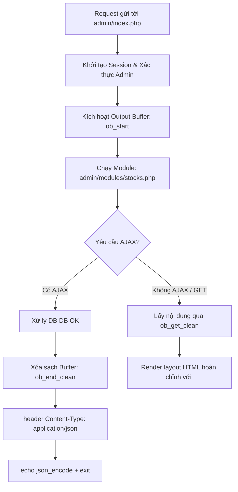

# Kế hoạch khắc phục lỗi AJAX Admin và Định dạng thẻ `<code>` danh sách sản phẩm Bot

Tài liệu này phân tích chi tiết nguyên nhân gốc rễ và đề xuất giải pháp kỹ thuật giải quyết 2 yêu cầu:
1. Xử lý triệt để lỗi `Unexpected token '<', "<!doctype "... is not valid JSON` khi nhấn các nút lưu/submit trên giao diện web Admin.
2. Bọc giá tiền (VND & USD) cùng số lượng tồn kho trong thẻ `<code></code>` tại màn hình danh sách sản phẩm trên Telegram Bot.

---

## 1. Phân tích nguyên nhân gốc rễ

### 1.1. Lỗi `Unexpected token '<', "<!doctype "... is not valid JSON` trên Web Admin

#### Hiện tượng:
- Khi người quản trị bấm các nút submit (như Lưu trong modal cấu hình nguồn, modal nhập kho, modal sản phẩm), giao diện hiển thị thông báo lỗi `Unexpected token '<', "<!doctype "... is not valid JSON`.
- Dữ liệu trong cơ sở dữ liệu thực tế **vẫn được lưu thành công**.

#### Nguyên nhân kỹ thuật:
1. **Thứ tự render layout trong [`admin/index.php`](admin/index.php:85)**:
   - File [`admin/index.php`](admin/index.php) in toàn bộ cấu trúc HTML (`<!doctype html><html lang="...">...<main>...`) trước khi gọi `require __DIR__ . '/modules/' . $page . '.php';`.
   - Khi một form AJAX gửi POST lên backend, module xử lý xong dữ liệu và gọi hàm `$respond(...)` trả về JSON (`echo json_encode(...); exit;`).
   - Tuy nhiên, phần đầu của HTTP response body đã chứa sẵn mã HTML `<!doctype html>...` do `index.php` in ra từ trước.
   - Trình duyệt nhận được chuỗi bắt đầu bằng ký tự `<` thay vì `{`, dẫn đến `response.json()` ném ngoại lệ `SyntaxError: Unexpected token '<', "<!doctype "... is not valid JSON`.
2. **Các action dùng `redirectAdmin` thay vì dual-mode `$respond` trong [`admin/modules/stocks.php`](admin/modules/stocks.php:66)**:
   - Các hành động như `save_product`, `toggle_product`, `delete_product` gọi thẳng [`redirectAdmin('stocks', ...)`](admin/auth.php:29) (HTTP 302).
   - Khi fetch thực hiện theo dõi redirect (HTTP 302 -> `index.php?page=stocks`), response trả về là trang HTML đầy đủ với HTTP 200, tiếp tục gây lỗi parse JSON nếu form được gửi qua AJAX.
3. **Endpoint gửi AJAX và thiếu thuộc tính `data-ajax-form`**:
   - Hàm `submitForm(form)` dùng `fetch(window.location.href, ...)`. Nếu người dùng đang ở URL `/admin/` (không có query `?page=stocks`) hoặc có hash `#overview`, request POST có thể bị điều hướng sai vào `dashboard.php`.
   - Form thêm/sửa sản phẩm `stock-product-form` chưa có thuộc tính `data-ajax-form`, dẫn đến không đồng nhất cơ chế submit giữa các form modal trong cùng màn hình Kho hàng.

---

### 1.2. Định dạng thẻ `<code>` trong danh sách sản phẩm Telegram Bot

#### Hiện tượng & Yêu cầu:
- Tại màn hình danh sách sản phẩm của Telegram Bot, dòng phụ hiển thị giá và tồn kho hiện tại:
  `╰ 0.4 $ (9.900 VND) - Còn: 19`
- Người dùng yêu cầu bọc giá tiền và số lượng tồn kho trong thẻ `<code></code>`, ví dụ:
  `<code>0.4 $</code> (<code>9.900 VND</code>) - Còn: <code>19</code>`
  (và đối với tiếng Anh: `<code>0.4 $</code> (<code>9.900 VND</code>) - Stock: <code>19</code>`).

#### Cơ chế hiện tại:
- Tại [`bot/handlers/ProductHandler.php:36`](bot/handlers/ProductHandler.php:36):
  ```php
  $text .= $number . '. <b>' . Helpers::escape($product['name']) . "</b>\n"
      . $lang->get('product_item_sub', [
          'price' => Helpers::formatDualPrice($product['price'], $rate, $preference),
          'count' => $stock,
      ]) . "\n\n";
  ```
- File ngôn ngữ [`languages/vi.php:89`](languages/vi.php:89):
  `'product_item_sub' => ' ╰ :price - Còn: :count',`
- File ngôn ngữ [`languages/en.php:89`](languages/en.php:89):
  `'product_item_sub' => ' ╰ :price - Stock: :count',`
- Hàm [`Helpers::formatDualPrice()`](core/Helpers.php:26) trả về chuỗi văn bản thuần chưa có thẻ `<code>`. Các test trong [`tests/binance_pay_test.php:67`](tests/binance_pay_test.php:67) cũng đang kiểm tra định dạng văn bản thuần của hàm này.

---

## 2. Giải pháp kỹ thuật chi tiết

### 2.1. Khắc phục lỗi AJAX trên Web Admin

#### A. Kiến trúc Buffer độc lập trong [`admin/index.php`](admin/index.php)
- Tách biệt hoàn toàn luồng xử lý module và luồng render layout giao diện:
  - Trước khi in `<!doctype html>`, kích hoạt `ob_start()`.
  - Thực thi module qua `require __DIR__ . '/modules/' . $page . '.php';`.
  - Nếu module là AJAX request hoặc gọi `$respond()`: buffer sẽ được xóa sạch (`while (ob_get_level()) ob_end_clean();`), gửi đúng header `Content-Type: application/json; charset=utf-8` và xuất JSON thuần túy 100%.
  - Nếu module hoàn thành bình thường (GET hoặc form submit thông thường không exit sớm), lấy nội dung qua `ob_get_clean()` và render vào bên trong template `<main><?= $pageContent ?></main>`.
- Điều này cũng đảm bảo các lệnh `redirectAdmin()` (gửi header `Location`) không bao giờ bị lỗi `Headers already sent`.



#### B. Đồng bộ hóa `$respond` trong [`admin/modules/stocks.php`](admin/modules/stocks.php)
- Trong `$respond`:
  ```php
  $respond = static function (bool $success, string $message, array $data = []) use ($isAjaxRequest): never {
      if ($isAjaxRequest()) {
          while (ob_get_level()) {
              ob_end_clean();
          }
          header('Content-Type: application/json; charset=utf-8');
          echo json_encode(['success' => $success, 'message' => $message, 'data' => $data], JSON_UNESCAPED_UNICODE | JSON_UNESCAPED_SLASHES);
          exit;
      }
      redirectAdmin('stocks', $message);
  };
  ```
- Cập nhật các action `save_product`, `toggle_product`, `delete_product` chuyển sang sử dụng `$respond($success, $message)`.
- Bổ sung `data-ajax-form` cho `<form method="post" id="stock-product-form" data-ajax-form>`.
- Trong hàm JavaScript `submitForm(form)`:
  - Xác định target URL chuẩn: `var targetUrl = form.getAttribute('action') || 'index.php?page=stocks';`.
  - Kiểm tra `response.headers.get('content-type')` trước khi parse.
  - Sau khi lưu thành công: hiển thị Toast thông báo và tự động reload nhẹ nhàng (`setTimeout(() => location.reload(), 600)`) để cập nhật số liệu mới nhất trên bảng.

---

### 2.2. Nâng cấp hiển thị giá và tồn kho dạng `<code>` trên Telegram Bot

#### A. Nâng cấp hàm [`Helpers::formatDualPrice()`](core/Helpers.php:26)
- Bổ sung tham số tùy chọn `$codeWrapped = false`:
  ```php
  public static function formatDualPrice(
      float|int|string $vndAmount,
      float|int|string $usdtVndRate,
      string $preference = 'bank',
      bool $codeWrapped = false
  ): string {
      $rate = (float) $usdtVndRate;
      $vnd = self::money($vndAmount);
      if ($rate <= 0) {
          return $codeWrapped ? '<code>' . $vnd . '</code>' : $vnd;
      }

      $usd = round((float) $vndAmount / $rate, 2);
      $usdDisplay = self::formatDecimal($usd, 2) . ' $';
      if ($codeWrapped) {
          $usdDisplay = '<code>' . $usdDisplay . '</code>';
          $vnd = '<code>' . $vnd . '</code>';
      }

      return $preference === 'binance_pay'
          ? $usdDisplay . ' (' . $vnd . ')'
          : $vnd . ' (' . $usdDisplay . ')';
  }
  ```
- Lợi ích:
  - Giữ nguyên 100% tính tương thích ngược cho tất cả các vị trí đang gọi `formatDualPrice(...)` hiện tại (như chi tiết sản phẩm, giỏ hàng, thông báo).
  - Không phá vỡ bất kỳ test assertion nào trong [`tests/binance_pay_test.php`](tests/binance_pay_test.php).

#### B. Cập nhật khóa dịch trong [`languages/vi.php`](languages/vi.php) và [`languages/en.php`](languages/en.php)
- [`languages/vi.php:89`](languages/vi.php:89):
  `'product_item_sub' => ' ╰ :price - Còn: <code>:count</code>',`
- [`languages/en.php:89`](languages/en.php:89):
  `'product_item_sub' => ' ╰ :price - Stock: <code>:count</code>',`

#### C. Cập nhật hiển thị tại [`bot/handlers/ProductHandler.php:36`](bot/handlers/ProductHandler.php:36)
- Truyền `true` vào tham số `$codeWrapped`:
  ```php
  $text .= $number . '. <b>' . Helpers::escape($product['name']) . "</b>\n"
      . $lang->get('product_item_sub', [
          'price' => Helpers::formatDualPrice($product['price'], $rate, $preference, true),
          'count' => $stock,
      ]) . "\n\n";
  ```
- Kết quả tạo ra đúng chuẩn yêu cầu:
  - Khi ưu tiên Binance Pay: `<code>0.4 $</code> (<code>9.900 VND</code>) - Còn: <code>19</code>`
  - Khi ưu tiên Chuyển khoản ngân hàng: `<code>9.900 VND</code> (<code>0.4 $</code>) - Còn: <code>19</code>`
  - Khi không có tỷ giá / tỷ giá <= 0: `<code>9.900 VND</code> - Còn: <code>19</code>`

---

## 3. Danh sách công việc triển khai (Actionable Plan)

1. **Khắc phục lỗi AJAX trên Web Admin**:
   - Cập nhật [`admin/index.php`](admin/index.php) sử dụng `ob_start()` / `ob_get_clean()` bọc quanh `require module`, đảm bảo AJAX request xuất JSON sạch không dính HTML.
   - Cập nhật [`admin/modules/stocks.php`](admin/modules/stocks.php):
     - Hàm `$respond` dọn sạch buffer trước khi gửi JSON header.
     - Đồng bộ các action `save_product`, `toggle_product`, `delete_product` sử dụng `$respond()`.
     - Thêm `data-ajax-form` cho `stock-product-form`.
     - Cải tiến JS `submitForm` gửi tới explicit endpoint và reload sau lưu thành công.
2. **Định dạng thẻ `<code>` danh sách sản phẩm**:
   - Mở rộng [`Helpers::formatDualPrice()`](core/Helpers.php:26) hỗ trợ cờ `$codeWrapped = false`.
   - Cập nhật khóa `product_item_sub` trong [`languages/vi.php`](languages/vi.php) và [`languages/en.php`](languages/en.php) bọc `<code>:count</code>`.
   - Cập nhật [`bot/handlers/ProductHandler.php`](bot/handlers/ProductHandler.php) gọi `formatDualPrice(..., true)`.
3. **Kiểm thử và xác nhận hồi quy**:
   - Bổ sung unit test trong [`tests/binance_pay_test.php`](tests/binance_pay_test.php) kiểm tra `formatDualPrice` khi bật `$codeWrapped = true` cho cả 2 tùy chọn thanh toán (`bank` và `binance_pay`).
   - Chạy toàn bộ test suite để xác minh không có lỗi nào phát sinh.
