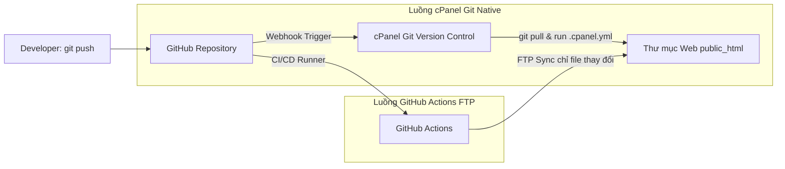

# Kế Hoạch Tự Động Hóa Triển Khai Lên cPanel & Đẩy Code Lên GitHub

## 1. Yêu Cầu Đặt Ra
- Đưa mã nguồn từ máy phát triển / repository lên hosting cPanel hoàn toàn tự động, loại bỏ thao tác nén zip và upload thủ công qua File Manager / FTP.
- Đảm bảo an toàn cho các file cấu hình nhạy cảm (`config/app.php`, `config/database.php`, `config/bank.php`) trên hosting cPanel để không bị ghi đè sau mỗi lần cập nhật code tự động.
- Khởi tạo git, commit toàn bộ mã nguồn hiện tại và push lên GitHub repo: `https://github.com/buivienvn1/taoscheap_bot`.

---

## 2. So Sánh & Lựa Chọn Giải Pháp Tự Động Hóa Lên cPanel

### Phương án A: cPanel Git™ Version Control + Webhook (Khuyên dùng nhất - Native cPanel)
cPanel tích hợp sẵn Git và công cụ tự động deploy qua file `.cpanel.yml`.
- **Nguyên lý hoạt động**:
  1. Trên cPanel: Vào mục **Git™ Version Control**, clone repo từ GitHub về (hoặc kết nối repo).
  2. Trong mã nguồn: Đặt file `.cpanel.yml` quy định lệnh `rsync` hoặc `cp` sang thư mục website (ví dụ `/home/user/public_html`).
  3. Cài đặt Webhook: Lấy Deploy Webhook URL từ cPanel và thêm vào GitHub Repo Settings (`Settings -> Webhooks`).
  4. Mỗi khi `git push` lên GitHub `main`, GitHub sẽ gửi tín hiệu webhook -> cPanel lập tức tự động kéo code mới nhất (`git pull`) và chạy file `.cpanel.yml` để cập nhật website trong tích tắc.
- **Ưu điểm**:
  - Không cần mở cổng FTP hoặc SSH ra ngoài Internet.
  - Tốc độ cực nhanh vì cPanel tự kéo trực tiếp từ GitHub bằng kết nối nội bộ hosting.
  - An toàn, được cPanel hỗ trợ chính thức.

### Phương án B: GitHub Actions CI/CD (Deploy qua FTP / FTPS)
- **Nguyên lý hoạt động**:
  1. Mỗi khi push code lên nhánh `main`, GitHub Actions Runner khởi chạy workflow `.github/workflows/deploy.yml`.
  2. Runner sử dụng Action FTP (`SamKirkland/FTP-Deploy-Action`) kết nối đến tài khoản FTP của cPanel và chỉ đồng bộ những file có thay đổi.
  3. Bỏ qua các file cấu hình và file hệ thống bằng cấu hình `exclude`.
- **Ưu điểm**:
  - Hoạt động được trên mọi loại hosting cPanel dù có bật tính năng Git™ Version Control hay không.
  - Kiểm soát được hoàn toàn log triển khai trực tiếp trên giao diện GitHub Actions.

=> **Khuyến nghị**: Chúng ta sẽ cấu hình **cả hai phương án**:
- Cung cấp sẵn file `.cpanel.yml` chuẩn cho Phương án A.
- Cung cấp sẵn file workflow `.github/workflows/deploy.yml` cho Phương án B.
Bạn có thể tùy ý chọn phương án phù hợp nhất với quyền hạn tài khoản cPanel của bạn.

---

## 3. Kiến Trúc & Luồng Hoạt Động (Mermaid Diagram)

---

## 4. Các Bước Thực Hiện Chi Tiết

1. **Chuẩn bị cấu hình an toàn & Git**:
   - Tạo file `.gitignore` để tránh commit cache, file tạm, credentials nhạy cảm.
   - Tạo file `.cpanel.yml` phục vụ triển khai tự động qua cPanel Git.
   - Tạo file `.github/workflows/deploy.yml` phục vụ triển khai qua GitHub Actions (dự phòng trường hợp cPanel không có Git).
2. **Cập nhật tài liệu hướng dẫn vào README.md**:
   - Bổ sung mục hướng dẫn từng bước kích hoạt tự động hóa trên cPanel và GitHub.
3. **Thực thi Git Commit & Push**:
   - Khởi tạo git repository (`git init`).
   - Cấu hình remote `origin` trỏ về `https://github.com/buivienvn1/taoscheap_bot`.
   - Tạo branch `main`, add toàn bộ file, commit và push lên repository.
