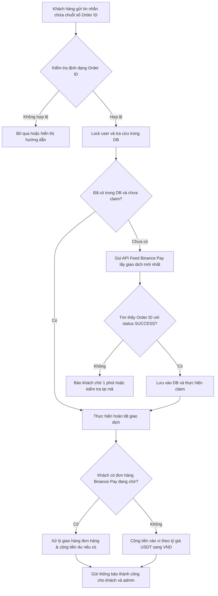

# Kế hoạch Tích hợp Phương thức Thanh toán Binance Pay (USDT)

## 1. Tổng quan yêu cầu
- **Mục tiêu**: Tích hợp phương thức thanh toán **Binance Pay**, đơn vị tiền tệ **USDT**, sử dụng API bên thứ 3 cung cấp link feed để lấy lịch sử giao dịch.
- **Quy tắc hoạt động**:
  - Không cần mã QR động.
  - **Nạp tiền vào ví**: Khách hàng chuyển số tiền USDT bất kỳ tới Binance Pay ID của shop. Khi chuyển xong, Binance cung cấp mã `orderId`, khách gửi lại mã này vào bot để được tự động quy đổi sang VND và cộng tiền vào ví.
  - **Thanh toán đơn hàng trực tiếp**: Khách hàng chọn phương thức Binance Pay khi mua hàng, bot tính toán số USDT cần chuyển theo tỷ giá; khách chuyển tiền và gửi mã `orderId` vào bot để nhận hàng ngay lập tức (nếu thừa tiền, tiền thừa được cộng vào ví).
  - **Xác thực tức thì**: Khách chỉ cần gửi trực tiếp chuỗi số `orderId` vào tin nhắn Telegram, bot tự động nhận diện và đối soát với API feed để kích hoạt giao dịch ngay.
  - **Quản trị**: Cấu hình bật/tắt Binance Pay, Binance Pay ID và tỷ giá quy đổi USDT -> VND riêng biệt trong trang Quản trị Cài đặt ([`admin/modules/settings.php`](admin/modules/settings.php:1)).

---

## 2. Phân tích Dữ liệu Feed Bên thứ ba
Cấu trúc phản hồi mẫu từ API feed:
```json
{
  "status": "success",
  "transactions": [
    {
      "transactionNumber": "P_A25E6ATX58H71116",
      "transactionID": "P_A25E6ATX58H71116",
      "amount": 0.01,
      "description": "",
      "transactionDate": "2026-11-03T14:23:35+00:00",
      "type": "BINANCE_PAY",
      "currency": "{\"orderId\":\"463596655021883392\",\"status\":\"SUCCESS\"}"
    }
  ],
  "next_cursor": null,
  "stale": false,
  "incomplete": false,
  "last_sync_at": "2026-11-03T14:24:46+00:00",
  "last_sync_ok_at": "2026-11-03T14:24:46+00:00"
}
```

### Đặc điểm cần lưu ý:
1. Trường `amount`: Số tiền chuyển khoản đơn vị **USDT** (ví dụ `0.01`).
2. Trường `currency`: Chuỗi JSON mã hóa chứa `orderId` (chuỗi số 15–20 chữ số, ví dụ `"463596655021883392"`) và trạng thái giao dịch (`"SUCCESS"`).
3. Trường `transactionID` / `transactionNumber`: Mã định danh giao dịch của bên thứ 3.
4. Trường `description`: Chuỗi rỗng `""`.

---

## 3. Kiến trúc Luồng Dữ liệu & Quy trình Xử lý

### Sơ đồ luồng xử lý xác nhận Order ID:


---

## 4. Các Thay đổi Cụ thể trong Hệ thống

### 4.1. Database Migration: [`migrations/018_binance_pay_integration.sql`](migrations/018_binance_pay_integration.sql:1)
1. Bổ sung các cấu hình mặc định vào bảng `settings`:
   - `binance_pay_enabled`: `'0'`
   - `binance_pay_id`: `''` (Binance Pay ID / Binance Email)
   - `binance_pay_rate_usdt_vnd`: `'25500'` (Tỷ giá quy đổi USDT sang VND)
2. Mở rộng bảng `orders`:
   - Thêm enum giá trị `binance_pay` vào cột `payment_method`:
     `ALTER TABLE orders MODIFY COLUMN payment_method ENUM('wallet', 'vietqr_direct', 'hybrid', 'binance_pay') NOT NULL;`
   - Bổ sung `binance_order_id VARCHAR(64) NULL`, `binance_usdt_amount DECIMAL(15,4) NULL`.
3. Mở rộng bảng `deposits`:
   - Bổ sung `payment_method ENUM('vietqr', 'binance_pay') NOT NULL DEFAULT 'vietqr'`,
   - Bổ sung `binance_order_id VARCHAR(64) NULL`, `binance_usdt_amount DECIMAL(15,4) NULL`.
4. Tạo bảng lưu trữ giao dịch Binance Pay `binance_pay_transactions`:
   - `id BIGINT UNSIGNED AUTO_INCREMENT PRIMARY KEY`
   - `transaction_id VARCHAR(64) NOT NULL UNIQUE` (khóa chống trùng lặp giao dịch bên thứ 3)
   - `binance_order_id VARCHAR(64) NOT NULL UNIQUE` (mã Order ID của Binance)
   - `amount DECIMAL(15,4) NOT NULL` (số USDT)
   - `status VARCHAR(30) NOT NULL` (ví dụ: `SUCCESS`)
   - `transaction_at VARCHAR(50) NULL`
   - `claimed_by_user_id BIGINT UNSIGNED NULL`
   - `claimed_request_type ENUM('deposit','order') NULL`
   - `claimed_request_id BIGINT UNSIGNED NULL`
   - `claimed_at DATETIME NULL`
   - `raw_payload TEXT NULL`
   - `created_at DATETIME NOT NULL DEFAULT CURRENT_TIMESTAMP`
   - `KEY idx_binance_order_id (binance_order_id)`
   - `KEY idx_binance_claimed (claimed_by_user_id, claimed_at)`

---

### 4.2. Cấu hình & Adapter Core
1. **File cấu hình**: [`config/binance_pay.example.php`](config/binance_pay.example.php:1)
   - `enabled`: `false`
   - `provider`: `'binance_pay_third_party'`
   - `url`: `'https://feed-provider.example/api/v1/feed'`
   - `token`: `'REPLACE_WITH_ROTATED_TOKEN'`
   - `auth_mode`: `'query'` (hoặc `'header'`)
   - `token_parameter`: `'token'`
   - `allowed_host`: `'feed-provider.example'`
   - `timeout_seconds`: 15
2. **Adapter**: [`core/BinancePayAdapter.php`](core/BinancePayAdapter.php:1)
   - Kiểm tra `status` thành công.
   - Duyệt mảng `transactions`:
     - Phân tích chuỗi JSON trong trường `currency`.
     - Lấy `orderId` và `status`.
     - Trích xuất `amount` (USDT), `transactionID`, `transactionNumber`, `transactionDate`.
3. **Client**: [`core/BinancePayClient.php`](core/BinancePayClient.php:1)
   - Đọc cấu hình từ `config/binance_pay.local.php` (hoặc `config/payment_feed.local.php`).
   - Gọi cURL an toàn với SSL verification và timeout.
4. **Service**: [`core/BinancePayService.php`](core/BinancePayService.php:1)
   - Lưu trữ các transaction tải về vào bảng `binance_pay_transactions`.
   - Phương thức `claimOrderId(int $userId, string $orderId, Language $lang): array`:
     - Đảm bảo an toàn giao dịch với `FOR UPDATE`.
     - Kiểm tra nếu mã đã được claim -> báo lỗi trùng lặp.
     - Nếu chưa có trong DB -> chủ động fetch fresh page từ client để khớp ngay lập tức.
     - Tính tiền VND: `amount_vnd = round(amount_usdt * rate, 2)`.
     - Nếu user có pending order Binance Pay: chuyển qua `PaymentProcessor` để giao hàng và cộng tiền thừa (nếu có).
     - Nếu không có pending order: thực hiện nạp tiền ví, cộng `amount_vnd` vào ví user và tạo bản ghi nạp tiền.
     - Đánh dấu `claimed_at = NOW()`, `claimed_by_user_id = $userId`.
     - Bắn notification outbox cho user và admin.

---

### 4.3. Cập nhật Bot Telegram Handlers
1. **Nạp tiền**: [`bot/handlers/DepositHandler.php`](bot/handlers/DepositHandler.php:1)
   - Nếu `binance_pay_enabled == '1'`:
     - Hiển thị menu chọn:
       - `[ 🏦 Ngân hàng (VietQR) ]` (callback: `deposit:vietqr`)
       - `[ 🟡 Binance Pay (USDT) ]` (callback: `deposit:binance`)
     - Khi chọn `deposit:binance`:
       - Hiển thị Binance Pay ID của shop, tỷ giá quy đổi hiện tại.
       - Hướng dẫn chuyển tiền và nhắn lại mã Order ID.
   - Nếu không bật: giữ nguyên luồng VietQR hiện tại.
2. **Thanh toán đơn hàng**: [`bot/handlers/OrderHandler.php`](bot/handlers/OrderHandler.php:1)
   - Khi số dư ví không đủ, nếu `binance_pay_enabled == '1'`:
     - Hiển thị tùy chọn thanh toán:
       - `[ 🏦 Chuyển khoản VietQR ]` (callback: `pay_method:vietqr:...`)
       - `[ 🟡 Binance Pay (USDT) ]` (callback: `pay_method:binance:...`)
     - Khi chọn Binance Pay:
       - Tạo đơn hàng pending với `payment_method = 'binance_pay'`.
       - Tính số USDT cần chuyển: `ceil(remaining_vnd / rate * 100) / 100`.
       - Hiển thị chi tiết số USDT, Binance Pay ID của shop, hướng dẫn gửi mã Order ID để kích hoạt giao hàng.
3. **Tiếp nhận Order ID từ tin nhắn chat**: [`bot/Router.php`](bot/Router.php:1)
   - Trong hàm [`handle()`](bot/Router.php:37), khi nhận tin nhắn text từ người dùng:
   - Kiểm tra nếu chuỗi text khớp định dạng Order ID của Binance (chuỗi từ 15 đến 22 chữ số):
   - Gọi `BinancePayService->claimOrderId()`:
     - Nếu thành công: gửi tin nhắn hoàn tất đơn hàng hoặc thông báo nạp ví thành công.
     - Nếu không tìm thấy: thông báo rõ ràng mã chưa tìm thấy trong hệ thống, hướng dẫn kiểm tra lại hoặc thử lại sau 1-2 phút.

---

### 4.4. Cập nhật Admin UI & Đa ngôn ngữ
1. **Quản trị Cài đặt**: [`admin/modules/settings.php`](admin/modules/settings.php:1)
   - Thêm block "Cấu hình Binance Pay":
     - Checkbox bật/tắt: `binance_pay_enabled`
     - Ô nhập Binance Pay ID / Email: `binance_pay_id`
     - Ô nhập Tỷ giá USDT (VND): `binance_pay_rate_usdt_vnd`
   - Đảm bảo tuân thủ quy chuẩn chiều cao form control và giao diện responsive.
2. **Quản trị Nạp tiền & Đơn hàng**: [`admin/modules/deposits.php`](admin/modules/deposits.php:1), [`admin/modules/orders.php`](admin/modules/orders.php:1)
   - Hiển thị rõ phương thức thanh toán: `VietQR` hoặc `Binance Pay`.
   - Hiển thị mã Binance Order ID nếu thanh toán qua Binance Pay.
3. **Đa ngôn ngữ**: [`languages/vi.php`](languages/vi.php:1) và [`languages/en.php`](languages/en.php:1)
   - Bổ sung đầy đủ các khóa dịch:
     - `payment_method_binance`: 'Binance Pay' / 'Binance Pay'
     - `deposit_choose_method`: 'Vui lòng chọn phương thức nạp tiền:'
     - `btn_deposit_vietqr`: '🏦 Ngân hàng (VietQR)'
     - `btn_deposit_binance`: '🟡 Binance Pay (USDT)'
     - `binance_deposit_title`: 'NẠP TIỀN QUA BINANCE PAY'
     - `binance_pay_id_line`: '🟡 Binance Pay ID: <code>:id</code>'
     - `binance_rate_line`: '💱 Tỷ giá: <b>1 USDT = :rate</b>'
     - `binance_deposit_instruction`: 'Chuyển USDT bất kỳ tới Binance Pay ID trên. Chuyển xong hãy gửi mã <b>Order ID</b> vào đây để nhận tiền tự động.'
     - `binance_order_instruction`: 'Chuyển chính xác hoặc nhiều hơn <b>:usdt_amount USDT</b> tới Binance Pay ID trên. Chuyển xong hãy gửi mã <b>Order ID</b> vào đây để nhận hàng.'
     - `binance_claim_success_deposit`: '✅ Đã nạp thành công <b>:usdt USDT</b> (~:amount)\nSố dư: <b>:balance</b>'
     - `binance_claim_not_found`: '❌ Chưa tìm thấy giao dịch Binance Pay với Order ID: <code>:order_id</code>. Vui lòng kiểm tra lại mã hoặc thử lại sau 1 phút.'
     - `binance_claim_already_used`: '⚠️ Mã Order ID này đã được xác nhận trước đó.'
     - `admin_binance_pay_title`: 'Cấu hình Binance Pay'
     - `admin_binance_pay_enabled`: 'Kích hoạt Binance Pay'
     - `admin_binance_pay_id`: 'Binance Pay ID / Email'
     - `admin_binance_pay_rate`: 'Tỷ giá USDT (VND)'

---

### 4.5. Kiểm thử Tự động (Tests)
- Tạo test file: [`tests/binance_pay_test.php`](tests/binance_pay_test.php:1)
  - Kiểm tra parse đúng payload feed mẫu từ bên thứ 3.
  - Kiểm tra trích xuất chính xác `orderId` và `status` từ trường `currency`.
  - Kiểm tra tính toán quy đổi USDT -> VND theo tỷ giá.
  - Kiểm tra cơ chế chống double-claim Order ID.

---

## 5. Danh mục Công việc Cần Triển khai (Actionable Plan)
1. **Migration & Schema**: Tạo migration `migrations/018_binance_pay_integration.sql` cập nhật các bảng `settings`, `orders`, `deposits` và tạo `binance_pay_transactions`.
2. **Cấu hình & Adapter Core**:
   - Tạo `config/binance_pay.example.php`.
   - Tạo [`core/BinancePayAdapter.php`](core/BinancePayAdapter.php:1) và [`core/BinancePayClient.php`](core/BinancePayClient.php:1).
   - Tạo [`core/BinancePayService.php`](core/BinancePayService.php:1) tích hợp với [`core/PaymentProcessor.php`](core/PaymentProcessor.php:1).
3. **Cập nhật Bot Handlers & UI**:
   - Cập nhật [`bot/handlers/DepositHandler.php`](bot/handlers/DepositHandler.php:1) hỗ trợ nạp qua Binance Pay.
   - Cập nhật [`bot/handlers/OrderHandler.php`](bot/handlers/OrderHandler.php:1) hỗ trợ thanh toán đơn qua Binance Pay.
   - Cập nhật [`bot/Router.php`](bot/Router.php:1) tự động nhận diện tin nhắn Order ID và đối soát ngay lập tức.
4. **Cập nhật Admin Settings & Lịch sử**:
   - Cập nhật [`admin/modules/settings.php`](admin/modules/settings.php:1) quản lý Binance Pay ID và tỷ giá USDT.
   - Cập nhật hiển thị trong [`admin/modules/deposits.php`](admin/modules/deposits.php:1) và [`admin/modules/orders.php`](admin/modules/orders.php:1).
5. **Đa ngôn ngữ & Tests**:
   - Thêm đầy đủ khóa dịch vào [`languages/vi.php`](languages/vi.php:1) và [`languages/en.php`](languages/en.php:1).
   - Viết test suite trong [`tests/binance_pay_test.php`](tests/binance_pay_test.php:1) và chạy xác thực.
