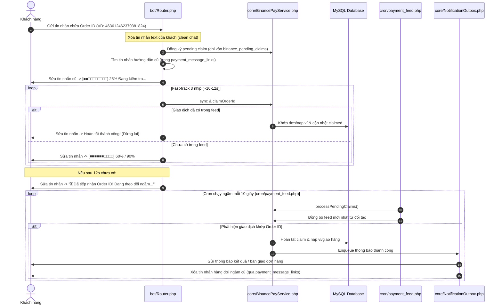

# Kế hoạch Triển khai: Xử lý Độ trễ Binance Pay Feed (Mô hình Hybrid) & Dọn dẹp Tin nhắn Chống Spam

## 1. Mục tiêu
1. **Giải quyết triệt để độ trễ (latency) của API feed Binance Pay**: Khắc phục tình trạng bot báo "Chưa tìm thấy giao dịch" khiến khách hàng hoang mang và phải gõ lại Order ID nhiều lần.
2. **Trải nghiệm Hybrid cao cấp**:
   - **Fast-track Live Progress Bar (10-12s)**: Hiển thị thanh tiến trình trực tiếp với 3 nhịp kiểm tra nhanh. Nếu đối tác cập nhật nhanh, giao dịch được duyệt và hoàn tất tại chỗ.
   - **Background Queue (Tự động theo dõi ngầm)**: Nếu sau 12s feed chưa về, hệ thống tự động lưu vào hàng đợi và chuyển giao cho Cron worker kiểm tra định kỳ mỗi 10 giây. Khách hàng không cần nhập lại.
3. **Chống Spam & Dọn dẹp Tin nhắn (Message Cleanup)**:
   - Xóa ngay tin nhắn text nhập Order ID của khách hàng để giữ khung chat sạch sẽ.
   - Tái sử dụng tin nhắn hướng dẫn nạp/thanh toán cũ để hiển thị thanh tiến trình thay vì gửi thêm tin nhắn mới.
   - Khi hoàn tất (dù qua Fast-track hay Background Cron), hệ thống tự động xóa/thay thế các tin nhắn chờ qua `payment_message_links` và `NotificationOutbox`, đảm bảo chỉ có 1 thông báo kết quả duy nhất.

---

## 2. Kiến trúc & Luồng Xử lý (Workflow)

---

## 3. Các bước Triển khai Chi tiết

### Bước 1: Database Migration (`migrations/019_binance_pending_claims.sql`)
- Tạo bảng `binance_pending_claims`:
  - `id`: `BIGINT UNSIGNED AUTO_INCREMENT PRIMARY KEY`
  - `user_id`: `BIGINT UNSIGNED NOT NULL`
  - `chat_id`: `BIGINT NOT NULL`
  - `message_id`: `BIGINT NULL` (tin nhắn tiến trình/hướng dẫn liên kết)
  - `order_id`: `VARCHAR(64) NOT NULL` (Binance Order ID)
  - `request_type`: `ENUM('deposit','order') NOT NULL`
  - `request_id`: `BIGINT UNSIGNED NOT NULL`
  - `status`: `ENUM('pending','claimed','expired','failed') NOT NULL DEFAULT 'pending'`
  - `attempts`: `INT UNSIGNED NOT NULL DEFAULT 0`
  - `last_error_code`: `VARCHAR(100) NULL`
  - `last_checked_at`: `DATETIME NULL`
  - `claimed_at`: `DATETIME NULL`
  - `expires_at`: `DATETIME NOT NULL` (mặc định +30 phút từ lúc tạo)
  - `created_at`, `updated_at`: `DATETIME`
  - Chỉ mục (Indexes): `(status, order_id)`, `(user_id, status)`, `(request_type, request_id, status)`.
  - Khóa ngoại: `FOREIGN KEY (user_id) REFERENCES users(id) ON DELETE CASCADE`.

### Bước 2: Nâng cấp `core/BinancePayService.php`
- Thêm phương thức `registerPendingClaim(int $userId, int $chatId, ?int $messageId, string $orderId): array`:
  - Tìm request đang pending (`order` hoặc `deposit`). Nếu không có -> trả về `no_pending_request`.
  - Hủy các pending claim cũ của request này (nếu có).
  - Thêm bản ghi mới vào `binance_pending_claims` với thời hạn 30 phút.
  - Trả về thông tin request và claim ID.
- Thêm phương thức `processPendingClaims(int $limit = 20): array`:
  - Quét các claim có `status = 'pending' AND expires_at > NOW()`.
  - Nếu có claim pending: gọi `sync()` cập nhật feed.
  - Lặp qua từng claim:
    - Kiểm tra trong `binance_pay_transactions`.
    - Nếu khớp: gọi `claimOrderId()` hoặc thực thi trực tiếp quy trình `PaymentProcessor`, cập nhật claim thành `claimed`.
    - Nếu hết hạn (`expires_at <= NOW()`): đổi status thành `expired`.

### Bước 3: Nâng cấp Bot Router & UI Handler (`bot/Router.php`)
- Khi người dùng gửi chuỗi Order ID:
  1. Gọi `$this->telegram->deleteMessage($chatId, $userMessageId)` để xóa ngay tin nhắn text số của khách (chống spam chat).
  2. Tìm tin nhắn thanh toán đang active trong `payment_message_links` cho user/request đó.
  3. Đăng ký pending claim thông qua `BinancePayService::registerPendingClaim()`.
  4. Sửa tin nhắn active cũ (hoặc gửi tin nhắn mới và lưu link) với nội dung Bước 1 (25%).
  5. Vòng lặp Fast-track 3 nhịp (3 nhịp x ~3.5s = ~11s):
     - Kiểm tra claim. Nếu thành công: sửa tin nhắn thành kết quả hoàn tất và kết thúc.
     - Nếu chưa: cập nhật thanh tiến trình lên 60%, rồi 90%.
  6. Nếu hết 3 nhịp chưa khớp:
     - Sửa tin nhắn thành thông báo "Đã tiếp nhận Order ID... Hệ thống đang tự động theo dõi ngầm".
     - Giữ tin nhắn này trong `payment_message_links` để sau này outbox tự động dọn dẹp khi giao dịch thành công.

### Bước 4: Tích hợp Polling vào Background Cron (`cron/payment_feed.php`)
- Khởi tạo `BinancePayService` trong `cron/payment_feed.php` (sử dụng cấu hình sẵn có).
- Trong vòng lặp `do ... while (true)` chạy mỗi 10 giây:
  - Gọi `$binancePay->processPendingClaims(20)`.
  - Gửi các thông báo thành công qua `$outbox->retryBatch()`.
  - Kích hoạt dọn dẹp các tin nhắn chờ qua cơ chế dọn dẹp của outbox (`cleanupPaymentMessages`).

### Bước 5: Cập nhật Đa ngôn ngữ (`languages/vi.php`, `languages/en.php`)
- Khai báo đầy đủ các khóa:
  - `binance_checking_step_1`: Tiến trình 25% kèm icon.
  - `binance_checking_step_2`: Tiến trình 60% kèm icon.
  - `binance_checking_step_3`: Tiến trình 90% kèm icon.
  - `binance_claim_queued`: Thông báo tiếp nhận thành công vào hàng đợi ngầm.
  - `binance_claim_queued_help`: Lời dặn khách không cần nhập lại và yên tâm chờ bot thông báo.

### Bước 6: Kiểm thử (Automated Tests)
- Tạo test case trong `tests/binance_pay_test.php` hoặc `tests/binance_pending_claim_test.php`:
  - Test đăng ký pending claim và chống claim trùng.
  - Test luồng Fast-track: khi feed có sẵn trong vòng 1-2 nhịp -> khớp và hoàn tất ngay.
  - Test luồng Background Worker: khi feed về muộn -> `processPendingClaims` quét khớp, chuyển `status = claimed` và kích hoạt notification outbox.
  - Test xử lý hết hạn (claim expiration).

---

## 4. Kế hoạch Kiểm tra & Triển khai
1. Kiểm tra syntax PHP với `php -l`.
2. Chạy test suite `tests/binance_pay_test.php`.
3. Kiểm tra đa ngôn ngữ song ngữ Việt/Anh không hard-code.
4. Triển khai commit và push lên nhánh `main` để GitHub Actions tự động deploy lên production cPanel.
