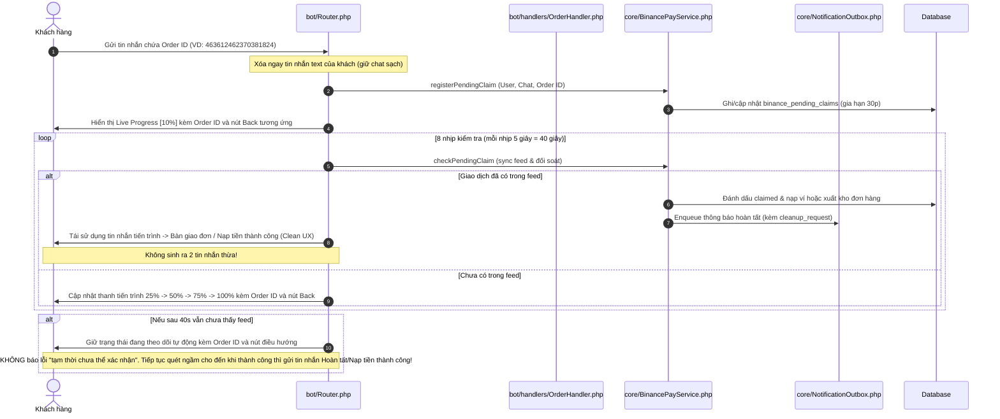

# Kế hoạch Triển khai: Nâng cấp Toàn diện Trải nghiệm Binance Pay, Đa tiền tệ Thông minh & Xử lý Giao dịch

## 1. Mục tiêu & Yêu cầu từ Người dùng

Bản kế hoạch này giải quyết triệt để 9 vấn đề cốt lõi:
1. **Dọn dẹp sạch sẽ tin nhắn cũ (Clean Message Flow)**: Không để xảy ra tình trạng tin nhắn tiến trình/chờ cũ vẫn còn tồn tại (ảnh 1) rồi mới xuất hiện tin nhắn giao hàng/nạp tiền mới bên dưới (ảnh 2). Tái sử dụng hoặc xóa tin nhắn cũ ngay khi hoàn tất.
2. **Luôn hiển thị Binance Order ID**: Vì tin nhắn chứa Order ID người dùng gửi được bot xóa tự động để chống spam, bot **phải luôn hiển thị `<code>:order_id</code>`** ở mọi giai đoạn (tiến trình chờ, đang quét, hoàn tất, thông báo kết quả, lịch sử).
3. **Mở rộng thời gian Live Progress lên 40 giây**: Tăng thanh tiến trình từ 10-15s lên 40 giây (8 nhịp × 5s hoặc 10 nhịp × 4s) kèm kiểm tra live từng nhịp để bao quát trọn vẹn độ trễ trả feed từ đối tác Binance Pay.
4. **Chuẩn hóa mã giao dịch theo phương thức**: Phân biệt rõ phương thức thanh toán giữa Bank (`NAP-xxxx`) và Binance Pay (`BINANCE-:order_id` hoặc `BN-:order_id`) cho cả khách hàng và Admin.
5. **Thông báo nạp tiền riêng biệt cho Binance Pay**: Khắc phục lỗi hiển thị thông báo nạp chung chung của ngân hàng (ảnh 3). Hiển thị rõ nạp qua Binance Pay, số USDT đã nạp, số VND quy đổi và Binance Order ID.
6. **Bổ sung nút điều hướng linh hoạt**: Ở màn hình chờ/tiến trình Binance Pay, luôn có nút:
   - Với Nạp tiền: Nút `[🏠 Menu chính]` (`start`).
   - Với Mua hàng: Nút `[⬅ Chi tiết sản phẩm]` (`product:<id>`).
7. **Khắc phục lỗi bot không nhận Order ID khi mua hàng (ảnh 5)**: Sửa mismatch key trong Router (`binance_claim_short_payment`, `binance_claim_already_used`), tính toán làm tròn trần (ceil) để không bị lỗi `short_payment`, đồng thời gia hạn thời gian pending cho đơn Binance Pay đang được claim.
8. **Làm gọn số thập phân USDT & chuẩn hóa text**:
   - Loại bỏ toàn bộ các số 0 thừa phía sau (ví dụ: `2.00000000` -> `2`, `1.5000` -> `1.5`, `1.9608` -> `1.9608`).
   - Thay cụm `(equivalent to :amount)` thành `(~ :amount)`.
9. **Hiển thị giá song song Đa tiền tệ (VND & USDT) theo thói quen khách hàng**:
   - Thêm trường `preferred_payment_method` vào bảng `users`.
   - Nếu khách vừa thanh toán / ưu tiên Bank: `50.000 VND (~ 1.96 USDT)`.
   - Nếu khách vừa thanh toán / ưu tiên Binance Pay: `1.96 USDT (~ 50.000 VND)`.
   - Áp dụng trên Danh sách sản phẩm, Chi tiết sản phẩm, Tổng tiền giỏ hàng.

---

## 2. Kiến trúc & Sơ đồ Luồng Xử lý

---

## 3. Chi tiết Các Bước Triển khai

### Bước 1: Schema Migration (`migrations/020_user_currency_preference_and_binance_ref.sql`)
1. Mở rộng bảng `users`:
   - Thêm cột `preferred_payment_method ENUM('bank','binance_pay') NOT NULL DEFAULT 'bank'` sau `language`.
2. Mở rộng bảng `deposits`:
   - Đảm bảo `reference_code` lưu `BINANCE-:order_id` khi nạp qua Binance Pay.
   - Thêm cột `binance_order_id VARCHAR(64) NULL`, `binance_usdt_amount DECIMAL(16,4) NULL`.

### Bước 2: Nâng cấp Helper Đa tiền tệ (`core/Helpers.php`)
1. Bổ sung phương thức [`Helpers::formatDualPrice(float|int|string $vndAmount, float $rate, string $preference = 'bank')`](core/Helpers.php):
   - Tính `$usdt = $rate > 0 ? ceil(((float) $vndAmount / $rate) * 10000) / 10000 : 0.0`.
   - Format `$usdtFormatted = Helpers::formatDecimal($usdt, 4) . ' USDT'`.
   - Format `$vndFormatted = Helpers::money($vndAmount)`.
   - Nếu `$preference === 'binance_pay'`: Trả về `{$usdtFormatted} (~ {$vndFormatted})`.
   - Ngược lại: Trả về `{$vndFormatted} (~ {$usdtFormatted})`.
2. Tối ưu [`Helpers::formatDecimal()`](core/Helpers.php:12) và [`Helpers::cleanNumber()`](core/Helpers.php:18) để loại bỏ toàn bộ số 0 thừa ở phần thập phân.

### Bước 3: Áp dụng Đa tiền tệ Thông minh trong ProductHandler & OrderHandler
1. Trong [`bot/handlers/ProductHandler.php`](bot/handlers/ProductHandler.php):
   - Lấy `preferred_payment_method` của người dùng và tỷ giá Binance Pay từ `BinancePayService::paymentDetails()`.
   - Hiển thị giá đa tiền tệ ở:
     - Danh sách sản phẩm (`product_item_sub`)
     - Chi tiết sản phẩm (`price`, `total`, `discount_summary`)
2. Trong [`bot/handlers/OrderHandler.php`](bot/handlers/OrderHandler.php):
   - Khi tạo đơn hàng Binance Pay:
     - Lưu `users.preferred_payment_method = 'binance_pay'`.
     - Tính số USDT: `$usdtRaw = ceil(((float) $bankAmount / $rate) * 10000) / 10000;`.
     - Format: `$usdtAmount = Helpers::formatDecimal($usdtRaw, 4);`.
     - Thay chuỗi text thành `(~ :amount)`.
     - Gắn bàn phím: Nút `[⬅ Chi tiết sản phẩm]` (`product:<id>`) hoặc `[❌ Hủy đơn]` (nếu có trừ ví).

### Bước 4: Nâng cấp Live Progress 40 giây & Nút Bấm Điều hướng trong Router
1. Trong [`bot/Router.php`](bot/Router.php:215):
   - Tăng số bước tiến trình lên 8 nhịp (mỗi nhịp 5 giây = 40 giây).
   - Truyền kèm bàn phím điều hướng phù hợp vào `renderBinanceProgress`:
     - Nếu request là `deposit`: Bàn phím có nút `[🏠 Menu chính]` (`start`).
     - Nếu request là `order`: Bàn phím có nút `[⬅ Chi tiết sản phẩm]` (`product:<productId>`).
   - Sửa template các bước `binance_checking_step_1` đến `step_8` để **luôn luôn hiển thị `<code>:order_id</code>`**.
   - **Không hiển thị thông báo lỗi "Binance tạm thời chưa thể xác nhận..." (ảnh 1)**: Khi mạng hoặc feed Binance trả chậm, bot duy trì trạng thái theo dõi mượt mà kèm Order ID và các nút điều hướng, tuyệt đối không nhảy sang thông báo lỗi gây hoang mang. Bot tiếp tục lắng nghe/quét ngầm cho đến khi giao dịch thành công thì cập nhật ngay tin nhắn Nạp tiền/Giao hàng thành công.
   - Khớp đúng khóa lỗi `short_payment` -> `binance_claim_short_payment`, `already_claimed` -> `binance_claim_already_used`.
   - Khi claim thành công: Sửa trực tiếp (`editMessageOrSend`) tin nhắn tiến trình thành kết quả hoàn tất hoặc xóa sạch tin nhắn tiến trình trước khi gửi thông báo giao hàng/nạp tiền, giải quyết dứt điểm tình trạng 2 tin nhắn chồng chéo (ảnh 1 & ảnh 2).

### Bước 5: Chuẩn hóa Thông báo & Quản trị Binance Pay
1. Trong [`core/PaymentProcessor.php`](core/PaymentProcessor.php):
   - Khi xử lý nạp tiền qua Binance Pay:
     - Lưu `reference_code = 'BINANCE-' . $transaction['binance_order_id']`.
     - Đặt mẫu thông báo riêng `deposit_binance_success` hiển thị đầy đủ: Số USDT, Số VND quy đổi, Mã Binance Order ID, Số dư mới.
     - Truyền đủ `cleanup_request_type` và `cleanup_request_id` cho cả Order và Deposit để `NotificationOutbox` tự động dọn dẹp tin nhắn chờ cũ.
2. Trong Admin Modules ([`admin/modules/orders.php`](admin/modules/orders.php), [`admin/modules/deposits.php`](admin/modules/deposits.php)):
   - Bổ sung filter `binance_pay` và hiển thị cột Mã giao dịch / Binance Order ID phân biệt rõ với mã Bank.

### Bước 6: Cập nhật Ngôn ngữ (VI & EN)
- Cập nhật [`languages/vi.php`](languages/vi.php) và [`languages/en.php`](languages/en.php):
  - Thay `(tương đương :amount)` / `(equivalent to :amount)` thành `(~ :amount)`.
  - Cập nhật các bước tiến trình 40s kèm Order ID.
  - Bổ sung khóa thông báo nạp Binance Pay `deposit_binance_success`.
  - Đảm bảo đầy đủ cặp khóa dịch song ngữ.

### Bước 7: Kiểm thử Toàn diện & Xác thực
- Bổ sung các bài test tự động trong [`tests/binance_pay_test.php`](tests/binance_pay_test.php):
  - Test thuật toán `ceil` 4 chữ số không bao giờ gây `short_payment`.
  - Test format số thập phân sạch (`Helpers::formatDecimal` & `Helpers::cleanNumber`).
  - Test cơ chế format giá kép đa tiền tệ `Helpers::formatDualPrice`.
  - Test khớp khóa dịch và dọn dẹp tin nhắn.
  - Chạy toàn bộ test suite và migration runner.
