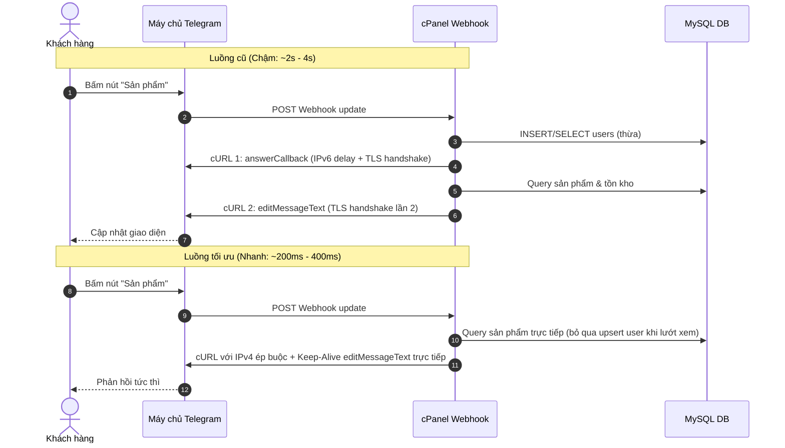

# Kế Hoạch Tối Ưu Tốc Độ Phản Hồi Bot Telegram Trên cPanel

## 1. Phân Tích Nguyên Nhân Bot Phản Hồi Chậm
Khi chạy webhook trên hosting cPanel, có 4 điểm nghẽn chính làm chậm thời gian phản hồi:

1. **Trì hoãn DNS / IPv6 trong cURL (Nguyên nhân lớn nhất: 1s - 3s)**:
   - Các máy chủ cPanel thường ưu tiên kết nối IPv6 khi cURL ra ngoài (`api.telegram.org`). Nếu đường truyền quốc tế hoặc routing IPv6 của nhà mạng/datacenter bị nghẽn, cURL sẽ mất 1 - 3 giây chờ timeout trước khi tự động chuyển về IPv4.
2. **Gọi cURL 2 lần tuần tự làm nhân đôi độ trễ mạng (500ms - 1s)**:
   - Trong `bot/Router.php`, mỗi callback query hiện tại đang gọi:
     - Lần 1: `answerCallbackQuery` -> Chờ Telegram phản hồi (mất 200 - 500ms).
     - Lần 2: `editMessageText` / `sendPhoto` -> Mở kết nối TLS mới và chờ phản hồi (mất thêm 200 - 500ms).
   - Hai lần bắt tay SSL riêng biệt khiến bot có cảm giác trễ rõ rệt.
3. **Chưa tái sử dụng kết nối cURL (Connection Reuse)**:
   - Mỗi hàm gọi Telegram hiện tại đều khởi tạo `curl_init()` và `curl_close()` mới tinh, không tận dụng được HTTP Keep-Alive.
4. **Truy vấn cơ sở dữ liệu thừa (`upsertUser`) ở mọi thao tác**:
   - Mỗi lần bấm xem sản phẩm, bot lại thực hiện 2 câu lệnh SQL liên tiếp: `INSERT ... ON DUPLICATE KEY UPDATE users` và `SELECT * FROM users`, trong khi màn hình sản phẩm không hề cần dùng thông tin người dùng.

---

## 2. Các Biện Pháp Tối Ưu Chi Tiết

### Bước 1: Ép Buộc IPv4 & Bật Tối Ưu Đường Truyền Trong `core/Telegram.php`
- Thiết lập `CURLOPT_IPRESOLVE => CURL_IPRESOLVE_V4` để triệt tiêu 100% độ trễ chờ timeout IPv6 trên cPanel.
- Bật `CURLOPT_TCP_NODELAY => 1` và cấu hình persistent cURL handle để giữ kết nối HTTPS (Keep-Alive), tránh lặp lại SSL handshake.

### Bước 2: Tối Ưu Hóa Luồng Xử Lý Callback Trong `bot/Router.php`
- Đối với các thao tác điều hướng UI (`products`, `product:id`, `start`, `support`), **gọi thẳng `editMessageText`**. Việc cập nhật tin nhắn tự động tắt trạng thái quay vòng (spinner) trên nút bấm mà không cần phải gọi thêm lệnh `answerCallbackQuery` riêng lẻ.
- Chỉ gọi `answerCallbackQuery` khi cần hiển thị popup thông báo (alert).

### Bước 3: Giảm Tải Query Người Dùng (`Lazy Upsert User`)
- Chỉ chạy `upsertUser` khi người dùng gửi lệnh `/start` hoặc khi vào các nghiệp vụ cần tài khoản thực sự (`buy`, `deposit`, `profile`, `history`).
- Khi khách chỉ lướt xem danh sách hoặc xem chi tiết sản phẩm, bỏ qua việc ghi DB liên tục.

### Bước 4: Tối Ưu Truy Vấn Tồn Kho Sản Phẩm
- Viết lại câu lệnh SQL trong `ProductHandler::list` để giảm chi phí subquery, sử dụng index có sẵn `idx_stocks_available` một cách hiệu quả nhất.
