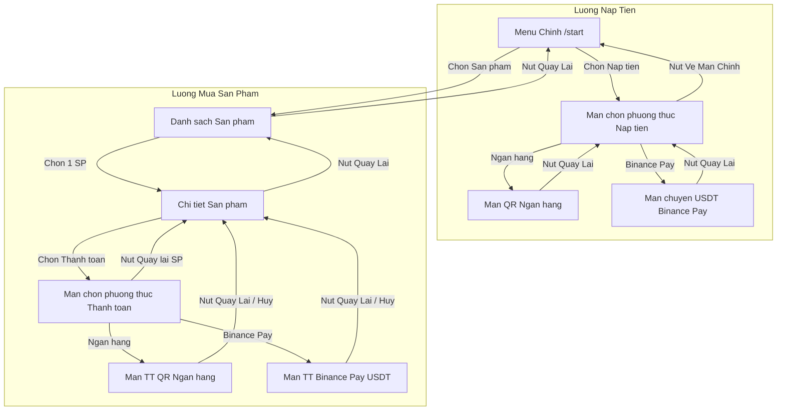

# Kế Hoạch Tối Ưu Định Dạng Giá Kép & Đảm Bảo Điều Hướng Quay Lại (Back) Toàn Diện Cho Bot

## 1. Yêu Cầu Cốt Lõi Từ Người Dùng
1. **Loại bỏ dấu `~` ở mọi vị trí hiển thị giá**:
   - Trước: `50.000 VND (~ 1.9608 USDT)` hoặc `1.9608 USDT (~ 50.000 VND)`.
   - Yêu cầu mới: Bỏ dấu `~` hoàn toàn, chỉ giữ cặp ngoặc đơn.
2. **Quy chuẩn đơn vị USDT vs $**:
   - **Chỉ tại màn hình thanh toán Binance Pay** (hướng dẫn chuyển tiền thực tế vào Binance Pay ID): Giữ đơn vị `USDT` (ví dụ: `💳 Cần chuyển: <b>:usdt USDT</b> (:amount)`, `Tỷ giá: 1 USDT = ...`, hướng dẫn chuyển USDT).
   - **Tất cả các vị trí khác**: Đổi đơn vị `USDT` thành ký hiệu `$`:
     - Danh sách sản phẩm, chi tiết sản phẩm, ưu đãi mua số lượng, tổng tiền giỏ hàng: dùng `$`.
     - Nút chọn phương thức thanh toán / nạp tiền: đổi `🟡 Binance Pay (USDT)` thành `🟡 Binance Pay ($)`.
3. **Bổ sung nút điều hướng quay về màn hình trước đó ở tất cả các màn hình**:
   - **Màn chọn phương thức nạp tiền** (khi bấm Nạp tiền từ menu): Thêm nút `🏠 Màn chính` (`start`).
   - **Màn nạp tiền chi tiết (Ngân hàng / Binance)**: Thêm nút `◀️ Quay lại` (`deposit`) để quay lại màn chọn phương thức nếu muốn đổi cách nạp, cùng nút `🏠 Màn chính` (`start`).
   - **Màn chọn phương thức thanh toán đơn hàng** (khi bấm Thanh toán từ chi tiết sản phẩm): Thêm nút `◀️ Chi tiết sản phẩm` (`product:$productId`).
   - **Rà soát toàn diện**: Đảm bảo tất cả các màn hình (Lịch sử, Chi tiết đơn hàng, Hỗ trợ, Ngôn ngữ, Báo hết hàng, Hủy đơn...) không có màn hình nào bị "cụt", luôn có nút quay lại bước trước đó.

---

## 2. Kiến Trúc Luồng Điều Hướng (Mermaid Diagram)

---

## 3. Chi Tiết Các File Sẽ Điều Chỉnh

### 3.1. [`core/Helpers.php`](core/Helpers.php:26) - Hàm `formatDualPrice()`
- Loại bỏ tiền tố `~ `.
- Đổi đơn vị hiển thị phụ thành ký hiệu `$`:
  - Khi user ưu tiên `binance_pay`:
    `$formattedUsdt . ' $ (' . $vnd . ')'` hoặc `'$' . $formattedUsdt . ' (' . $vnd . ')'`
  - Khi user ưu tiên `bank`:
    `$vnd . ' (' . $formattedUsdt . ' $)'` hoặc `$vnd . ' ($' . $formattedUsdt . ')'`
  - Giữ nguyên cơ chế làm sạch số 0 vô nghĩa bằng `Helpers::formatDecimal($usdt, 4)`.

### 3.2. Ngôn ngữ [`languages/vi.php`](languages/vi.php:1) & [`languages/en.php`](languages/en.php:1)
- Cập nhật nhãn nút:
  - `binance_pay_button`: `🟡 Binance Pay ($)`
- Cập nhật dòng số tiền thanh toán Binance Pay (bỏ dấu `~`):
  - VI: `'binance_order_amount_line' => '💳 Cần chuyển: <b>:usdt USDT</b> (:amount)'`
  - EN: `'binance_order_amount_line' => '💳 Send: <b>:usdt USDT</b> (:amount)'`

### 3.3. [`bot/handlers/DepositHandler.php`](bot/handlers/DepositHandler.php:15)
- Tại `show()` (màn chọn phương thức nạp tiền):
  - Bổ sung nút quay về màn chính: `[['text' => $lang->get('main_menu'), 'callback_data' => 'start']]`.
- Tại `showBank()` và `showBinance()`:
  - Bổ sung nút quay lại màn chọn phương thức `[['text' => $lang->get('back'), 'callback_data' => 'deposit']]` bên cạnh `[['text' => $lang->get('main_menu'), 'callback_data' => 'start']]`.

### 3.4. [`bot/handlers/OrderHandler.php`](bot/handlers/OrderHandler.php:81)
- Tại `checkout()` (khi `$paymentMethod === null` và Binance Pay bật):
  - Bổ sung nút quay về màn chi tiết sản phẩm: `[['text' => $lang->get('back_product_detail'), 'callback_data' => 'product:' . $productId]]`.

### 3.5. Kiểm thử [`tests/binance_pay_test.php`](tests/binance_pay_test.php:67) & Test Suite
- Cập nhật các test assertion cho `Helpers::formatDualPrice()` khớp với định dạng mới không dấu `~` và dùng `$`.
- Chạy toàn bộ test suite để đảm bảo không phát sinh lỗi hồi quy (regression).

---

## 4. Xác Nhận Với Người Dùng
Kế hoạch đã bao quát đầy đủ cả 5 yêu cầu về định dạng giá kép, vị trí USDT/$, và các nút điều hướng quay về màn hình trước đó.
