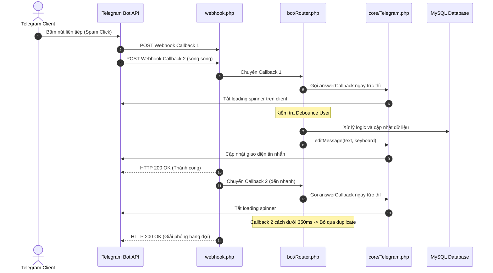

# Kế hoạch kiến trúc: Tối ưu định dạng giá, Xử lý dứt điểm spam nút Telegram Bot & Đồng bộ tồn kho thực tế

Tài liệu này phân tích nguyên nhân gốc rễ và thiết kế giải pháp kỹ thuật toàn diện cho 3 vấn đề được người dùng phản hồi:
1. **Định dạng số tiền & tỷ giá**: Bỏ các số `000` vô nghĩa ở phần thập phân để giao diện trực quan, dễ nhìn.
2. **Bot bị treo / không phản hồi khi user spam nút liên tục**: Tìm ra nguyên nhân kỹ thuật cốt lõi và xử lý triệt để từ tầng Webhook, API Telegram và Router.
3. **Thiết kế lại danh sách sản phẩm trên Bot & tính tồn kho thực tế**: Định dạng 2 dòng chuyên nghiệp và xóa bỏ hoàn toàn hardcode `100` khi liên kết API, đồng bộ công thức tính tồn kho với Web Admin.

---

## 1. Phân tích nguyên nhân gốc rễ (Root Cause Analysis)

### Vấn đề 1: Số tiền và tỷ giá hiển thị nhiều số 000 dư thừa
- **Hiện trạng**:
  - Tại `admin/modules/suppliers.php`: Số dư NCC đang dùng `number_format($balance['amount'], 6, '.', ',')` dẫn đến hiển thị dạng `15.000000 USDT`.
  - Ô nhập tỷ giá USDT -> VND lấy giá trị từ cài đặt đã lưu `number_format($value, 8, '.', '')`, hiển thị trong input là `25500.00000000`.
  - Cột đơn giá sản phẩm NCC dùng `number_format($item['unit_price'], 6, '.', ',')`, hiển thị `0.100000 USDT`.
- **Hệ quả**: Dãy số 0 kéo dài làm rối mắt, che khuất giá trị thực và tạo cảm giác giao diện thô ráp.
- **Giải pháp**: Xây dựng 2 hàm chuẩn hóa số trong [`core/Helpers.php`](core/Helpers.php:1):
  - `formatDecimal($value, $maxDecimals = 6)`: Dùng cho text/bảng hiển thị, tự động cắt bỏ số 0 đuôi và dấu chấm thập phân thừa (`15.000000` -> `15`, `0.100000` -> `0.1`, `25500.00000000` -> `25,500`).
  - `cleanNumber($value, $maxDecimals = 8)`: Dùng cho `<input type="number">`, định dạng số thực tiêu chuẩn không phân cách hàng nghìn (`25500.00000000` -> `25500`).

---

### Vấn đề 2: User spam bấm nút khiến bot bị treo / ngừng phản hồi
Hiện tượng người dùng mô tả:
> "Khi user spam bấm liên tục vào 1 nút thì nút đó cứ xoay loading và không phản hồi lại nữa, sau đó gửi /start thì vẫn ra màn chính nhưng bấm các nút lại không thấy phản hồi gì."

Qua phân tích mã nguồn hệ thống, nguyên nhân gồm 3 mắt xích liên hoàn:

1. **Telegram API ném lỗi `message is not modified`**:
   - Khi user bấm liên tục một inline button (ví dụ nút làm mới, nút chọn số lượng hoặc nút xem chi tiết), Telegram gửi nhiều webhook callback update liên tiếp.
   - Request 1 xử lý và cập nhật tin nhắn. Request 2 đến ngay sau đó gửi cùng nội dung và keyboard lên Telegram Bot API.
   - Telegram trả về lỗi: `400 Bad Request: message is not modified`.
   - Trong [`core/Telegram.php`](core/Telegram.php:32), phương thức `editMessage()` hiện tại chỉ bắt lỗi `there is no text in the message to edit`, **hoàn toàn không bắt lỗi `message is not modified`** (trong khi hàm `editMessageOrSend()` có bắt). Do đó, `editMessage()` ném ra `RuntimeException`.

2. **Webhook trả về HTTP 500 gây nghẽn hàng đợi Telegram (Webhook Backlog)**:
   - Khi `RuntimeException` văng ra khỏi Handler và Router, [`webhook.php`](webhook.php:23) bắt ngoại lệ và thực thi:
     ```php
     catch (Throwable $error) {
         error_log($error->getMessage());
         http_response_code(500); // LỖI NGUY HIỂM NHẤT
         echo 'Error';
     }
     ```
   - Theo cơ chế hoạt động của Telegram Webhook: Khi máy chủ trả về mã HTTP lỗi (4xx, 5xx), Telegram Bot API coi như update chưa được xử lý thành công và **sẽ tự động retry gửi lại gói tin đó liên tục theo lũy thừa thời gian**.
   - Toàn bộ đường truyền webhook của Bot bị nghẽn (pipeline backlog). Các update callback tiếp theo bị kẹt sau gói tin đang retry.
   - Khi người dùng gửi `/start`, tin nhắn `/start` có thể lọt qua một worker khác hoặc sau khi retry tạm nghỉ, màn hình chính hiện ra; nhưng ngay khi người dùng bấm lại bất kỳ inline button nào, callback mới lại rơi vào hàng đợi nghẽn hoặc lại gặp lỗi `message is not modified` -> tiếp tục tạo vòng lặp tê liệt.

3. **Xung đột Concurrency Lock (Deadlock / Lock Wait Timeout) trong Database**:
   - Khi spam click, nhiều request webhook cùng lúc chạy transaction với khóa hàng `FOR UPDATE` (ví dụ trên bảng `checkout_selections` hoặc bảng `users`).
   - Các tiến trình chờ lock lẫn nhau vượt quá timeout của MySQL (`1205 Lock wait timeout exceeded`) -> sinh ngoại lệ DB -> tiếp tục làm sập webhook thành HTTP 500.

- **Giải pháp triệt để**:
  - Trong [`core/Telegram.php`](core/Telegram.php:32): Bổ sung bắt lỗi `message is not modified` trong `editMessage()`, trả về kết quả thành công mà không ném ngoại lệ.
  - Trong [`webhook.php`](webhook.php:19): **Luôn luôn trả HTTP 200 OK** cho Telegram sau khi đã log lỗi. Không bao giờ trả HTTP 500 để giải phóng hàng đợi Telegram ngay lập tức.
  - Trong [`bot/Router.php`](bot/Router.php:46):
    - Đảm bảo gọi `answerCallback()` ngay tức thì để tắt biểu tượng loading spinner trên điện thoại người dùng.
    - Bổ sung cơ chế **Debounce / Throttling** cấp router: Nếu cùng một người dùng gửi callback liên tiếp trong khoảng thời gian quá ngắn (< 350ms), hệ thống chỉ phản hồi `answerCallback` và bỏ qua lượt xử lý trùng lặp, triệt tiêu hoàn toàn nguy cơ race condition và lock DB.

---

### Vấn đề 3: Danh sách sản phẩm trên Bot đổi mẫu hiển thị & tính tồn kho thực tế
- **Hiện trạng**:
  - Trong [`bot/handlers/ProductHandler.php`](bot/handlers/ProductHandler.php:16), câu truy vấn SQL đang hardcode:
    `CASE WHEN COALESCE(src.has_api,0)=1 THEN 100 ELSE COALESCE(s.available,0) END stock`
    Hễ sản phẩm nào gắn nguồn API thì luôn hiển thị số tồn kho là `100`.
  - Mẫu hiển thị hiện tại là 1 dòng: `1. Tên SP - Kho: 100`.
  - Không hiển thị giá trực tiếp tại danh sách sản phẩm.
- **Yêu cầu mới**:
  - Đổi định dạng hiển thị thành cấu trúc 2 dòng:
    ```text
    1. Gemini Pro 18 Months
     ╰ 29.000đ - Còn: 10
    ```
  - Tính tồn kho khả dụng thực tế: Phải đồng bộ chính xác với công thức trên Web Admin:
    `Tổng tồn khả dụng = Tồn thủ công (nếu bật) + Tồn API khả dụng`
    Trong đó: `Tồn API khả dụng = min(stock_NCC, floor(số_dư_USDT / đơn_giá_USDT))` theo thứ tự ưu tiên (ưu tiên 1 -> ưu tiên 2).
  - Áp dụng tồn kho thực tế này vào cả màn hình danh sách, màn hình chi tiết sản phẩm và giới hạn số lượng đặt mua tối đa.

---

## 2. Kiến trúc giải pháp kỹ thuật

### Sơ đồ luồng xử lý Webhook Callback chống nghẽn (Anti-Spam Pipeline)



---

## 3. Chi tiết các module cần triển khai

### Module 1: Chuẩn hóa hiển thị số và tỷ giá ([`core/Helpers.php`](core/Helpers.php:1))
- Bổ sung 2 helper:
  - [`Helpers::formatDecimal()`](core/Helpers.php:8): Định dạng số gọn gàng, tự động tỉa các số 0 thừa phía sau phần thập phân, giữ lại phân cách hàng nghìn cho phần nguyên.
  - [`Helpers::cleanNumber()`](core/Helpers.php:8): Định dạng số thuần để gán vào thuộc tính `value` của thẻ `<input type="number">`.
- Cập nhật [`admin/modules/suppliers.php`](admin/modules/suppliers.php:134):
  - Hiển thị số dư NCC: dùng `formatDecimal()`.
  - Ô nhập tỷ giá USDT -> VND: dùng `cleanNumber()`.
  - Hiển thị đơn giá sản phẩm NCC: dùng `formatDecimal()`.

### Module 2: Xử lý triệt để treo bot & lỗi spam nút
1. **[`core/Telegram.php`](core/Telegram.php:32)**:
   - Sửa phương thức `editMessage()`: Bắt lỗi `message is not modified` an toàn và trả về mảng kết quả hợp lệ thay vì ném exception.
   - Thêm xử lý fallback an toàn cho các trường hợp tin nhắn bị xóa hoặc không thể chỉnh sửa.
2. **[`webhook.php`](webhook.php:19)**:
   - Cải tiến khối `catch (Throwable $error)`:
     - Ghi log chi tiết lỗi kèm exception class, message, file, line và trace.
     - Luôn trả về `http_response_code(200); echo 'OK';` để Telegram không retry làm kẹt bot.
3. **[`bot/Router.php`](bot/Router.php:46)**:
   - Đảm bảo `answerCallback()` được thực thi ngay dòng đầu tiên.
   - Thêm cơ chế callback debouncing nhẹ theo `user_id` và timestamp:
     - Nếu user spam cùng 1 nút trong vòng 350ms, hệ thống ghi nhận đã acknowledge callback và bỏ qua lượt xử lý thừa.

### Module 3: Tính toán tồn kho thực tế tập trung ([`suppliers/SupplierCatalogService.php`](suppliers/SupplierCatalogService.php:1))
- Bổ sung phương thức dùng chung trong [`suppliers/SupplierCatalogService.php`](suppliers/SupplierCatalogService.php:80):
  - `getVariantStockMap(): array`: Truy vấn và tính toán tồn kho cho tất cả variant active trong hệ thống.
  - `getVariantStock(int $variantId): array`: Tính toán tồn kho cho một variant cụ thể.
- Thuật toán tính tồn:
  1. Kiểm tra cấu hình nguồn `supplier_sources` của variant.
  2. Nguồn manual: Nếu `status = 1`, đếm số lượng dòng trong `stocks` có `is_sold = 0`.
  3. Nguồn API: Duyệt theo `priority ASC` (1 -> 2). Với mỗi nguồn active:
     - Lấy `stock` và `unit_price` từ `supplier_products`.
     - Lấy `amount` USDT từ `supplier_balances`.
     - Tính: `effective_stock = min(stock, floor(amount / unit_price))`.
     - Nếu `effective_stock > 0`, lấy nguồn này làm `api_stock` và dừng lại.
  4. Tổng tồn khả dụng: `available = manual_stock + api_stock`.
- Tái sử dụng phương thức này trên cả [`admin/modules/stocks.php`](admin/modules/stocks.php:196) và [`bot/handlers/ProductHandler.php`](bot/handlers/ProductHandler.php:13).

### Module 4: Thiết kế lại danh sách sản phẩm trên Telegram Bot ([`bot/handlers/ProductHandler.php`](bot/handlers/ProductHandler.php:13))
- Truyền `SupplierCatalogService` vào `ProductHandler` thông qua [`bot/Router.php`](bot/Router.php:19).
- Trong `ProductHandler::list()`:
  - Lấy danh sách sản phẩm active kèm `v.id variant_id, v.price`.
  - Tính toán tồn kho thực tế từ `SupplierCatalogService`.
  - Xuất giao diện 2 dòng đa ngôn ngữ:
    ```text
    1. <b>Gemini Pro 18 Months</b>
     ╰ 29.000đ - Còn: 10

    2. <b>Canva Pro 1 Year</b>
     ╰ 99.000đ - Còn: 5
    ```
- Cập nhật [`languages/vi.php`](languages/vi.php:20) và [`languages/en.php`](languages/en.php:20):
  - Khai báo key `product_item_sub`:
    - `vi`: `'product_item_sub' => ' ╰ :price - Còn: :count',`
    - `en`: `'product_item_sub' => ' ╰ :price - Stock: :count',`
- Cập nhật `ProductHandler::detail()`, `render()` và `subscribeToStock()`:
  - Loại bỏ hoàn toàn hardcoded `100`.
  - Gán tồn kho thực tế cho sản phẩm để điều chỉnh bộ chọn số lượng tối đa (`displayQuantity = min(quantity, stock)`).

---

## 4. Các file dự kiến chỉnh sửa

| Đường dẫn file | Nội dung thay đổi |
|---|---|
| [`core/Helpers.php`](core/Helpers.php:1) | Bổ sung hàm `formatDecimal()` và `cleanNumber()` cắt số 0 thừa |
| [`admin/modules/suppliers.php`](admin/modules/suppliers.php:1) | Dùng hàm helper mới cho số dư, tỷ giá input và đơn giá sản phẩm NCC |
| [`core/Telegram.php`](core/Telegram.php:1) | Sửa `editMessage()` bắt an toàn `message is not modified` |
| [`webhook.php`](webhook.php:1) | Luôn trả HTTP 200 kèm log lỗi chi tiết, không trả HTTP 500 khi gặp exception |
| [`bot/Router.php`](bot/Router.php:1) | Thêm debounce chống spam click callback, inject `SupplierCatalogService` vào `ProductHandler` |
| [`suppliers/SupplierCatalogService.php`](suppliers/SupplierCatalogService.php:1) | Thêm hàm tính tồn kho thực tế `getVariantStockMap()` và `getVariantStock()` |
| [`admin/modules/stocks.php`](admin/modules/stocks.php:1) | Tái sử dụng hàm tính tồn kho tập trung từ `SupplierCatalogService` |
| [`bot/handlers/ProductHandler.php`](bot/handlers/ProductHandler.php:1) | Định dạng 2 dòng cho danh mục SP; xóa hardcode `100`, dùng tồn kho thực tế |
| [`languages/vi.php`](languages/vi.php:1) | Thêm key đa ngôn ngữ `product_item_sub` tiếng Việt |
| [`languages/en.php`](languages/en.php:1) | Thêm key đa ngôn ngữ `product_item_sub` tiếng Anh |

---

## 5. Kế hoạch kiểm tra & nghiệm thu (Verification)

1. **Kiểm tra định dạng số**:
   - Truy cập trang Nhà cung cấp: kiểm tra tỷ giá USDT hiển thị `25500` hoặc số thực tế gọn gàng, không có `.00000000`.
   - Kiểm tra số dư NCC hiển thị `15 USDT` thay vì `15.000000 USDT`.
   - Kiểm tra đơn giá sản phẩm NCC hiển thị `0.1 USDT` hoặc `1.2 USDT`.
2. **Kiểm tra chống spam nút bot**:
   - Mô phỏng spam click nhanh nhiều lần trên một nút inline (nút sản phẩm, nút refresh hoặc nút số lượng).
   - Xác nhận nút phản hồi mượt, tắt loading spinner ngay, bot không bị treo, lệnh `/start` và các nút kế tiếp hoạt động trơn tru.
   - Kiểm tra `error_log` không xuất hiện `message is not modified` gây sập webhook.
3. **Kiểm tra giao diện danh sách sản phẩm Bot**:
   - Kiểm tra định dạng 2 dòng trên Telegram Bot đúng mẫu:
     `1. [Tên sản phẩm]\n ╰ [Giá] - Còn: [Số tồn]`
   - Xác nhận sản phẩm có API hiển thị đúng số tồn kho thực tế (ví dụ: Còn: 10) trùng khớp 100% với số lượng trên Web Admin thay vì con số tĩnh `100`.
   - Chuyển ngôn ngữ sang English để xác nhận text hiển thị chuẩn `Stock: :count` không bị hardcode tiếng Việt.
4. **Kiểm tra cú pháp PHP & Triển khai**:
   - Chạy kiểm tra lint cú pháp PHP 8.1 cho tất cả các file sửa đổi.
   - Commit và push lên GitHub, kích hoạt workflow deploy cPanel tự động.
