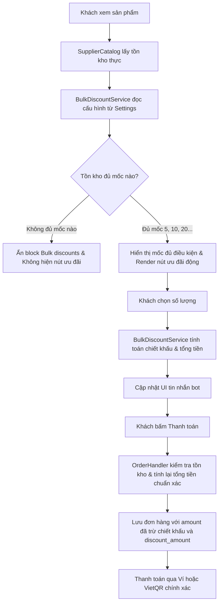

# Kế hoạch triển khai Tính năng Ưu đãi Chiết khấu Số lượng (Bulk Discounts)

## 1. Mục tiêu và Yêu cầu Nghiệp vụ

1. **Hiển thị bảng ưu đãi số lượng (Bulk discounts) trong bot:**
   - Nằm ngay phía trên khối `Chi tiết đặt hàng` trong tin nhắn chi tiết sản phẩm.
   - Định dạng hiển thị chuẩn đa ngôn ngữ:
     - Tiếng Việt:
       ```text
       <b>Ưu đãi số lượng:</b>
       ╰ 5+ cái : −1%
       ╰ 10+ cái : −1.5%
       ╰ 20+ cái : −2%
       ```
     - Tiếng Anh:
       ```text
       <b>Bulk discounts:</b>
       ╰ 5+ pcs : −1%
       ╰ 10+ pcs : −1.5%
       ╰ 20+ pcs : −2%
       ```
   - **Quy tắc tồn kho**: Chỉ hiển thị các mốc mà số lượng tồn kho hiện tại (`stock`) đáp ứng đủ. Nếu tồn kho không đủ mốc nào (ví dụ tồn kho < 5 cái) thì ẩn hoàn toàn khối này.

2. **Các nút chọn nhanh (Quick quantity buttons):**
   - Tự động hiển thị kèm mức ưu đãi:
     - Ví dụ: `5 cái (−1%)` | `10 cái (−1.5%)` | `20 cái (−2%)`.
     - Tiếng Anh: `5 pcs (−1%)` | `10 pcs (−1.5%)` | `20 pcs (−2%)`.
   - Chỉ xuất hiện các nút tương ứng với các mốc mà kho còn đủ hàng (`stock >= mốc`).

3. **Cập nhật khối Chi tiết đặt hàng khi số lượng thỏa mốc chiết khấu:**
   - Khi khách chọn số lượng có chiết khấu (ví dụ 5 cái, đơn giá 19.900 VND):
     ```text
     <b>Chi tiết đặt hàng</b>
     ╰ Số lượng: 5
     ╰ Chiết khấu: −1% (−995 VND)
     ╰ Tổng: 98.505 VND
     ```
   - Khi số lượng không có chiết khấu (ví dụ 1 cái): Không hiển thị dòng chiết khấu để giao diện luôn tinh gọn:
     ```text
     <b>Chi tiết đặt hàng</b>
     ╰ Số lượng: 1
     ╰ Tổng: 19.900 VND
     ```
   - **Gợi ý mua thêm thông minh (Smart Upsell Hint):**
     Khi số lượng đang chọn cận kề mốc ưu đãi tiếp theo (ví dụ: đang chọn 4 cái mà mốc 5 cái giảm 1%, hoặc đang chọn 8-9 cái mà mốc 10 cái giảm 1.5%), và kho tồn thực tế đủ số lượng của mốc tiếp theo đó (`stock >= next_tier_qty`), hiển thị thêm dòng gợi ý ngắn gọn ngay dưới Chi tiết đặt hàng:
     ```text
     💡 <i>Thêm 1 cái nữa để nhận ưu đãi −1%!</i>
     ```
     (Tiếng Anh: `💡 <i>Add 1 more to get −1% off!</i>`)

4. **Cấu hình trên Web Admin:**
   - Cấu hình tập trung tại `admin/modules/settings.php` tận dụng bảng `settings` hiện có (KISS, không sinh thêm bảng thừa):
     - `bulk_discount_enabled`: Bật/Tắt tính năng ưu đãi số lượng.
     - `bulk_discount_tiers`: Danh sách các mốc số lượng & phần trăm chiết khấu (định dạng cấu hình mỗi dòng `Số lượng:Phần trăm`, ví dụ:
       ```text
       5:1
       10:1.5
       20:2
       ```
       Kèm validation kiểm tra định dạng khi lưu).

---

## 2. Ý tưởng bổ sung từ Chuyên gia (Đảm bảo tối giản, không sinh code thừa)

1. **Dịch vụ tính toán tập trung (`BulkDiscountService`):**
   - Đặt tại `core/BulkDiscountService.php` để tái sử dụng 100% giữa việc hiển thị trong bot ([`bot/handlers/ProductHandler.php`](bot/handlers/ProductHandler.php)) và xử lý thanh toán thực tế ([`bot/handlers/OrderHandler.php`](bot/handlers/OrderHandler.php)).
   - Đảm bảo số tiền khách thấy trên bot và số tiền trừ ví / chuyển khoản VietQR luôn khớp chính xác từng đồng, không thể bị gian lận hoặc sai lệch làm tròn.

2. **Hỗ trợ Callback linh hoạt cho mọi mốc số lượng (Dynamic Quantity Handler):**
   - Thay vì fix cứng `five`, `ten`, router và handler sẽ chấp nhận callback data `qty:PRODUCT_ID:VERSION:5`, `10`, `20`...
   - Khi Admin thay đổi mốc trên Web Admin (ví dụ đổi thành 3, 7, 15 cái), hệ thống tự động sinh nút và xử lý bấm nút mượt mà mà không cần chỉnh sửa lại mã nguồn PHP.

3. **Lưu vết chiết khấu vào bảng `orders` (`017_add_order_bulk_discount.sql`):**
   - Bổ sung cột `discount_amount DECIMAL(15,2) DEFAULT 0.00` vào bảng `orders`.
   - Khi Admin xem chi tiết đơn hàng trong Admin Console ([`admin/modules/orders.php`](admin/modules/orders.php)) hoặc nhận thông báo Telegram qua `NotificationOutbox`, hệ thống hiển thị rõ số tiền đã chiết khấu, tránh nhầm lẫn giữa đơn giá gốc và tổng tiền thực thu.

4. **Gợi ý thông minh (Smart Upsell Hint) khi khách mua cận kề mốc ưu đãi:**
   - Nếu khách đang bấm chọn `4` cái (trong khi mốc ưu đãi là `5` cái và kho vẫn còn >= 5 cái), hiển thị thêm 1 dòng gợi ý nhỏ:
     *💡 Mua thêm 1 cái nữa để nhận ưu đãi −1%!*
   - Kích thích tăng giá trị trung bình trên mỗi đơn hàng (AOV) hoàn toàn tự nhiên.

---

## 3. Kiến trúc Luồng Dữ liệu (Mermaid Diagram)



---

## 4. Các bước triển khai chi tiết

### Bước 1: Database Migration
- Tạo migration [`migrations/017_add_order_bulk_discount.sql`](migrations/017_add_order_bulk_discount.sql):
  - Thêm cột `discount_amount DECIMAL(15,2) NOT NULL DEFAULT 0.00 AFTER unit_price` trong bảng `orders`.

### Bước 2: Xây dựng `core/BulkDiscountService.php`
- Đọc cấu hình từ `settings` (`bulk_discount_enabled`, `bulk_discount_tiers`).
- Phương thức `getEligibleTiers(int $stock): array`: Trả về các tier có `qty <= stock`.
- Phương thức `calculate(float $unitPrice, int $quantity, int $stock): array`:
  - Trả về `subtotal`, `discount_percent`, `discount_amount`, `final_total`, `applied_tier`, `upsell_hint`.

### Bước 3: Cấu hình trên Web Admin (`admin/modules/settings.php`)
- Thêm trường `bulk_discount_enabled` và `bulk_discount_tiers` vào danh sách keys được lưu.
- Thêm giao diện quản lý trong trang Cài đặt với văn bản hướng dẫn rõ ràng, dễ nhập và có kiểm tra hợp lệ.

### Bước 4: Cập nhật Bot Product Handler (`bot/handlers/ProductHandler.php`)
- Tích hợp `BulkDiscountService`.
- Render danh sách ưu đãi số lượng phía trên `Chi tiết đặt hàng` nếu có mốc hợp lệ theo tồn kho.
- Render dòng `Chiết khấu` trong chi tiết đặt hàng khi số lượng được chọn thỏa mãn mốc ưu đãi.
- Sinh các nút bấm nhanh kèm phần trăm ưu đãi (`5 cái (-1%)`, `10 cái (-1.5%)`, `20 cái (-2%)`).
- Cập nhật hàm `changeQuantity` để nhận giá trị số động từ nút bấm.

### Bước 5: Cập nhật Bot Order Handler (`bot/handlers/OrderHandler.php`)
- Tích hợp `BulkDiscountService` khi checkout.
- Tính toán tổng thanh toán và lưu `discount_amount` vào bảng `orders` (cả luồng Ví, VietQR và Hybrid).
- Cập nhật nội dung thông báo gửi cho Admin khi có đơn hàng được giảm giá.

### Bước 6: Đa ngôn ngữ (`languages/vi.php` & `languages/en.php`)
- Bổ sung đầy đủ các từ khóa:
  - `bulk_discounts_title`: "Ưu đãi số lượng" / "Bulk discounts"
  - `bulk_discount_item`: "╰ :qty+ cái : -:percent%" / "╰ :qty+ pcs : -:percent%"
  - `discount_label`: "Chiết khấu" / "Discount"
  - `discount_summary`: "-:percent% (-:amount)"
  - `quick_tier_button`: ":qty cái (-:percent%)" / ":qty pcs (-:percent%)"
  - `bulk_discount_upsell`: "💡 Mua thêm :needed cái nữa để nhận ưu đãi -:percent%!" / "💡 Add :needed more to get -:percent% off!"

### Bước 7: Cập nhật hiển thị Đơn hàng Admin (`admin/modules/orders.php`)
- Hiển thị thông tin chiết khấu nếu đơn hàng có `discount_amount > 0`.

### Bước 8: Viết Test tự động & Kiểm tra toàn diện
- Viết file test kiểm tra logic tính toán chiết khấu, các mốc biên, trường hợp kho không đủ mốc và kiểm tra đa ngôn ngữ.
