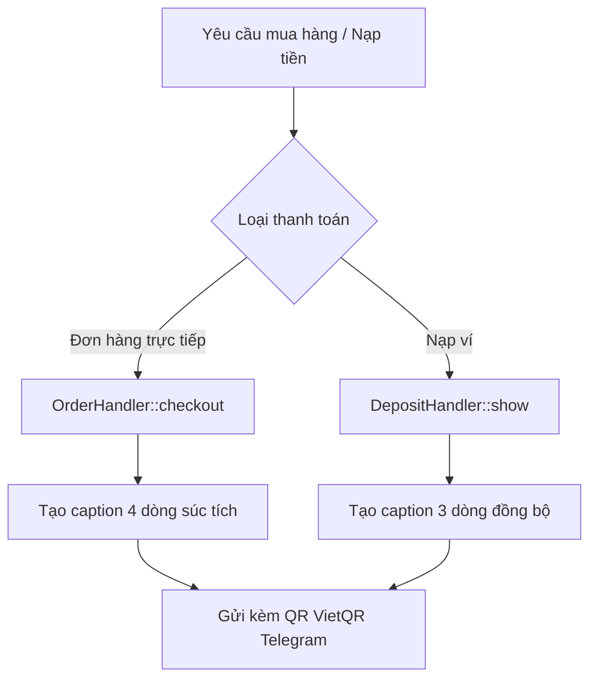

# Kế hoạch Rút gọn Giao diện Thanh toán Bot Telegram & Hướng dẫn File Cấu hình NCC

## 1. Giải đáp vấn đề Nhà cung cấp bị "Chưa cấu hình" sau khi Deploy

### Hiện tượng
- Trong trang Quản trị cPanel, hai nhà cung cấp Sandromania và Cuppon'sHub quay lại trạng thái **"Chưa cấu hình"**.
- Trước đó, các thông tin API key / secret đã được lưu vào file [`config/suppliers.example.php`](config/suppliers.example.php:1).

### Nguyên nhân
- [`config/suppliers.example.php`](config/suppliers.example.php:1) là file mẫu thuộc quyền quản lý của Git repository (được track trong Git).
- Mỗi khi GitHub Actions chạy quy trình deploy (kéo code từ branch `main` về cPanel), Git sẽ cập nhật hoặc ghi đè file mẫu về trạng thái gốc của kho mã nguồn.

### Giải pháp & File cần tạo
- Hệ thống đã được lập trình cơ chế ưu tiên nạp file cục bộ tại [`bootstrap.php:8-11`](bootstrap.php:8):
  ```php
  $supplierConfigFile = __DIR__ . '/config/suppliers.local.php';
  $suppliers = require (is_file($supplierConfigFile)
      ? $supplierConfigFile
      : __DIR__ . '/config/suppliers.example.php');
  ```
- File cần tạo trên cPanel là: **[`config/suppliers.local.php`](config/suppliers.example.php:1)**.
- Trong file [`.gitignore:31`](.gitignore:31), quy tắc `config/*.local.php` đã được khai báo loại trừ khỏi Git.
- **Thao tác trên cPanel**:
  1. Vào thư mục `config/`.
  2. Tạo bản sao (Copy) từ file `suppliers.example.php` thành file mới có tên `suppliers.local.php` (tương tự như file `payment_feed.local.php` đang hoạt động ổn định).
  3. Điền thông tin API Key / Secret của các nhà cung cấp vào `suppliers.local.php` và lưu lại.
  4. Kể từ thời điểm này, mọi lần deploy code mới từ Git sẽ **không bao giờ** ghi đè hoặc làm mất cấu hình NCC nữa.

---

## 2. Thiết kế Màn hình Thanh toán Rút gọn

### Yêu cầu người dùng
Giao diện thanh toán đơn hàng chuyển khoản hiển thị rút gọn thành đúng 4 dòng:
```text
📦 Gemini Pro 18 Months x 1
💳 Cần thanh toán: 29.000đ
🏦 Ngân hàng: ACB | STK: 15762881
📝 Nội dung: DONATE5UG43S
```

### Kiến trúc hiển thị chi tiết



#### A. Thanh toán Đơn hàng Mua Sản phẩm ([`OrderHandler.php:70-85`](bot/handlers/OrderHandler.php:70))
- Định dạng caption rút gọn:
  - Dòng 1 (Sản phẩm & Số lượng): `📦 :product x :quantity`
  - Dòng 2a (Nếu có trừ tiền từ ví trước - Hybrid): `👛 Đã trừ ví: :wallet_amount`
  - Dòng 2b (Số tiền cần chuyển): `💳 Cần thanh toán: :amount`
  - Dòng 3 (Thông tin nhận tiền): `🏦 Ngân hàng: :bank | STK: <code>:account</code>`
  - Dòng 4 (Nội dung chuyển khoản): `📝 Nội dung: <code>:content</code>`
- Đóng thẻ `<code>` cho Số tài khoản và Mã nội dung giúp người dùng trên ứng dụng Telegram di động có thể **chạm 1 chạm để sao chép ngay lập tức**, mang lại trải nghiệm tiện dụng tối đa.
- Loại bỏ các khối rườm rà:
  - Bỏ blockquote tiêu đề cồng kềnh `THANH TOÁN ĐƠN HÀNG`.
  - Bỏ các dòng phụ tách riêng `Đơn giá`, `Tổng tiền`, `Số lượng`.
  - Bỏ đoạn văn hướng dẫn quét mã dài dòng phía dưới vì thao tác quét QR đã trực quan.

#### B. Thanh toán Nạp tiền vào Ví ([`DepositHandler.php:39-47`](bot/handlers/DepositHandler.php:39))
- Đồng bộ giao diện rút gọn tương ứng:
  - Dòng 1 (Tiêu đề tác vụ): `💳 Nạp tiền vào ví`
  - Dòng 2 (Thông tin nhận tiền): `🏦 Ngân hàng: :bank | STK: <code>:account</code>`
  - Dòng 3 (Nội dung chuyển khoản): `📝 Nội dung: <code>:content</code>`
- Loại bỏ blockquote và câu văn hướng dẫn dài, giữ giao diện sạch đẹp, tối giản.

#### C. Trường hợp Fallback khi ảnh QR không tải được
- Giữ nguyên cấu trúc text rút gọn ở trên, kèm thêm dòng thông báo nhẹ nhàng ở cuối: `<i>Không thể hiển thị ảnh QR...</i>` cùng nút `🔗 Mở mã QR`.

---

## 3. Các File Cần Chỉnh sửa

1. [`languages/vi.php`](languages/vi.php:31) và [`languages/en.php`](languages/en.php:31):
   - Thêm các khóa bản dịch mới:
     - `payment_compact_item`: `📦 :product x :quantity`
     - `payment_compact_need_pay`: `💳 Cần thanh toán: :amount` / `💳 Amount to pay: :amount`
     - `payment_compact_wallet_deducted`: `👛 Đã trừ ví: :amount` / `👛 Deducted from wallet: :amount`
     - `deposit_compact_title`: `💳 Nạp tiền vào ví` / `💳 Deposit to wallet`
   - Chuẩn hóa các khóa hiện có:
     - `payment_bank_line`: `🏦 Ngân hàng: :bank | STK: <code>:account</code>` / `🏦 Bank: :bank | Account: <code>:account</code>`
     - `payment_content_line`: `📝 Nội dung: <code>:content</code>` / `📝 Transfer content: <code>:content</code>`

2. [`bot/handlers/OrderHandler.php`](bot/handlers/OrderHandler.php:70):
   - Thay thế việc ghép chuỗi nhiều dòng bằng template rút gọn:
     - Dòng sản phẩm và số lượng.
     - Dòng trừ ví (nếu có).
     - Dòng cần thanh toán.
     - Dòng ngân hàng và số tài khoản.
     - Dòng nội dung chuyển khoản.

3. [`bot/handlers/DepositHandler.php`](bot/handlers/DepositHandler.php:39):
   - Cập nhật biến `$content` áp dụng mẫu rút gọn 3 dòng súc tích đồng bộ.
