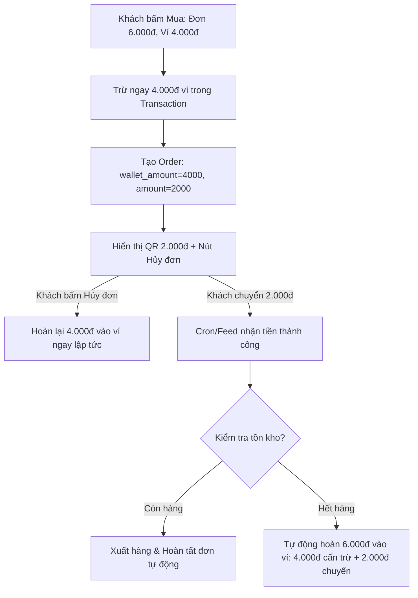

# Kế Hoạch Kiến Trúc Cơ Chế Thanh Toán Kết Hợp (Hybrid Payment: Ví + Chuyển Khoản QR)

## 1. Mục tiêu và Bối cảnh

Khi người dùng mua một sản phẩm có giá trị lớn hơn số dư ví hiện tại (Ví dụ: Sản phẩm giá **6.000đ**, số dư ví đang có **4.000đ**):
- **Mong muốn:** Tự động cấn trừ **4.000đ** từ ví người dùng và chỉ tạo mã VietQR thanh toán cho **2.000đ** còn thiếu.
- **Yêu cầu then chốt:**
  1. Tránh hoàn toàn rủi ro âm tiền (Double-spending).
  2. Không giam tiền khách / loại bỏ rủi ro tranh chấp khi khách đổi ý không chuyển khoản.
  3. Xử lý triệt để tranh chấp kho (Race Condition) nếu sản phẩm hết hàng trong lúc khách đang chuyển khoản.
  4. Tuân thủ nguyên tắc KISS (Keep It Simple, Stupid), không đẻ thêm bảng phụ hay daemon phức tạp, tái sử dụng tối đa luồng sẵn có.

---

## 2. Giải Pháp Kiến Trúc Tối Giản (KISS) Cho 4 Vấn Đề



### 2.1. Giải quyết Vấn đề 3: Rủi ro âm tiền (Double-spending)
- **Cơ chế:** Khi người dùng bấm Mua, hệ thống thực hiện trừ ngay `4.000đ` khỏi cột `balance` của bảng `users` ngay bên trong DB Transaction:
  ```sql
  UPDATE users SET balance = balance - 4000 WHERE id = ? AND balance >= 4000
  ```
- **Ý nghĩa:** Khách không thể dùng `4.000đ` này để mở đồng thời đơn hàng khác. Số dư ví giảm ngay, loại trừ hoàn toàn khả năng bị âm tiền.

### 2.2. Giải quyết Vấn đề 1: Tránh giam tiền & Tranh chấp khi khách không chuyển
- **Cơ chế:**
  1. Dưới tin nhắn mã QR thanh toán có nút: `[❌ Hủy đơn]` (`callback_data: cancel_order:<order_id>`).
  2. Khi khách bấm `[❌ Hủy đơn]`: Hệ thống lập tức hoàn trả `4.000đ` vào ví của người dùng (`UPDATE users SET balance = balance + 4000`), cập nhật `orders.status = 'cancelled'` và chỉnh sửa tin nhắn báo hoàn tiền thành công. Khách nhận lại tiền ví trong **1 giây**.
  3. Khi đơn hàng quá 15 phút chưa thanh toán hoặc khi user bấm nút `[⬅ Quay lại]`, hệ thống tự động hoàn lại tiền cấn trừ về ví.

### 2.3. Giải quyết Vấn đề 2: Hết hàng trong lúc chuyển khoản (Race Condition)
- **Tận dụng kiến trúc có sẵn:** Hệ thống hiện tại trong [`PaymentProcessor::refundOrder()`](core/PaymentProcessor.php:182) đã có sẵn logic xử lý khi đơn hàng bị `out_of_stock`.
- **Cơ chế cho Hybrid:**
  - Nếu trong lúc khách quét QR chuyển `2.000đ` mà sản phẩm vừa hết hàng:
  - Khi tiền `2.000đ` về, [`PaymentProcessor::processOrder()`](core/PaymentProcessor.php:147) phát hiện thiếu hàng.
  - Hệ thống tự động kích hoạt hoàn tiền toàn bộ: **Cả `4.000đ` (tiền cấn trừ ví trước đó) + `2.000đ` (tiền chuyển khoản mới về) = `6.000đ`** về thẳng số dư ví của khách.
  - Gửi thông báo: *"Sản phẩm vừa hết hàng trong lúc bạn thanh toán. Hệ thống đã hoàn trả toàn bộ 6.000đ vào số dư ví của bạn."* Khách an tâm 100%, không bị mất tiền.

### 2.4. Giải quyết Vấn đề 4: Tối giản Database & Codebase
- **Không tạo bảng mới!**
- Chỉ bổ sung **2 cột** vào bảng `orders`, không tạo bảng mới:
  - `wallet_amount DECIMAL(15,2) NOT NULL DEFAULT 0.00`: số tiền ví đã tạm giữ.
  - `expires_at DATETIME NULL`: thời điểm tự động hủy và hoàn ví (15 phút).
- Phân loại đơn hàng theo `payment_method`:
  - `'wallet'`: `wallet_amount = total`, `amount = 0.00`
  - `'vietqr_direct'`: `wallet_amount = 0.00`, `amount = total`
  - `'hybrid'`: `wallet_amount = 4000.00`, `amount = 2000.00` (Mã QR sinh ra đúng số tiền `amount`)

---

## 3. Thiết Kế Giao Diện UI/UX (Đa Ngôn Ngữ)

### 3.1. Tin nhắn hiển thị Mã QR thanh toán bù
```text
<blockquote><b>THANH TOÁN ĐƠN HÀNG</b></blockquote>

Sản phẩm: Spotify Premium 1 Tháng
Số lượng: 1
Tổng đơn: 6.000đ
Đã trừ ví: -4.000đ
Cần chuyển: 2.000đ

Ngân hàng: ACB · 99999999
Nội dung: TAOS12345

Vui lòng chuyển đúng số tiền và nội dung để hệ thống tự động giao hàng.
```

### 3.2. Bàn phím Inline Keyboard
```text
[ ❌ Hủy đơn ]   [ ⬅ Quay lại ]
```
*(Bấm `Hủy đơn` -> Hoàn trả ngay 4.000đ vào ví và vô hiệu hóa QR).*

---

## 4. Danh Sách Các File Cần Thay Đổi

1. **Database Migration:**
   - [`migrations/010_hybrid_payment.sql`](migrations/010_hybrid_payment.sql): Thêm `wallet_amount`, `expires_at` và phương thức `hybrid` vào bảng `orders`.
   - Cập nhật [`install.sql`](install.sql).

2. **Xử lý Đơn hàng (`bot/handlers/OrderHandler.php`):**
   - [`OrderHandler::checkout()`](bot/handlers/OrderHandler.php:18):
     - Nếu `balance > 0` và `balance < total`: Tính `$walletAmount = $balance`, `$bankAmount = $total - $balance`.
     - Gọi hàm tạo đơn hybrid: trừ `$walletAmount` từ `users.balance`, ghi `transactions`, lưu `wallet_amount` vào `orders`, sinh QR với số tiền `$bankAmount`.
   - Bổ sung hàm [`OrderHandler::cancelOrder()`](bot/handlers/OrderHandler.php): Hoàn lại `wallet_amount` vào `users.balance`, đánh dấu `orders.status = 'cancelled'`.

3. **Xử lý Thanh toán (`core/PaymentProcessor.php`):**
   - [`PaymentProcessor::processOrder()`](core/PaymentProcessor.php:147):
     - Khi giao hàng thành công: Ghi nhận tổng giá trị thanh toán đủ.
     - Khi hết hàng hoặc có lỗi (`refundOrder`): Cộng hoàn trả `amount + wallet_amount` vào `users.balance`.

4. **Tự động hết hạn (`core/PaymentProcessor.php` và `cron/payment_feed.php`):**
   - Hủy đơn Hybrid chưa thanh toán sau 15 phút và hoàn phần ví đã giữ trong transaction có khóa.
   - Tái sử dụng vòng cron feed hiện có, không tạo daemon hoặc cron mới.

5. **Điều hướng Callback (`bot/Router.php`):**
   - Đăng ký callback `cancel_order:<order_id>` -> Gọi sang [`OrderHandler::cancelOrder()`](bot/handlers/OrderHandler.php).

6. **Đa ngôn ngữ (`languages/vi.php` & `languages/en.php`):**
   - Thêm các khóa: `payment_wallet_deducted_line`, `payment_need_transfer_line`, `cancel_order_button`, `order_cancelled_wallet_refunded`, `hybrid_out_of_stock_refunded`.

7. **Giao diện Quản trị (`admin/modules/orders.php`):**
   - Hiển thị thêm chi tiết cấn trừ ví (nếu `wallet_amount > 0`).

---

## 5. Quy Trình Triển Khai Sau Khi Duyệt

- [ ] Bước 1: Tạo migration `010_hybrid_order_wallet_amount.sql` và cập nhật `install.sql`.
- [ ] Bước 2: Thêm ngôn ngữ trong `languages/vi.php` và `languages/en.php`.
- [ ] Bước 3: Cập nhật `bot/handlers/OrderHandler.php` và `bot/Router.php` cho luồng tạo đơn và hủy đơn hybrid.
- [ ] Bước 4: Cập nhật `core/PaymentProcessor.php` cho trường hợp hoàn tiền đủ cả ví lẫn chuyển khoản khi hết hàng.
- [ ] Bước 5: Cập nhật `admin/modules/orders.php`.
- [ ] Bước 6: Kiểm tra cú pháp, git diff và commit deploy lên `origin/main`.
