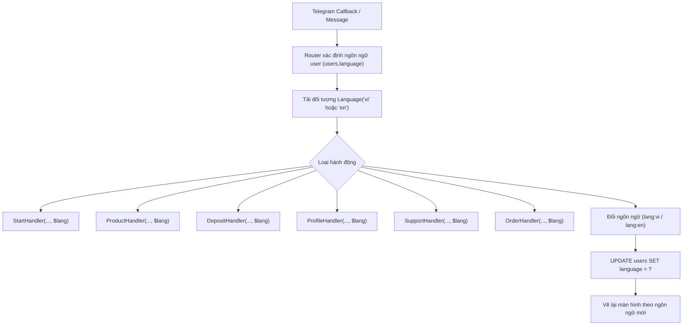

# Kế Hoạch Triển Khai Đa Ngôn Ngữ Song Ngữ (Tiếng Việt & English)

Tài liệu này chi tiết hóa lộ trình kiến trúc và giải pháp kỹ thuật để kích hoạt tính năng đa ngôn ngữ (i18n) cho Telegram Shop Bot, kết nối lớp [`Language`](core/Language.php:5) vào toàn bộ luồng [`Router`](bot/Router.php:5), các Handler và trang Quản trị.

---

## 1. Mục Tiêu & Nguyên Tắc Thiết Kế

1. **Kiến trúc linh hoạt, không phá vỡ hiệu năng**:
   - Sử dụng lớp [`Language`](core/Language.php:5) sẵn có, mở rộng từ điển đầy đủ cho cả `vi` và `en`.
   - Router nạp đối tượng `Language` tương ứng với ngôn ngữ của người dùng (`users.language`) và truyền dạng tham số method (`stateless`) vào các handler để không tốn tài nguyên khởi tạo lại handler.
   - Giữ vững tiêu chí phản hồi 1-roundtrip trên cPanel mà không tăng thêm số lượng truy vấn MySQL thừa.

2. **Trải nghiệm người dùng mượt mà (UI/UX)**:
   - Thêm nút chuyển đổi ngôn ngữ trực tiếp `🌐 Ngôn ngữ / Language` trên màn hình chính `/start` và màn hình `Cá nhân`.
   - Màn hình chọn ngôn ngữ hiển thị rõ ràng với cờ và tên ngôn ngữ: `🇻🇳 Tiếng Việt` và `🇬🇧 English`.
   - Khi chọn ngôn ngữ mới: Cập nhật ngay vào database và tự động vẽ lại giao diện theo ngôn ngữ vừa chọn.

3. **Bảo toàn dữ liệu (Data Preservation)**:
   - Tạo migration mới `migrations/003_add_multilingual_settings.sql` để bổ sung các cấu hình nội dung tiếng Anh (`shop_intro_en`, `support_text_en`), tuyệt đối không xóa dữ liệu hay can thiệp bảng cũ.

---

## 2. Kiến Trúc Luồng Đa Ngôn Ngữ

---

## 3. Các Thành Phần Cần Nâng Cấp

### 3.1. Từ điển ngôn ngữ (`languages/vi.php` & `languages/en.php`)
Bổ sung đầy đủ 100% các chuỗi UI, nút bấm và thông báo lỗi:
- **Menu chính (`start`)**: Chào mừng, tại sao chọn chúng tôi, ưu điểm, thông tin liên hệ, nút bấm:
  - `btn_products`, `btn_deposit`, `btn_profile`, `btn_support`, `btn_language`.
- **Sản phẩm (`products`)**: Tiêu đề danh sách, tiêu đề chi tiết, số lượng sẵn có, hết hàng, tính năng nổi bật, gói sản phẩm, giá, kho, nút mua, nút quay lại, nút làm mới.
- **Nạp tiền (`deposit`)**: Tiêu đề nạp ví, nội dung chuyển khoản, nạp tối thiểu, lưu ý giữ mã.
- **Cá nhân (`profile`)**: Tiêu đề thông tin, ID, tên, số dư, đơn đã mua, nút lịch sử đơn hàng, tiêu đề lịch sử, trạng thái chưa có đơn.
- **Hỗ trợ (`support`)**: Tiêu đề hỗ trợ, nội dung mặc định.
- **Đơn hàng (`orders`)**: Tiêu đề thanh toán, thông tin sản phẩm, số tiền, nội dung thanh toán, mua thành công, mã đơn, thông tin nhận hàng, lỗi hết hàng, lỗi thay đổi số dư.
- **Chuyển đổi ngôn ngữ (`language`)**: Tiêu đề chọn ngôn ngữ, thông báo đổi thành công, nút quay lại.

### 3.2. Lớp điều phối [`Router`](bot/Router.php:5)
- Xác định ngôn ngữ của người dùng:
  - Nếu là lệnh `/start` hoặc callback có user: lấy từ `users.language` (mặc định `'vi'`).
  - Sử dụng mảng đối tượng Language sẵn trong Router: `$languages = ['vi' => new Language('vi'), 'en' => new Language('en')]` để tái sử dụng ngay lập tức mà không phải đọc lại file PHP nhiều lần.
- Thêm xử lý callback chuyển ngôn ngữ:
  - `language`: Mở giao diện chọn ngôn ngữ (`🇻🇳 Tiếng Việt`, `🇬🇧 English`).
  - `lang:vi` / `lang:en`: Thực hiện cập nhật `UPDATE users SET language = ? WHERE telegram_id = ?`, sau đó render lại màn hình `/start` với ngôn ngữ mới.

### 3.3. Các Handler trong `bot/handlers/`
Cập nhật tham số nhận đối tượng `Language $lang` vào các phương thức giao diện:
1. [`StartHandler::show()`](bot/handlers/StartHandler.php:11):
   - Sử dụng `$lang->get(...)` cho tiêu đề `<blockquote>`, danh sách ưu điểm và nhãn các nút.
   - Hiển thị `$settings['shop_intro_en']` nếu ngôn ngữ hiện tại là `en` (fallback về `shop_intro` nếu trống).
2. [`ProductHandler::list()`](bot/handlers/ProductHandler.php:11) & [`ProductHandler::detail()`](bot/handlers/ProductHandler.php:30):
   - Thay thế toàn bộ text tĩnh tiếng Việt bằng `$lang->get('products_title')`, `$lang->get('out_of_stock')`, v.v.
3. [`DepositHandler::show()`](bot/handlers/DepositHandler.php:11):
   - Caption ảnh VietQR đa ngôn ngữ.
4. [`ProfileHandler::show()`](bot/handlers/ProfileHandler.php:11) & [`ProfileHandler::history()`](bot/handlers/ProfileHandler.php:19):
   - Màn cá nhân và lịch sử đơn hàng đa ngôn ngữ.
5. [`SupportHandler::show()`](bot/handlers/SupportHandler.php:11):
   - Tiêu đề hỗ trợ đa ngôn ngữ; đọc `$settings['support_text_en']` khi ngôn ngữ là `en`.
6. [`OrderHandler::buy()`](bot/handlers/OrderHandler.php:11):
   - Màn thanh toán VietQR và thông báo kết quả mua hàng qua ví bằng tiếng Anh/tiếng Việt tương ứng.

### 3.4. Cơ sở dữ liệu & Quản trị Admin
- Tạo file migration [`migrations/003_add_multilingual_settings.sql`](migrations/003_add_multilingual_settings.sql):
  - Bổ sung cấu hình `shop_intro_en` và `support_text_en` vào bảng `settings`.
- Cập nhật [`admin/modules/settings.php`](admin/modules/settings.php):
  - Thêm các ô nhập dữ liệu cho `shop_intro_en` và `support_text_en`.

---

## 4. Các Bước Triển Khai Cụ Thể (Todo Items)

1. [ ] **Cập nhật từ điển `languages/vi.php` và `languages/en.php`** với đầy đủ các key giao diện.
2. [ ] **Tạo migration an toàn `migrations/003_add_multilingual_settings.sql`** và cập nhật `install.sql`.
3. [ ] **Cập nhật trang cấu hình `admin/modules/settings.php`** hỗ trợ nhập nội dung song ngữ.
4. [ ] **Nâng cấp `bot/Router.php`** để phân giải ngôn ngữ người dùng và xử lý callback `language`, `lang:vi`, `lang:en`.
5. [ ] **Cập nhật các handler trong `bot/handlers/`** (`StartHandler`, `ProductHandler`, `DepositHandler`, `ProfileHandler`, `SupportHandler`, `OrderHandler`) để đọc chuỗi theo `$lang`.
6. [ ] **Kiểm tra rà soát cú pháp tĩnh** và xác nhận luồng đổi ngôn ngữ hai chiều hoạt động chính xác.
