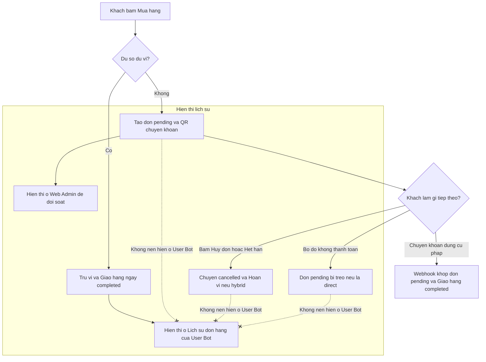
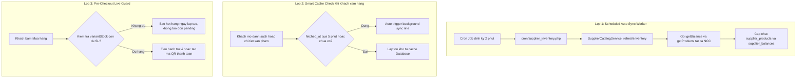

# Kế hoạch Tối ưu Đơn Pending, Thiết kế lại Hiển thị Lịch sử Đơn hàng & Tự động Check Kho API

Tài liệu này phân tích bản chất, mục đích của việc lưu trữ trạng thái đơn hàng `pending`, chỉ ra bất cập trong khâu hiển thị hiện tại và đề xuất phương án kỹ thuật toàn diện nhằm:
1. **Chuẩn hóa hiển thị lịch sử đơn hàng trên Telegram Bot & Web Admin**.
2. **Tự động dọn dẹp đơn pending quá hạn**.
3. **Tự động kiểm tra và đồng bộ số lượng kho từ các nhà cung cấp API**.

---

## 1. Phân tích hiện trạng & Giải đáp: "Lưu đơn Pending để làm gì?"

### 1.1. Tại sao hệ thống lại tạo và lưu đơn hàng `pending` vào Database?
Trong luồng mua hàng tại [`OrderHandler::checkout()`](bot/handlers/OrderHandler.php:19) và [`OrderHandler::pendingDirectOrder()`](bot/handlers/OrderHandler.php:259):
1. **Đối soát giao dịch tự động từ ngân hàng (Bank Payment Reconciliation):**
   - Khi khách hàng thanh toán qua chuyển khoản ngân hàng (`vietqr_direct` hoặc `hybrid`), hệ thống sinh ra một mã thanh toán duy nhất (`payment_code`, ví dụ `DONATE123456`) gắn với mã đơn hàng (`order_code`, ví dụ `OD261030...`).
   - Bản ghi `orders` với `status = 'pending'` đóng vai trò là "chờ khớp nối". Khi Webhook ngân hàng (hoặc cron SePay/ACB) phát hiện biến động số dư, hệ thống tìm kiếm trong bảng `orders` xem có đơn `pending` nào khớp với `payment_code` và số tiền không. Nếu không lưu đơn `pending`, bot sẽ không biết tiền về từ ngân hàng là để thanh toán cho sản phẩm nào, số lượng bao nhiêu, của khách hàng nào để thực hiện xuất kho (`StockFulfillmentService`) tự động.
2. **Khóa và bảo vệ số dư ví đối với đơn Hybrid (Hybrid Payment Safety):**
   - Với đơn `hybrid` (kết hợp số dư ví + chuyển khoản ngân hàng phần còn thiếu), hệ thống trừ tạm giữ tiền ví ngay tại thời điểm tạo mã QR (`hybrid_wallet_reserved`).
   - Đơn `pending` lưu lại trường `wallet_amount` để đảm bảo:
     - Khách không thể dùng số dư đó mua món khác khi đang chờ chuyển khoản.
     - Nếu khách bấm **Hủy đơn** hoặc đơn bị **Hết hạn sau 15 phút**, hệ thống có cơ sở để hoàn lại đúng số tiền đó vào ví của khách (`wallet_credited`).
3. **Quản lý vòng đời ảnh mã QR (Cleanup QR Messages):**
   - Đơn `pending` liên kết với bảng `payment_message_links` để theo dõi tin nhắn QR Telegram. Khi thanh toán thành công, bị hủy hoặc quá hạn, bot sẽ tự động xóa/thu hồi ảnh QR để tránh việc khách hàng chuyển nhầm tiền vào đơn cũ.

### 1.2. Vì sao người dùng lại thấy khó hiểu và thắc mắc?
- **Lỗi hiển thị ở Telegram Bot User ([`ProfileHandler::orders()`](bot/handlers/ProfileHandler.php:97)):**
  Câu lệnh SQL hiện tại:
  ```sql
  SELECT id, order_code, product_name
  FROM orders
  WHERE user_id = ?
  ORDER BY id DESC
  LIMIT ...
  ```
  Câu lệnh này **KHÔNG lọc theo trạng thái (`status`)**! Bất kỳ khi nào khách hàng bấm vào sản phẩm thử xem mã QR rồi không mua, một đơn `pending` vẫn được sinh ra. Khi khách vào **Menu cá nhân > 📦 Lịch sử đơn hàng**, bot hiển thị cả những đơn `pending` (chưa thanh toán) và `cancelled` (đã hủy) lẫn lộn với đơn thành công. Khách bấm nút "Xem" thì không có tài khoản hay key nào được giao.
- **Trạng thái đối với Web Admin ([`admin/modules/orders.php`](admin/modules/orders.php)):**
  Admin cần thấy đơn `pending` để theo dõi các giao dịch đang diễn ra dở dang, hỗ trợ khách khi chuyển khoản sai cú pháp hoặc đối soát thủ công. Tuy nhiên hiện tại chưa có badge phân màu trạng thái trực quan giữa `completed` và `pending`.
- **Lỗ hổng dọn dẹp đơn `vietqr_direct` quá hạn:**
  Cron [`PaymentProcessor::expireHybridOrders()`](core/PaymentProcessor.php:85) chỉ tự động hủy đơn `hybrid` hết hạn. Các đơn thanh toán 100% qua ngân hàng (`vietqr_direct`) bị bỏ quên ở trạng thái `pending` vĩnh viễn, làm bảng dữ liệu phình to với các đơn rác.



---

## 2. Phương án thiết kế lại hiển thị & Xử lý đơn Pending

### 2.1. Ở phía Telegram User Bot
1. **Lọc dữ liệu lịch sử đơn hàng:**
   - Trong [`ProfileHandler::orders()`](bot/handlers/ProfileHandler.php:94): Chỉ lấy các đơn đã hoàn tất thành công:
     ```sql
     SELECT id, order_code, product_name, quantity, amount, wallet_amount, created_at, completed_at
     FROM orders
     WHERE user_id = ? AND status = 'completed'
     ORDER BY id DESC
     LIMIT ...
     ```
   - Đảm bảo mục "Lịch sử đơn hàng" của khách chỉ chứa những sản phẩm khách thực sự đã thanh toán và nhận bàn giao.
2. **Định dạng hiển thị danh sách đơn:**
   - Chuyển từ định dạng cũ:
     `OD26103014072332 · Gemini Pro 18 Months`
   - Sang định dạng chuẩn mới:
     ```text
     ✅ OD26103014072332
      ╰ Gemini Pro 18 Months x 1 — 29.000đ
     ```
   - Dùng icon ✅, ký tự phân nhánh ` ╰ `, hiển thị rõ số lượng (`x 1`) và tổng giá trị đơn hàng (`Helpers::money()`).
3. **Màn hình khi bấm nút "Xem" (`order_history:$orderId:$page`):**
   - Đưa về định dạng chuẩn y hệt như tin nhắn lúc bot vừa giao hàng tại [`OrderHandler::walletOrderMessage()`](bot/handlers/OrderHandler.php:216) và [`NotificationOutbox::renderMessage()`](core/NotificationOutbox.php:171):
     ```text
     ✅ <b>Mua hàng thành công</b>

     Sản phẩm: Gemini Pro 18 Months
     Số lượng: <b>1</b>
     Tổng tiền: <b>29.000đ</b>
     Trạng thái: Đã giao hàng

     Code: <code>OD26103014072332</code> | 30/10/2026 14:07:23

     <b>Sản phẩm 1:</b>
     <code>tai_khoan_hoac_license_key</code>
     ```
   - Loại bỏ các dòng thông tin kỹ thuật dư thừa (*Đơn giá, Phương thức thanh toán, Trừ ví, Cần chuyển...*).
   - Khách hàng bấm một chạm vào khối thẻ `<code>...</code>` là có thể sao chép ngay tài khoản/key đã nhận.
   - Bàn phím đính kèm: Nút `[⬅ Quay lại]` (`orders:$page`).

### 2.2. Ở phía Web Admin
1. **Giữ nguyên việc lưu và quản lý đơn `pending`:**
   - Đơn `pending` vẫn được lưu và hiển thị trong danh sách [`admin/modules/orders.php`](admin/modules/orders.php) để quản trị viên đối soát khi có phát sinh.
2. **Bổ sung Badge màu trạng thái trực quan:**
   - `completed`: Badge xanh lá (`badge-success`)
   - `pending`: Badge màu cam/vàng (`badge-warning`)
   - `processing`: Badge màu xanh dương (`badge-info`)
   - `failed`: Badge màu đỏ (`badge-danger`)
   - `cancelled`: Badge màu xám (`badge-secondary`)

### 2.3. Tự động dọn dẹp đơn `pending` quá hạn
- Mở rộng phương thức trong [`core/PaymentProcessor.php`](core/PaymentProcessor.php:85):
  Tự động quét các đơn `vietqr_direct` quá `expires_at` (15 phút) -> chuyển trạng thái sang `cancelled` (`result_reason = 'expired'`), đồng bộ giải phóng mã thanh toán trong `payment_code_registry`.

---

## 3. Phương án: Tự động check số lượng kho từ các nhà cung cấp API

### 3.1. Phân tích bài toán tồn kho API
Hệ thống hiện tại quản lý tồn kho API qua:
- `supplier_products.stock`: Số lượng tồn kho mà nhà cung cấp báo qua API.
- `supplier_balances.amount`: Số dư ví đối tác tại nhà cung cấp (USDT/USD).
- `SupplierCatalogService::effectiveStock()`: Số lượng thực tế có thể bán:
  $$\text{effectiveStock} = \min(\text{supplier\_products.stock}, \lfloor \text{balance} / \text{unit\_price} \rfloor)$$
- `SupplierCatalogService::refreshInventory()`: Đã có sẵn logic gọi `syncBalance()` và `syncProducts()` cho tất cả các nhà cung cấp API đang hoạt động (`CupponHub`, `Sandromania`, ...).

**Điểm nghẽn hiện tại**: Việc đồng bộ kho API chỉ diễn ra khi Admin bấm nút thủ công trên web admin! Chưa có cơ chế chạy ngầm tự động định kỳ, dẫn đến nguy cơ khách đặt mua nhưng kho trên API của NCC đã hết từ trước.

### 3.2. Kiến trúc giải pháp Tự động check kho API

Hệ thống sẽ triển khai cơ chế 3 lớp bảo vệ tự động:



#### Lớp 1: Scheduled Auto Sync Worker ([`cron/supplier_inventory.php`](cron/supplier_inventory.php))
- Xây dựng file chạy dòng lệnh CLI độc lập: [`cron/supplier_inventory.php`](cron/supplier_inventory.php).
- Sử dụng cơ chế file lock chống chạy đè (`taos-supplier-inventory.lock`).
- Gọi `$supplierCatalog->refreshInventory()`.
- Chạy định kỳ qua cPanel Cron Job / Crontab hệ thống (khuyến nghị chu kỳ mỗi 2 - 3 phút).
- Bổ sung ghi log kết quả thực thi (số provider thành công, số lỗi, thời gian cập nhật).

#### Lớp 2: Tự động làm mới khi dữ liệu quá hạn (TTL Cache-Refresh)
- Trong [`SupplierCatalogService::variantStockMap()`](suppliers/SupplierCatalogService.php:110):
  Kiểm tra mốc thời gian `fetched_at` của các nhà cung cấp được cấu hình.
  Nếu toàn bộ sản phẩm của một NCC chưa từng được sync hoặc lần sync cuối cùng đã quá 10 phút, hệ thống tự động kích hoạt đồng bộ lại dữ liệu cho NCC đó nếu không có lock nào đang giữ.

#### Lớp 3: Chặn đơn hàng ngay trước khi thanh toán (Pre-Checkout Live Guard)
- Trong [`OrderHandler::checkout()`](bot/handlers/OrderHandler.php:42):
  Trước khi tạo đơn pending hoặc trừ tiền ví, gọi [`SupplierCatalogService::variantStock()`](suppliers/SupplierCatalogService.php:184).
  Nếu tồn kho thực tế (`available < quantity`):
  -> Dừng quy trình ngay và thông báo lỗi hết hàng `just_out_of_stock`.
  -> Không sinh ra đơn `pending` vô nghĩa trong database.

---

## 4. Chi tiết các file thay đổi

| STT | Tập tin | Nội dung thay đổi |
|:---:|---|---|
| 1 | [`languages/vi.php`](languages/vi.php) & [`languages/en.php`](languages/en.php) | Bổ sung key `history_order_item`, `history_order_back`. Chuẩn hóa hiển thị định dạng đơn hàng. |
| 2 | [`bot/handlers/ProfileHandler.php`](bot/handlers/ProfileHandler.php) | Sửa `orders()` lọc `status = 'completed'` và render theo định dạng mới `✅ OD... \n ╰ ...`. Sửa `orderDetail()` trả về nội dung giao hàng y hệt lúc bàn giao. |
| 3 | [`bot/handlers/OrderHandler.php`](bot/handlers/OrderHandler.php) | Bổ sung kiểm tra `variantStock()` trước khi trừ ví hoặc tạo QR chuyển khoản. |
| 4 | [`core/PaymentProcessor.php`](core/PaymentProcessor.php) | Bổ sung hàm tự động hủy đơn `vietqr_direct` quá hạn 15 phút. |
| 5 | [`cron/supplier_inventory.php`](cron/supplier_inventory.php) | Tạo mới cron worker đồng bộ số dư và tồn kho sản phẩm từ tất cả NCC API. |
| 6 | [`cron/payment_feed.php`](cron/payment_feed.php) | Tích hợp gọi hủy đơn pending quá hạn cả `hybrid` và `vietqr_direct`. |
| 7 | [`admin/modules/orders.php`](admin/modules/orders.php) | Thêm badge màu phân biệt trạng thái đơn hàng trực quan. |
| 8 | [`admin/modules/suppliers.php`](admin/modules/suppliers.php) | Hiển thị hướng dẫn lệnh cron tự động check kho và trạng thái sync gần nhất. |
| 9 | [`admin/assets/style.css`](admin/assets/style.css) | Thêm style cho các class `.badge-pending`, `.badge-completed`, `.badge-cancelled`. |

---

## 5. Kế hoạch triển khai (Action Plan)

- [ ] **Bước 1: Cập nhật file ngôn ngữ đa ngữ**
  - Thêm các key `history_order_item` vào [`languages/vi.php`](languages/vi.php) và [`languages/en.php`](languages/en.php).
- [ ] **Bước 2: Nâng cấp hiển thị Lịch sử đơn hàng phía Bot Telegram**
  - Cập nhật [`ProfileHandler::orders()`](bot/handlers/ProfileHandler.php:94) lọc đơn `completed` và hiển thị định dạng nhánh cây.
  - Cập nhật [`ProfileHandler::orderDetail()`](bot/handlers/ProfileHandler.php:122) hiển thị nội dung giao hàng chuẩn mực.
- [ ] **Bước 3: Xây dựng worker tự động kiểm tra tồn kho API**
  - Viết worker [`cron/supplier_inventory.php`](cron/supplier_inventory.php).
  - Tối ưu [`SupplierCatalogService.php`](suppliers/SupplierCatalogService.php) hỗ trợ kiểm tra mốc thời gian stale cache.
- [ ] **Bước 4: Kiểm tra tồn kho trước khi thanh toán & Dọn dẹp đơn pending quá hạn**
  - Cập nhật [`OrderHandler::checkout()`](bot/handlers/OrderHandler.php:19) chặn đơn nếu tồn kho không đủ.
  - Cập nhật [`core/PaymentProcessor.php`](core/PaymentProcessor.php:85) tự động hủy đơn `vietqr_direct` quá hạn.
- [ ] **Bước 5: Nâng cấp giao diện Web Admin**
  - Thêm badge màu sắc trạng thái trong [`admin/modules/orders.php`](admin/modules/orders.php).
  - Cập nhật CSS [`admin/assets/style.css`](admin/assets/style.css).
- [ ] **Bước 6: Kiểm thử toàn diện**
  - Kiểm tra giao diện Bot: danh sách đơn hàng, xem lại key/tài khoản.
  - Kiểm tra chạy thử cron `cron/supplier_inventory.php` và xác minh cập nhật tồn kho API.
  - Kiểm tra trên cả 2 ngôn ngữ vi/en.
