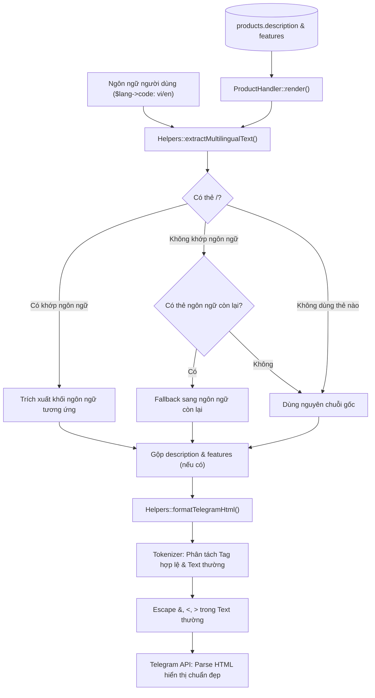

# Kế Hoạch Hỗ Trợ Đa Ngôn Ngữ & Telegram HTML Cho Mô Tả Chi Tiết Sản Phẩm

Tài liệu này chi tiết hóa giải pháp kỹ thuật nhằm hỗ trợ cú pháp thẻ đa ngôn ngữ `<vi></vi>`, `<en></en>` cùng các thẻ Telegram HTML (`<b>`, `<i>`, `<s>`, `<u>`, `<code>`, `<pre>`, `<a>`, `<blockquote>`, `<tg-spoiler>`) trong phần mô tả chi tiết sản phẩm.

---

## 1. Yêu Cầu & Hiện Trạng

### 1.1. Yêu cầu của người dùng
1. Mô tả chi tiết sản phẩm hỗ trợ hiển thị song ngữ Anh - Việt theo cú pháp thẻ:
   - `<vi>Nội dung tiếng Việt</vi>`
   - `<en>English content</en>`
2. Bên trong các thẻ này, hỗ trợ đầy đủ các định dạng HTML hợp lệ của Telegram: `<b>`, `<i>`, `<s>`, `<u>`, `<code>`, `<pre>`, `<a>`, `<blockquote>`, `<tg-spoiler>`.
3. Khi người dùng Telegram đổi sang ngôn ngữ nào, bot sẽ tự động hiển thị mô tả tương ứng với ngôn ngữ đó.

### 1.2. Hiện trạng codebase
- File [`bot/handlers/ProductHandler.php`](bot/handlers/ProductHandler.php:171) đang xử lý mô tả như sau:
  - Tách chuỗi theo từng dòng bằng `preg_split('/\R/u', ...)`.
  - Ép buộc gắn tiền tố `╰ ` và gọi [`Helpers::escape()`](core/Helpers.php:13) (`htmlspecialchars`) lên từng dòng.
  - **Hệ quả**: Mọi thẻ HTML (`<b>`, `<i>`, v.v.) bị escape thành ký tự thô (`<b>`), Telegram không render được định dạng. Nếu người dùng viết thẻ HTML nhiều dòng (như `<blockquote>`), việc chèn `╰ ` vào giữa sẽ làm gãy cú pháp HTML của Telegram.
- File [`core/Helpers.php`](core/Helpers.php:17) đã có hàm `sanitizeTelegramHtml($text)`, nhưng dùng `strip_tags` đơn giản nên chưa xử lý ký tự đặc biệt (`&`, `<`, `>`) nằm trong các đoạn text thường, dễ gây lỗi `Bad Request: can't parse entities` khi gửi qua Telegram Bot API.
- Trang quản trị [`admin/modules/products.php`](admin/modules/products.php:126) lưu trữ nội dung UTF-8 nguyên vẹn vào cột `description` và `features` trong bảng `products`. Khi hiển thị form edit đã escape an toàn qua `e()`, không bị xung đột.

---

## 2. Kiến Trúc Luồng Dữ Liệu & Giải Pháp Kỹ Thuật



---

## 3. Chi Tiết Kỹ Thuật Các Module

### 3.1. Mở rộng [`core/Helpers.php`](core/Helpers.php)
Bổ sung 2 hàm chuyên biệt theo quy chuẩn Clean Code (KISS, Single Responsibility):

1. **`Helpers::extractMultilingualText(?string $text, string $langCode): string`**:
   - Nhận vào chuỗi văn bản và mã ngôn ngữ (`vi` hoặc `en`).
   - Tìm kiếm các khối thẻ `<vi>...</vi>` hoặc `<en>...</en>` bằng biểu thức chính quy (hỗ trợ cờ `/is`, khoảng trắng thẻ đóng mở, và bắt nhiều khối nếu có qua `preg_match_all`).
   - Nếu tìm thấy thẻ của ngôn ngữ hiện tại: gộp và trả về nội dung bên trong thẻ.
   - Nếu không có thẻ của ngôn ngữ hiện tại nhưng có thẻ của ngôn ngữ đối ứng: fallback trả về nội dung của thẻ đối ứng (đảm bảo không bao giờ bị trắng màn hình).
   - Nếu chuỗi không chứa bất kỳ thẻ `<vi>` hay `<en>` nào: trả về nguyên văn chuỗi gốc (tương thích ngược 100% với các sản phẩm đã nhập từ trước).

2. **`Helpers::formatTelegramHtml(?string $text): string`**:
   - Chuẩn hóa ngắt dòng: chuyển đổi `<br>`, `<br/>` thành `\n`.
   - Phân tích cú pháp văn bản qua tokenizer (Regex Split giữ nguyên delimiter):
     - Thẻ Telegram hợp lệ: `<b>`, `<strong>`, `<i>`, `<em>`, `<u>`, `<ins>`, `<s>`, `<strike>`, `<del>`, `<tg-spoiler>`, `<a>`, `<code>`, `<pre>`, `<blockquote>`.
     - Với các thẻ hợp lệ: giữ nguyên định dạng, kiểm tra an toàn thuộc tính (ví dụ thẻ `<a>` chỉ giữ `href`, thẻ `code` chỉ giữ `class="language-..."`).
     - Với các đoạn văn bản thường (text nodes): decode HTML entities cũ (tránh double escape) rồi escape chuẩn các ký tự `<`, `>`, `&` thành `<`, `>`, `&`.
     - Với các thẻ không hợp lệ (như `<div>`, `<script>`, `<p>`): loại bỏ tag an toàn.
   - Đảm bảo an toàn 100%, không bao giờ phát sinh lỗi parse entities của Telegram.

### 3.2. Cập nhật [`bot/handlers/ProductHandler.php`](bot/handlers/ProductHandler.php)
- Trong phương thức `render()`:
  - Bóc tách đa ngôn ngữ cho `$product['description']` và `$product['features']` qua `Helpers::extractMultilingualText(..., $lang->code())`.
  - Nếu cả hai rỗng -> hiển thị `'╰ ' . $lang->get('description_empty')`.
  - Nếu có nội dung -> xử lý qua `Helpers::formatTelegramHtml()` và hiển thị trọn vẹn dưới tiêu đề `<b>' . $lang->get('description') . "</b>\n".
  - Người dùng có thể tự do định dạng: in đậm, in nghiêng, trích dẫn `<blockquote>`, gạch đầu dòng `•`, `-` hoặc `╰ ` theo ý muốn mà không bị hệ thống ép buộc hay làm gãy cấu trúc HTML.

### 3.3. Cập nhật gợi ý giao diện Quản trị [`admin/modules/products.php`](admin/modules/products.php)
- Bổ sung ghi chú trợ giúp (`.help-text`) ngay dưới nhãn hoặc trường textarea `Mô tả` và `Hướng dẫn sử dụng`:
  - `Hỗ trợ đa ngôn ngữ: <vi>Nội dung tiếng Việt</vi><en>English content</en>.`
  - `Hỗ trợ thẻ Telegram HTML: <b>in đậm</b>, <i>in nghiêng</i>, <u>gạch chân</u>, <s>gạch ngang</s>, <code>code</code>, <pre>khối code</pre>, <blockquote>trích dẫn</blockquote>, <a href="...">liên kết</a>.`

### 3.4. Trường hợp sử dụng thực tế (Theo ảnh giao diện quản trị)
- Người quản trị nhập trực tiếp vào ô `Mô tả` như sau:
```text
<en>
- Open the link and click the "Activate Plan" button.
- No payment method or card required.
- Works with any account that has not used this offer before.
- Invite up to 5 additional family members.
- Activation warranty: 1 hour.
</en>
<vi>
- Mở liên kết và nhấn nút "Activate Plan".
- Không cần phương thức thanh toán hoặc thẻ ngân hàng.
- Sử dụng được trên mọi tài khoản chưa từng nhận ưu đãi này.
- Có thể mời thêm tối đa 5 thành viên vào gói gia đình.
- Bảo hành kích hoạt: 1 giờ.
</vi>
```
- **Kết quả hiển thị trên Bot**:
  - Với tài khoản tiếng Việt (`vi`): Chỉ hiển thị các dòng trong thẻ `<vi>`, giữ nguyên định dạng gạch đầu dòng `- `, xuống dòng và các thẻ HTML nếu có.
  - Với tài khoản tiếng Anh (`en`): Chỉ hiển thị các dòng trong thẻ `<en>`, giữ nguyên định dạng.
  - Không bị chèn ký tự `╰ ` chồng lên `- ` làm xấu giao diện.

### 3.5. Kiểm thử tự động (Unit / Integration Tests)
- Bổ sung test file `tests/multilingual_description_test.php` kiểm tra toàn diện các kịch bản:
  - Chuỗi nhập đúng như thực tế trong ảnh (`<en>` trước, `<vi>` sau).
  - Chuỗi chỉ có 1 thẻ (kiểm tra cơ chế fallback).
  - Chuỗi không có thẻ nào (plain text).
  - Chuỗi chứa các thẻ HTML Telegram hợp lệ (`<b>`, `<i>`, `<blockquote>`, `<code>`, `<a>`).
  - Chuỗi chứa các ký tự đặc biệt nguy hiểm (`<`, `>`, `&`).
  - Xử lý thẻ viết hoa/thường (`<VI>`, `<EN>`), thẻ có khoảng trắng (`<vi >`, `</vi >`).

---

## 4. Các Bước Triển Khai (Action Plan)

1. **Giai đoạn 1: Mở rộng Core Helper**
   - Cập nhật [`core/Helpers.php`](core/Helpers.php) với `extractMultilingualText` và `formatTelegramHtml`.
2. **Giai đoạn 2: Cập nhật Bot Handler**
   - Cập nhật [`bot/handlers/ProductHandler.php`](bot/handlers/ProductHandler.php) để áp dụng trích xuất đa ngôn ngữ và định dạng HTML Telegram.
3. **Giai đoạn 3: Cập nhật Giao diện Quản trị**
   - Bổ sung `.help-text` hướng dẫn cú pháp trong [`admin/modules/products.php`](admin/modules/products.php).
4. **Giai đoạn 4: Viết Test & Xác minh**
   - Viết test script kiểm thử logic trích xuất và parse HTML.
   - Chạy test đảm bảo 100% case đều pass không có lỗi cú pháp hay entity parse error.
