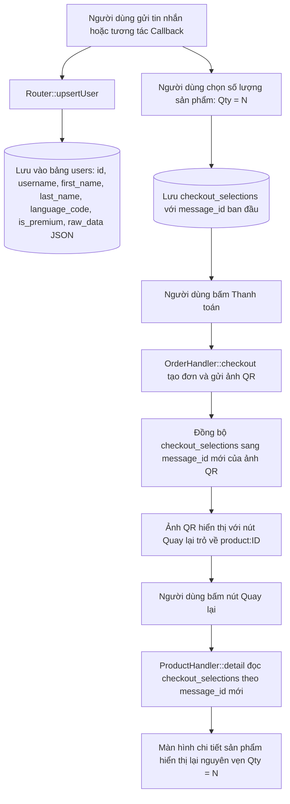

# Kế hoạch dọn dẹp cảnh báo QR, bảo toàn lựa chọn số lượng và lưu trữ toàn diện thông tin Telegram User

## 1. Mục tiêu và bối cảnh

### 1.1. Bỏ cảnh báo QR không giữ hàng
- Người dùng yêu cầu loại bỏ hoàn toàn dòng thông báo:
  > `⚠️ QR không giữ hàng. Nếu kho không đủ khi thanh toán được xử lý, toàn bộ tiền nhận sẽ được cộng vào ví.`
- Dòng này hiện xuất hiện ở chân thông tin thanh toán VietQR trong bot Telegram.
- Cần loại bỏ triệt để cả logic ghép text trong [`bot/handlers/OrderHandler.php`](bot/handlers/OrderHandler.php:82) và khóa ngôn ngữ `payment_no_reservation` trong [`languages/vi.php`](languages/vi.php:87) cũng như [`languages/en.php`](languages/en.php:87).

### 1.2. Nút quay lại về màn chi tiết sản phẩm và bảo toàn số lượng
- Hiện tại nút điều hướng dưới ảnh QR đang là `products_button` với callback `products` (dẫn về danh sách tất cả sản phẩm).
- Người dùng yêu cầu:
  - Nút quay lại phải dẫn về **chi tiết sản phẩm** vừa xem (`product:<productId>`).
  - **Giữ nguyên lựa chọn số lượng** mà người dùng đã chọn trước khi bấm thanh toán, để người dùng có thể đổi số lượng hoặc thao tác tiếp mà không bị reset về 1.
- Điểm mấu chốt kỹ thuật:
  - Khi gửi QR thanh toán, bot gọi [`core/Telegram::replaceWithPhoto()`](core/Telegram.php:121), xóa tin nhắn cũ và gửi tin nhắn photo mới. ID tin nhắn thay đổi sang ID mới.
  - Bảng `checkout_selections` có khóa chính là `(user_id, message_id)`. Nếu không sao chép/cập nhật bản ghi sang message ID của ảnh QR, khi người dùng bấm nút quay lại trên ảnh QR, hệ thống sẽ coi là message mới và khởi tạo lại số lượng về 1.
  - Giải pháp: Khi phát sinh message ID mới từ QR photo, lập tức sao chép/đồng bộ bản ghi `checkout_selections` sang message ID mới đó. Khi quay lại, [`bot/handlers/ProductHandler::detail()`](bot/handlers/ProductHandler.php:44) sẽ đọc đúng số lượng và phiên bản đã chọn.

### 1.3. Khảo sát và giải pháp thu thập toàn diện thông tin Telegram User
- **Hiện trạng:**
  - Trong [`bot/Router.php::upsertUser()`](bot/Router.php:122), hệ thống hiện chỉ lưu:
    - `telegram_id`
    - `username`
    - `first_name`
  - Bảng `users` hoàn toàn bỏ qua:
    - `last_name` (họ và tên đệm của người dùng).
    - `language_code` (ngôn ngữ client Telegram gửi về như `vi`, `en`, ...).
    - `is_premium` (trạng thái người dùng có đăng ký Telegram Premium hay không).
    - `is_bot` (xác định tài khoản bot).
    - Dữ liệu thô mở rộng: Toàn bộ payload JSON từ Telegram không được lưu trữ, làm mất các trường bổ sung mà Telegram có thể gửi về.
  - Ngoài ra, ở các callback query, [`bot/Router.php::findUser()`](bot/Router.php:116) chỉ `SELECT` mà không cập nhật lại thông tin mới nhất nếu người dùng đổi tên/username trên Telegram.
- **Giải pháp:**
  - Bổ sung migration `006_expand_users_telegram_metadata.sql` mở rộng bảng `users`.
  - Thêm các cột: `last_name`, `language_code`, `is_premium`, `is_bot`, và cột `raw_data JSON` để lưu trữ trọn vẹn 100% đối tượng Telegram User gửi sang.
  - Cập nhật [`bot/Router.php::upsertUser()`](bot/Router.php:122) và [`bot/Router.php::findUser()`](bot/Router.php:116) để luôn lưu và cập nhật đầy đủ mọi thông tin lấy được.
  - Cập nhật màn hình Cá nhân [`bot/handlers/ProfileHandler.php::show()`](bot/handlers/ProfileHandler.php:13) để hiển thị đầy đủ Họ tên, Username, huy hiệu Premium (nếu có).
  - Cập nhật trang quản trị [`admin/modules/users.php`](admin/modules/users.php:10) để hiển thị đầy đủ thông tin khách hàng.

---

## 2. Thiết kế kiến trúc & Luồng dữ liệu



---

## 3. Các bước triển khai chi tiết

### Bước 1: Loại bỏ cảnh báo QR và khóa ngôn ngữ liên quan
1. Chỉnh sửa [`bot/handlers/OrderHandler.php`](bot/handlers/OrderHandler.php:82):
   - Loại bỏ đoạn nối chuỗi `\n\n . '<b>' . $lang->get('payment_no_reservation') . '</b>'`.
   - Giữ lại chỉ dẫn quét QR thanh toán chuẩn xác.
2. Xóa khóa `payment_no_reservation` trong [`languages/vi.php`](languages/vi.php:87) và [`languages/en.php`](languages/en.php:87).

### Bước 2: Chuyển nút quay lại về chi tiết sản phẩm và bảo toàn số lượng
1. Trong [`bot/handlers/OrderHandler.php`](bot/handlers/OrderHandler.php:84):
   - Đổi bàn phím của tin nhắn thanh toán:
     `$keyboard = [[['text' => $lang->get('back'), 'callback_data' => 'product:' . $productId]]];`
2. Bảo toàn số lượng lựa chọn:
   - Sau khi gọi `$photoResult = $this->telegram->replaceWithPhoto($chatId, $messageId, $qrUrl, $content, $keyboard);`:
   - Lấy `$newMsgId = (int) ($photoResult['result']['message_id'] ?? 0);`
   - Nếu `$newMsgId > 0 && $newMsgId !== $messageId`:
     Thực thi sao chép bản ghi từ `checkout_selections` của `$messageId` cũ sang `$newMsgId` mới:
     ```sql
     INSERT INTO checkout_selections (user_id, message_id, product_id, quantity, version)
     SELECT user_id, ?, product_id, quantity, version
     FROM checkout_selections
     WHERE user_id = ? AND message_id = ?
     ON DUPLICATE KEY UPDATE product_id = VALUES(product_id), quantity = VALUES(quantity), version = VALUES(version)
     ```
   - Nhờ đó, khi người dùng bấm nút Quay lại từ tin nhắn QR photo, [`bot/handlers/ProductHandler::detail()`](bot/handlers/ProductHandler.php:44) tìm thấy ngay bản ghi lựa chọn với đúng số lượng đã chọn.

### Bước 3: Thu thập toàn bộ thông tin Telegram User và mở rộng cơ sở dữ liệu
1. Tạo migration `migrations/006_expand_users_telegram_metadata.sql`:
   ```sql
   ALTER TABLE users
       ADD COLUMN IF NOT EXISTS last_name VARCHAR(150) NULL AFTER first_name,
       ADD COLUMN IF NOT EXISTS language_code VARCHAR(20) NULL AFTER language,
       ADD COLUMN IF NOT EXISTS is_premium TINYINT(1) NOT NULL DEFAULT 0 AFTER language_code,
       ADD COLUMN IF NOT EXISTS is_bot TINYINT(1) NOT NULL DEFAULT 0 AFTER is_premium,
       ADD COLUMN IF NOT EXISTS raw_data JSON NULL AFTER state;
   ```
2. Cập nhật file cài đặt gốc [`install.sql`](install.sql:4):
   - Thêm các cột trên vào câu lệnh `CREATE TABLE IF NOT EXISTS users`.
   - Thêm bản ghi `006_expand_users_telegram_metadata.sql` vào danh sách migrations khởi tạo.
3. Cập nhật [`bot/Router.php`](bot/Router.php:116):
   - Hàm `upsertUser(array $from)`: Trích xuất và lưu đầy đủ:
     - `telegram_id`
     - `username`
     - `first_name`
     - `last_name`
     - `language_code`
     - `is_premium` (chuyển đổi boolean sang 0/1)
     - `is_bot` (chuyển đổi boolean sang 0/1)
     - `raw_data` (lưu dạng `json_encode($from, JSON_UNESCAPED_UNICODE)`)
   - Hàm `findUser(array $from)`: Không chỉ `SELECT`, mà tiến hành cập nhật thông tin người dùng nếu có thay đổi để luôn bảo đảm dữ liệu mới nhất.
4. Nâng cấp màn hình Cá nhân [`bot/handlers/ProfileHandler.php`](bot/handlers/ProfileHandler.php:13):
   - Họ và tên: Ghép `first_name` và `last_name` đầy đủ.
   - Username: Hiển thị `@username` (hoặc thông báo chưa thiết lập).
   - Huy hiệu Premium: Hiển thị thêm biểu tượng/nhãn Premium nếu `is_premium == 1`.
   - Bổ sung nhãn `username` và `premium_badge` vào [`languages/vi.php`](languages/vi.php) và [`languages/en.php`](languages/en.php).
5. Nâng cấp danh sách quản trị [`admin/modules/users.php`](admin/modules/users.php:10):
   - Hiển thị đầy đủ Họ tên, Username, nhãn Premium, ngôn ngữ Telegram và ngày đăng ký.

---

## 4. Kiểm tra và xác nhận an toàn

- Bảo đảm tuân thủ quy ước `AGENTS.md`:
  - Mọi chuỗi giao diện đều qua `Language::get()`.
  - Cập nhật song song cả 2 ngôn ngữ `vi` và `en`.
  - Dữ liệu động được escape qua [`core/Helpers::escape()`](core/Helpers.php:12).
  - Không động vào file [`core/Helpers.php`](core/Helpers.php) (giữ nguyên thay đổi cục bộ).
  - Kiểm tra diff cẩn thận trước khi commit.
