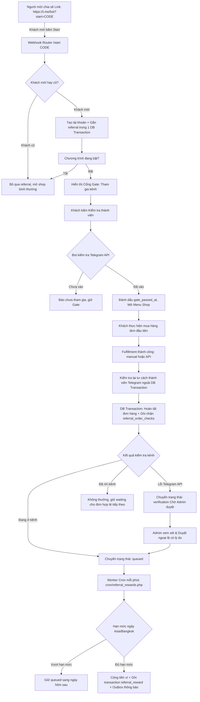

# Referral — Mời bạn mua hàng và nhận thưởng

Kế hoạch chi tiết và tài liệu kỹ thuật hoàn thiện cho hệ thống **Referral Purchase Rewards (Mời bạn mua hàng và nhận thưởng)**, đồng bộ từ [`plans/PLAN_ref.md`](plans/PLAN_ref.md) và hiện trạng triển khai trong codebase.

---

## 1. Kiến trúc tổng quan và luồng hoạt động

---

## 2. Chi tiết các thành phần hệ thống

### 2.1. Giao diện Telegram (`bot/handlers/ReferralHandler.php`, `bot/handlers/StartHandler.php`)
- **Nút ngoài màn hình chính**:
  - Tiếng Việt: `🎁 Mời bạn & Kiếm tiền`
  - Tiếng Anh: `🎁 Refer & Earn`
- **Màn hình bảng điều khiển Referral**:
  - Hiển thị mức thưởng mỗi bạn (`reward`).
  - Thống kê: Số bạn đã mời (`invited`), số bạn đã tạo thưởng thành công (`rewarded`), tổng tiền thưởng đã nhận vào ví (`earned`).
  - Link cá nhân: `https://t.me/{bot_username}?start={code}` (mã hex 12 ký tự duy nhất, cố định cho từng tài khoản).
  - Khối hướng dẫn **⭐️ Cách thức hoạt động** render động theo ngôn ngữ và Telegram HTML an toàn.
  - Bộ nút điều hướng: **🔗 Chia sẻ / Share**, **🔄 Cập nhật / Refresh**, **⬅️ Quay lại / Back**.
- **Cổng Gate**:
  - Chặn các tương tác mua hàng/nạp tiền cho tới khi tài khoản được giới thiệu bấm nút xác nhận đã tham gia kênh Telegram của shop.
  - Cho phép đổi ngôn ngữ hoặc liên hệ hỗ trợ trong lúc bị chặn.
  - Rate limit kiểm tra 5 giây chống spam API.

### 2.2. Quy tắc xét thưởng và tính nhất quán (`core/ReferralService.php`)
- **Không áp dụng ngưỡng giá trị đơn hàng**: Mọi đơn có thanh toán và giao hàng thành công (dù là 1 VND hay bất kỳ giá trị nào) đều đủ điều kiện xét thưởng.
- **Tối đa 1 lần thưởng cho mỗi người được giới thiệu**: Khách mới mua bao nhiêu đơn hay bao nhiêu sản phẩm thì người mời cũng chỉ nhận thưởng một lần duy nhất.
- **Không xét đơn nạp tiền**: Đơn nạp ví (`deposit`) không phải là mua hàng, không xét thưởng.
- **Ràng buộc thành viên**: Người mua phải đang ở trong kênh tại thời điểm đơn hàng hoàn tất. Nếu đã rời kênh, đơn hàng đó bị bỏ qua; nếu sau đó vào lại kênh và mua đơn mới thì đơn mới vẫn đủ điều kiện.
- **Khóa đa tiến trình & An toàn tài chính**:
  - Chốt mức thưởng cố định tại thời điểm gắn mã mời (thay đổi cấu hình sau đó chỉ áp dụng cho người mới).
  - Payout diễn ra trong 1 transaction duy nhất: Khóa dòng `users` và `referrals` bằng `FOR UPDATE`, cộng số dư ví, ghi lịch sử `transactions` với type `referral_reward`, tăng bộ đếm hạn mức ngày `referral_daily_usage`, cập nhật trạng thái `paid`, và đẩy thông báo vào `notification_outbox`.

### 2.3. Quản trị và Đa ngôn ngữ (`admin/modules/referrals.php`, `languages/`)
- **Cấu hình**:
  - Bật/tắt chương trình (mặc định tắt).
  - Tiền thưởng mỗi lượt mời (VND).
  - Hạn mức trả thưởng: Số lượt tối đa/người/ngày và Ngân sách tối đa toàn hệ thống/ngày (theo múi giờ `Asia/Bangkok`).
  - Kênh Telegram: ID kênh và link mời. Tự động kiểm tra quyền quản trị của bot khi bật.
  - Hướng dẫn đa ngôn ngữ: Hỗ trợ thẻ `<vi>` và `<en>`, Telegram HTML và placeholder `{reward}`.
  - Khóa đổi kênh: Không cho phép đổi kênh nếu đang còn referral chưa kết thúc (`status <> 'paid'`).
- **Danh sách quản trị & Duyệt ngoại lệ**:
  - Phân trang, tìm kiếm theo Telegram ID người mời/bạn mới, lọc theo trạng thái (`waiting`, `verification`, `queued`, `paid`).
  - Hiển thị mã đơn hàng liên quan, lý do xét duyệt kênh.
  - Nút duyệt ngoại lệ kèm lý do bắt buộc và bảo vệ CSRF đối với các trường hợp lỗi kết nối Telegram API (`api_error`).

### 2.4. Cơ sở dữ liệu và Tự động hóa (`migrations/015_referral_rewards.sql`, `install.sql`, `cron/referral_rewards.php`)
- Bảng `referral_codes`: Lưu mã mời 12 ký tự duy nhất cho mỗi user.
- Bảng `referrals`: Lưu quan hệ người mời - người được mời, số tiền thưởng chốt, kênh, trạng thái (`waiting`, `verification`, `queued`, `paid`), thời điểm qua gate và mã giao dịch trả thưởng.
- Bảng `referral_order_checks`: Lưu lịch sử kiểm tra tư cách thành viên theo đơn hàng.
- Bảng `referral_daily_usage`: Theo dõi hạn mức ngày cho từng người mời (`inviter_id > 0`) và toàn hệ thống (`inviter_id = 0`).
- Worker CLI `cron/referral_rewards.php`: Chạy mỗi phút qua cron với file lock `taos-referral-rewards.lock`, tự động trả các khoản thưởng đang `queued` khi hạn mức ngày được thiết lập lại.

---

## 3. Danh mục các điểm hoàn thiện code tiếp theo

| Thành phần | Vị trí tệp | Mục tiêu hoàn thiện |
|---|---|---|
| Gắn kết Service | [`bot/Router.php`](bot/Router.php:32) | Truyền trực tiếp `$this->referrals` vào `OrderHandler` constructor để chia sẻ cùng một instance `ReferralService`. |
| Gắn kết Service | [`payment_webhook.php`](payment_webhook.php:29) | Truyền `new ReferralService($db, $telegram)` vào `PaymentProcessor` để tái sử dụng `$telegram` đã nạp từ bootstrap. |
| Gắn kết Service | [`cron/payment_feed.php`](cron/payment_feed.php:18) | Tương tự, truyền `new ReferralService($db, $telegram)` vào `PaymentProcessor` trong feed worker. |
| An toàn thanh toán | [`core/ReferralService.php`](core/ReferralService.php:114) | Mở rộng điều kiện kiểm tra đơn hàng: kiểm tra cả `amount` và `wallet_amount` để đảm bảo tương thích mọi hình thức thanh toán (ví, QR, kết hợp). |
| Kiểm thử toàn diện | [`tests/referral_test.php`](tests/referral_test.php) | Chạy kiểm tra tính hợp lệ của cú pháp, quy tắc i18n và HTML. |
| Tài liệu vận hành | [`README.md`](README.md) | Xác nhận hướng dẫn cấu hình và thiết lập cron cho cPanel. |
