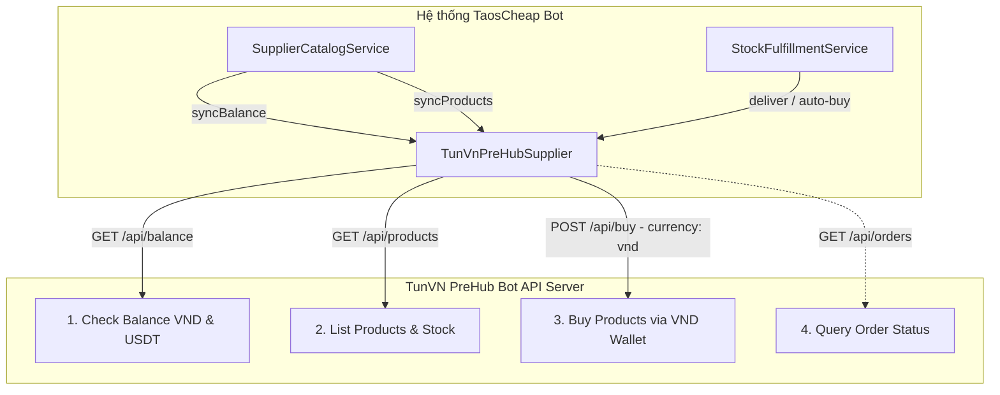

# Kế hoạch Tích hợp Nhà Cung Cấp "@TunVN_PreHub_bot" vào Hệ thống

Tài liệu tham chiếu: [`suppliers/ApiProvidersDocs/Shop Bot API Documentation.pdf`](suppliers/ApiProvidersDocs/Shop%20Bot%20API%20Documentation.pdf:1)

---

## 1. Phân tích Đặc tả Kỹ thuật của @TunVN_PreHub_bot API

### 1.1. Thông tin chung & Cơ chế Xác thực
- **Tên nhà cung cấp (Hiển thị)**: `@TunVN_PreHub_bot`
- **Mã định danh hệ thống (Provider Key)**: `tunvn_prehub`
- **Đơn vị tiền tệ giao dịch**: **`VND`** (khi mua hàng gửi `"currency": "vnd"`, đồng bộ số dư `balance_vnd`).
- **Phạm vi tích hợp**:
  - ✅ Xem danh mục và giá sản phẩm (`GET /api/products`).
  - ✅ Kiểm tra số dư ví VND (`GET /api/balance`).
  - ✅ Xuất kho tự động mua hàng bằng số dư ví VND (`POST /api/buy`).
  - ❌ **Không cần chức năng nạp tiền qua API** (bỏ qua endpoints `/api/deposit` và `/api/deposit/status`).
- **Base URL mặc định**: `https://tunvnmmo.duckdns.org` (có thể ghi đè trong cấu hình local).
- **Phương thức xác thực (Authentication)**:
  - Header HTTP: `X-API-Key: YOUR_API_KEY`
  - Body định dạng: `Content-Type: application/json`
  - Accept: `application/json`
- **Chính sách an toàn & Giới hạn (Limits)**:
  - 5 lần sai API Key liên tiếp trong 60 giây sẽ bị tạm khóa IP.
  - Kích thước payload request tối đa 64KB.
  - Mua hàng tối đa 100 sản phẩm mỗi request (`quantity <= 100`).

---

### 1.2. Danh sách Endpoints và Ánh xạ với Hệ thống



| Tác vụ hệ thống | Phương thức | Endpoint TunVN PreHub | Dữ liệu gửi đi | Dữ liệu phản hồi & Ánh xạ |
|---|---|---|---|---|
| **Kiểm tra số dư** | `GET` | `/api/balance` | Header `X-API-Key` | Trả về `balance_vnd` (chính) và `balance_usdt`. Ánh xạ vào `['VND' => ..., 'USDT' => ...]`. |
| **Đồng bộ sản phẩm & giá** | `GET` | `/api/products` | Header `X-API-Key` | Trả về danh sách sản phẩm. Ánh xạ `code` (ID), `name`, `stock`, `unit_price`, `currency` (`VND`), `max_quantity`. |
| **Xuất kho tự động (Mua hàng)** | `POST` | `/api/buy` | Header `X-API-Key`<br>Body: `{"product_id": ..., "quantity": ..., "currency": "vnd"}` | Trả về `order_id` và danh sách account/key đã giao (`items`). Ánh xạ thành công giao hàng tới khách hàng qua Telegram. |
| **Kiểm tra trạng thái đơn** | `GET` | `/api/orders` | Header `X-API-Key` | Tra cứu lịch sử đơn hàng tại NCC khi cần đối soát. |

*(Lưu ý: Bỏ qua `/api/deposit`, `/api/deposit/status` và `/api/rate` theo yêu cầu nghiệp vụ)*

---

## 2. Kiến trúc Hiện tại và Các Điểm Cần Nâng cấp

### 2.1. Lớp Nhà cung cấp [`TunVnPreHubSupplier`](suppliers/ApiProviders/TunVnPreHubSupplier.php)
- Kế thừa lớp trừu tượng [`BaseApiSupplier`](suppliers/BaseApiSupplier.php:5).
- Triển khai toàn bộ interface [`SupplierInterface`](suppliers/SupplierInterface.php:5):
  - `key()`: Trả về `'tunvn_prehub'`.
  - `name()`: Trả về `'@TunVN_PreHub_bot'`.
  - `requiredConfigKeys()`: Kiểm tra `['base_url', 'api_key']`.
  - `getBalance()`: Bóc tách `balance_vnd` (lưu thành `VND`) và `balance_usdt` (lưu thành `USDT`).
  - `getProducts()`: Chuẩn hoá các trường `product_id`, `name`, `price`, `stock`, tiền tệ `currency` (`VND`).
  - `getStock($remoteCode)`: Lấy tồn kho thực tế của mã sản phẩm tương ứng từ `/api/products`.
  - `deliver($remoteCode, $quantity, $idempotencyKey)`: Gọi `/api/buy` với `currency: "vnd"`, kiểm tra điều kiện `quantity <= 100`, trích xuất các dòng tài khoản / license key trả về cho khách.

### 2.2. Đăng ký Nhà cung cấp vào Hệ thống
- File [`suppliers/SupplierRegistry.php`](suppliers/SupplierRegistry.php:12):
  ```php
  $this->register(new TunVnPreHubSupplier((array) ($config['tunvn_prehub'] ?? [])));
  ```
- File cấu hình mẫu [`config/suppliers.example.php`](config/suppliers.example.php:1):
  Thêm cấu hình mẫu cho `tunvn_prehub`:
  ```php
  'tunvn_prehub' => [
      'enabled' => false,
      'name' => '@TunVN_PreHub_bot',
      'base_url' => 'https://tunvnmmo.duckdns.org',
      'api_key' => '',
      'currency' => 'vnd',
      'connect_timeout' => 5,
      'timeout' => 30,
  ],
  ```

### 2.3. Hỗ trợ Đa tiền tệ cho Tồn kho Khả dụng ([`SupplierCatalogService`](suppliers/SupplierCatalogService.php:103))
- **Hiện trạng**: Phương thức `variantStockMap()` trong [`SupplierCatalogService.php:126`](suppliers/SupplierCatalogService.php:126) đang chỉ truy vấn số dư USDT/USD:
  ```php
  $balanceRows = $this->db->fetchAll("SELECT provider_key,currency,amount FROM supplier_balances WHERE currency IN ('USD','USDT') ORDER BY currency='USDT'");
  ```
- **Nâng cấp**:
  - Mở rộng query để lấy cả số dư `VND`:
    ```php
    $balanceRows = $this->db->fetchAll("SELECT provider_key,currency,amount FROM supplier_balances WHERE currency IN ('USD','USDT','VND')");
    ```
  - Ánh xạ số dư 2 chiều `[$providerKey][$currency]`:
    ```php
    $balances[$providerKey][strtoupper($row['currency'])] = (float) $row['amount'];
    ```
  - Khi tính toán tồn kho khả dụng `effectiveStock($source, $balance)`:
    - Nếu sản phẩm của NCC dùng tiền tệ `VND`: lấy `$balance = $balances[$providerKey]['VND'] ?? 0.0`. Khi đó `floor(balance_vnd / unit_price_vnd)` tính ra đúng số lượng tồn thực có thể mua mà không bị lỗi lệch mệnh giá.
    - Nếu sản phẩm của NCC dùng `USDT`/`USD`: lấy `$balance = $balances[$providerKey]['USDT'] ?? $balances[$providerKey]['USD'] ?? 0.0`.

### 2.4. Trải nghiệm Giao diện Quản trị ([`admin/modules/suppliers.php`](admin/modules/suppliers.php:1))
- Hiển thị linh hoạt số dư theo cả USDT và VND cho từng nhà cung cấp trong bảng balance.
- Hiển thị nhãn tiền tệ VND chuẩn xác cho `@TunVN_PreHub_bot`.

---

## 3. Các Bước Triển khai Chi tiết

### Bước 1: Khởi tạo Lớp [`TunVnPreHubSupplier`](suppliers/ApiProviders/TunVnPreHubSupplier.php)
- Tạo file [`suppliers/ApiProviders/TunVnPreHubSupplier.php`](suppliers/ApiProviders/TunVnPreHubSupplier.php).
- Cài đặt `getBalance()`: Gọi `GET /api/balance`, trích xuất `balance_vnd` và `balance_usdt`.
- Cài đặt `getProducts()`: Gọi `GET /api/products`, chuẩn hoá danh sách sản phẩm với tiền tệ `VND`.
- Cài đặt `deliver()`: Gọi `POST /api/buy` với `currency: "vnd"`, xử lý trích xuất danh sách account / key từ phản hồi.
- Phân loại lỗi HTTP: 429, 5xx đánh dấu `retryable: true`, 4xx (400, 401, 404) đánh dấu `retryable: false`.

### Bước 2: Đăng ký Registry & Cấu hình
- Cập nhật [`suppliers/SupplierRegistry.php`](suppliers/SupplierRegistry.php:1) đăng ký `TunVnPreHubSupplier`.
- Cập nhật [`config/suppliers.example.php`](config/suppliers.example.php:1) với khóa `tunvn_prehub`.

### Bước 3: Nâng cấp [`SupplierCatalogService`](suppliers/SupplierCatalogService.php:1)
- Cập nhật nạp số dư `VND` trong `variantStockMap()` để tính `effectiveStock` chuẩn xác cho nhà cung cấp dùng đơn vị tiền tệ VND.

### Bước 4: Kiểm thử Tự động (Automated Tests)
- Tạo file test [`tests/tunvn_prehub_supplier_test.php`](tests/tunvn_prehub_supplier_test.php):
  - Kiểm tra parse số dư VND và USDT từ `getBalance`.
  - Kiểm tra danh mục sản phẩm từ `getProducts` với đơn vị VND.
  - Kiểm tra logic mua hàng `deliver` qua ví VND với các định dạng trả về (mảng item, key, text).
  - Kiểm tra tính toán tồn kho khả dụng `effectiveStock` với số dư VND.
  - Kiểm tra tính tương thích trong `SupplierRegistry`.

---

## 4. Kế hoạch Kiểm thử & Nghiệm thu

1. **Kiểm tra cú pháp code**: Chạy lint cú pháp PHP `php -l` cho toàn bộ các file mới và sửa đổi.
2. **Chạy test tự động**: Chạy file test PHP để đảm bảo toàn bộ assertion xanh 100%.
3. **Kiểm tra không xung đột**: Đảm bảo các NCC hiện tại (Sandromania, Cuppon'sHub) và kho thủ công tiếp tục hoạt động chuẩn xác 100%.
