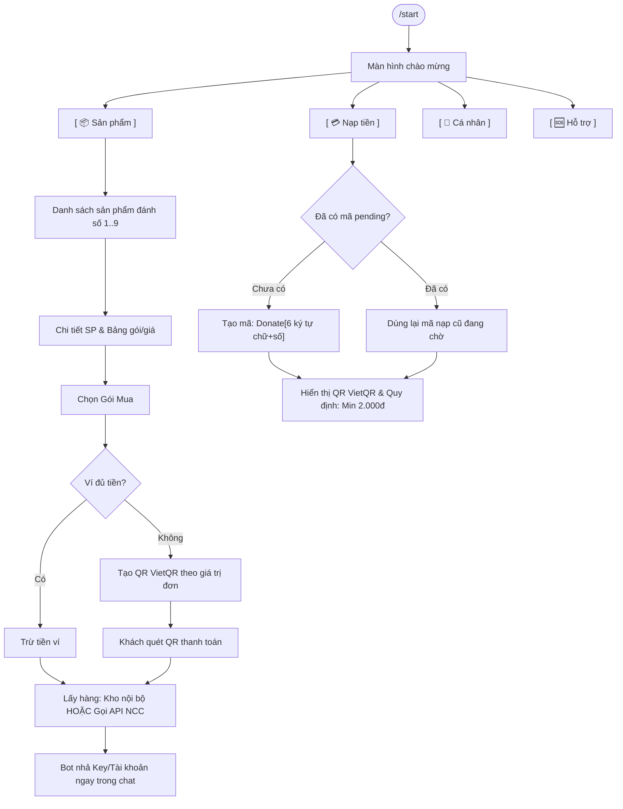

# Kế Hoạch & Thiết Kế Hệ Thống Shop Bot Telegram (cPanel - PHP 8 + MySQL)

## 1. Mục Tiêu & Nguyên Tắc Cốt Lõi
- **Môi trường triển khai**: Hosting cPanel (Apache/LiteSpeed + PHP 8.1/8.2 + MySQL).
- **Cơ chế Telegram**: Webhook HTTPS (nhận request từ Telegram, xử lý, giải phóng RAM ngay, không bị cPanel kill tiến trình).
- **Nguyên tắc cấu trúc**: **Tối đa 3 cấp thư mục**, dạng module độc lập, phân tách rõ ràng.
- **Tiêu chí UI/UX**: Tối giản thao tác, hiển thị trực quan theo ảnh mẫu, câu chữ ngắn gọn, rõ ràng.
- **Quy tắc bảo toàn dữ liệu**: **Không bao giờ xóa data cũ**. Mọi thay đổi cấu trúc bảng trong tương lai đều được quản lý bằng các file patch/migration (`migrations/`), chỉ thêm bảng/cột mới (`IF NOT EXISTS`), bảo đảm an toàn tuyệt đối cho số dư ví, tài khoản và lịch sử đơn hàng.

---

## 2. Luồng Trải Nghiệm Khách Hàng (Tối Giản UI/UX)



### Chi tiết các màn hình:
1. **Màn 1: Lệnh `/start`**
   - Nội dung súc tích: Tên shop, thông điệp ngắn, 3 dòng cam kết (giao dịch an toàn ✅, hỗ trợ nhanh ✅, chất lượng ✅), link liên hệ (@owner, @channel, website).
   - Bàn phím Inline Keyboard 2x2 tối ưu:
     - Hàng 1: `[ 📦 Sản phẩm ]` `[ 💳 Nạp tiền ]`
     - Hàng 2: `[ 👤 Cá nhân ]` `[ 🆘 Hỗ trợ ]`
2. **Màn 2: Danh Sách Sản Phẩm** (Giống Ảnh 2)
   - Nội dung: Đánh số danh sách kèm tồn kho: `1. ChatGPT - 5 sẵn có`, `2. Canva - 0 (Hết)`.
   - Bàn phím: Dãy nút số `[ 1 ] [ 2 ] [ 3 ] [ 4 ] [ 5 ]` + Hàng điều hướng `[ ⬅ Quay lại ] [ 🔄 Làm mới ]`.
3. **Màn 3: Chi Tiết Sản Phẩm & Biến Thể** (Giống Ảnh 3)
   - Nội dung: Tên, mô tả, tính năng nổi bật (gạch đầu dòng), danh sách gói kèm giá & tồn kho.
   - Bàn phím: Nút chọn gói `[ 1. Gói 1 Tháng ]` `[ 2. Gói 3 Tháng ]` + `[ ⬅ Quay lại ] [ 🔄 Làm mới ]`.
4. **Màn 4: Thanh Toán & Giao Hàng Linh Hoạt**
   - **Ví đủ tiền**: Bấm mua -> Trừ số dư ví -> Lấy hàng (kho nội bộ hoặc gọi API) -> Nhả key/account ngay trong tin nhắn bot.
   - **Ví không đủ tiền**: Tự động sinh mã VietQR theo đúng giá trị đơn hàng, nội dung: `Donate[6 ký tự chữ và số]`. Khách quét QR thanh toán xong, hệ thống tự đối soát và nhả key tức thì, không bắt khách phải nạp tiền qua nhiều bước.
5. **Màn 5: Nạp Tiền Vào Ví (Click `[ 💳 Nạp tiền ]`)**
   - Cú pháp quy định: `Donate[random 6 ký tự gồm cả chữ và số]` (Ví dụ: `DonateA8K3P9`, `Donate7X2M9Q`).
   - Quy định nạp: **Số tiền bất kỳ, tối thiểu là 2.000 VNĐ**.
   - **Cơ chế ghi nhớ mã nạp**: Hệ thống kiểm tra trong DB bảng `deposits`, nếu user đã có mã đang chờ xử lý (`pending`), bot giữ nguyên mã đó cho đến khi người dùng thanh toán hoàn tất.
   - Hiển thị mã QR VietQR Napas (cho phép khách tự nhập số tiền tùy ý trên App Ngân hàng >= 2.000đ hoặc chọn các nút bấm gợi ý nhanh: 10k, 20k, 50k, 100k, 200k, 500k).
6. **Màn 6: Hồ Sơ Cá Nhân (Click `[ 👤 Cá nhân ]`)**
   - Xem ID Telegram, Tên, Số dư ví hiện tại, Nút `[ 📜 Lịch sử mua hàng ]` (tra cứu lại tài khoản/key đã mua bất kỳ lúc nào).
7. **Màn 7: Hỗ Trợ (Click `[ 🆘 Hỗ trợ ]`)**
   - Thông tin Admin hỗ trợ, link nhóm bảo hành.

---

## 3. Kiến Trúc Mã Nguồn (Tối Đa 3 Cấp Thư Mục)

```text
taoscheap_bot/                        # [Cấp 1: Root]
├── config/                           # [Cấp 2: Cấu hình hệ thống]
│   ├── app.php                       # Token bot, URL webhook, Secret key, min_deposit = 2000
│   ├── database.php                  # Kết nối MySQL PDO
│   └── bank.php                      # Ngân hàng, số tài khoản, tên chủ thẻ VietQR
├── core/                             # [Cấp 2: Lớp xử lý lõi]
│   ├── Database.php                  # PDO Wrapper an toàn, Prepared Statements
│   ├── Telegram.php                  # Telegram Bot API (sendMessage, editMessage, inline keyboard)
│   ├── VietQR.php                    # Tạo URL mã QR VietQR Napas chuẩn (hỗ trợ số tiền cố định hoặc mở)
│   ├── Language.php                  # Đa ngôn ngữ (i18n: vi mặc định, sẵn sàng mở rộng en)
│   └── Helpers.php                   # Định dạng tiền VND, tạo random 6 ký tự chữ+số (A-Z, 0-9), escape HTML
├── bot/                              # [Cấp 2: Nghiệp vụ Bot Telegram]
│   ├── handlers/                     # [Cấp 3: Các màn hình chức năng]
│   │   ├── StartHandler.php          # /start và menu chính (có nút Nạp tiền)
│   │   ├── ProductHandler.php        # Danh sách SP số & Chi tiết biến thể
│   │   ├── OrderHandler.php          # Tạo đơn hàng, trừ ví / thanh toán QR trực tiếp
│   │   ├── DepositHandler.php        # Nạp tiền: sinh & ghi nhớ mã Donate[chữ+số 6 ký tự], kiểm tra min 2.000đ
│   │   ├── ProfileHandler.php        # Cá nhân, số dư ví, lịch sử đơn
│   │   └── SupportHandler.php        # Màn hình hỗ trợ CSKH
│   └── Router.php                    # Điều hướng callback_data và text command
├── suppliers/                        # [Cấp 2: Module nguồn hàng đa kênh]
│   ├── SupplierInterface.php         # Interface chuẩn: getStock(), deliver()
│   ├── ManualStock.php               # Nguồn 1: Kho nội bộ (nhập key/account trong admin)
│   ├── BaseApiSupplier.php           # Nguồn 2: Khung chuẩn kết nối API nhà cung cấp bên thứ 3
│   └── ApiProviders/                 # [Cấp 3: Driver cụ thể khi khách cung cấp API docs]
│       └── SampleSupplier.php        # Driver mẫu để cắm tài liệu API sau
├── admin/                            # [Cấp 2: Web Quản trị]
│   ├── assets/                       # [Cấp 3: CSS/JS đơn giản]
│   │   └── style.css                 # Giao diện responsive, sạch sẽ
│   ├── modules/                      # [Cấp 3: Các chức năng Admin]
│   │   ├── dashboard.php             # Thống kê doanh thu, đơn hàng, tồn kho
│   │   ├── products.php              # Quản lý Sản phẩm & Biến thể (chọn nguồn Tay/API)
│   │   ├── stocks.php                # Quản lý Kho thủ công (nhập hàng loạt textarea)
│   │   ├── orders.php                # Quản lý Đơn hàng, tra cứu key đã cấp
│   │   ├── deposits.php              # Quản lý & đối soát mã nạp tiền Donate[6 ký tự]
│   │   ├── users.php                 # Quản lý Khách hàng & Cộng/Trừ tiền ví
│   │   └── settings.php              # Cài đặt token bot, thiết lập Webhook 1-click
│   ├── auth.php                      # Đăng nhập bảo mật Web Admin
│   └── index.php                     # Router điều hướng Web Admin
├── migrations/                       # [Cấp 2: Quản lý phiên bản Database an toàn - KHÔNG XÓA DATA]
│   ├── 001_init_schema.sql           # Cấu trúc ban đầu (CREATE TABLE IF NOT EXISTS)
│   └── README.md                     # Nguyên tắc cập nhật bảng an toàn không bao giờ drop table
├── languages/                        # [Cấp 2: Từ điển đa ngôn ngữ]
│   ├── vi.php                        # Tiếng Việt (mặc định)
│   └── en.php                        # Tiếng Anh (sẵn sàng khi cần mở rộng)
├── webhook.php                       # [Cấp 1: Điểm nhận Webhook Telegram]
├── payment_webhook.php               # [Cấp 1: Webhook nhận biến động số dư ngân hàng tự động (SePay/PayOS/Casso)]
├── index.php                         # [Cấp 1: Trang chủ / Redirect Admin]
├── .htaccess                         # [Cấp 1: Bảo mật và chuyển hướng HTTPS trên cPanel]
└── install.sql                       # [Cấp 1: File khởi tạo DB 1-click ban đầu]
```

---

## 4. Thiết Kế Cơ Sở Dữ Liệu & Quy Tắc Bảo Toàn Dữ Liệu

### Cấu trúc bảng (khởi tạo bằng `CREATE TABLE IF NOT EXISTS`):
1. `users`:
   - `id`, `telegram_id` (BIGINT, UNIQUE), `username`, `first_name`, `balance` (DECIMAL 15,2 DEFAULT 0), `language`, `created_at`.
2. `products`:
   - `id`, `name`, `description`, `features` (TEXT), `sort_order`, `status` (TINYINT), `created_at`.
3. `variants`:
   - `id`, `product_id`, `name`, `price` (DECIMAL 15,2), `supplier_type` ('manual', 'api'), `provider_code` (VARCHAR 100), `sort_order`, `status`, `created_at`.
4. `stocks` (Kho key thủ công):
   - `id`, `variant_id`, `content` (TEXT), `is_sold` (TINYINT 0/1 DEFAULT 0), `order_id`, `created_at`, `sold_at`.
5. `orders`:
   - `id`, `order_code` (VARCHAR 50), `user_id`, `variant_id`, `amount`, `payment_method` ('wallet', 'vietqr_direct'), `stock_content` (TEXT), `status` ('completed', 'pending', 'failed'), `created_at`.
6. `deposits` (Quản lý nạp tiền & mã chuyển khoản):
   - `id`, `user_id`, `code` (VARCHAR 30, ví dụ `DonateA8K3P9`), `amount` (DECIMAL 15,2 DEFAULT 0), `status` ('pending', 'completed'), `created_at`, `completed_at`.
   - **Cơ chế ghi nhớ & Min 2.000đ**:
     - Khi user click nạp tiền: Tìm bản ghi `deposits` có `user_id` và `status = 'pending'`. Nếu có -> Tái sử dụng mã cũ. Nếu chưa -> Sinh ngẫu nhiên mã mới dạng `Donate` + 6 ký tự `[A-Z0-9]` (ví dụ `DonateB3K9T1`) và lưu lại.
     - Khi nhận webhook ngân hàng: Quét nội dung chuyển khoản chứa mã này -> Kiểm tra số tiền chuyển >= 2.000 VNĐ -> Cộng tiền vào số dư `users.balance` -> Đổi `deposits.status = 'completed'` -> Bot gửi thông báo nạp thành công kèm số dư mới cho khách.
7. `settings`:
   - `key_name` (VARCHAR, PRIMARY), `key_value` (TEXT).

### Quy định cập nhật dữ liệu (Migration Policy):
- **Tuyệt đối không sử dụng `DROP TABLE`** trong các bản cập nhật.
- Mọi bản nâng cấp sau này sẽ được tạo thành file riêng trong thư mục `migrations/` (ví dụ `002_add_provider_config.sql`) sử dụng `ALTER TABLE ... ADD COLUMN IF NOT EXISTS` để bảo toàn nguyên vẹn 100% dữ liệu đơn hàng và số dư của khách hàng.

---

## 5. Thiết Kế Module Nguồn Hàng Mở Rộng (Suppliers Module)
- Áp dụng mẫu thiết kế **Strategy Pattern**:
  - `SupplierInterface.php`:
    - `public function getStock(int $variantId): int;` (kiểm tra số lượng còn lại)
    - `public function deliver(int $variantId, array $orderContext): array;` (lấy tài khoản/key giao cho khách)
  - `ManualStock.php`:
    - Đọc từ bảng `stocks` nội bộ -> Lấy 1 bản ghi `is_sold = 0` -> Đánh dấu `is_sold = 1` -> Trả về kết quả giao ngay.
  - `BaseApiSupplier.php`:
    - Khung cơ sở hỗ trợ cURL, headers, timeout, log lỗi.
    - Sẵn sàng tích hợp API docs cụ thể từ các nhà cung cấp thứ 3 mà bạn sẽ cung cấp sau, đảm bảo cắm vào là chạy mà không làm thay đổi luồng Bot hay Database.

---

## 6. Web Admin Panel Tối Giản Cho cPanel
1. **Đăng nhập & Bảo mật**: Session PHP, mật khẩu bảo mật BCrypt.
2. **Dashboard**: Thống kê doanh thu hôm nay, tổng doanh thu, số đơn hoàn thành, số lượng khách bot, cảnh báo sản phẩm hết hàng.
3. **Quản lý Sản phẩm & Biến thể**: Thêm, sửa, xóa, bật/tắt hiển thị, sắp xếp thứ tự hiển thị trên Bot, chọn nguồn hàng (Tay / API).
4. **Quản lý Kho thủ công (Stocks)**: Nhập nhanh hàng loạt tài khoản vào ô textarea (mỗi dòng 1 key/tài khoản).
5. **Quản lý Đơn hàng & Nạp tiền (Deposits)**: Tra cứu lịch sử nạp tiền, đối soát mã `Donate[6 ký tự]`, duyệt nạp thủ công nếu khách chuyển sai cú pháp.
6. **Quản lý Khách hàng & Ví**: Xem danh sách ID Telegram, số dư, hỗ trợ cộng/trừ tiền thủ công.
7. **Cài đặt Hệ thống**: Cấu hình Token Telegram, 1-Click Set Webhook, chỉnh sửa thông tin giới thiệu shop trên màn hình `/start`.
