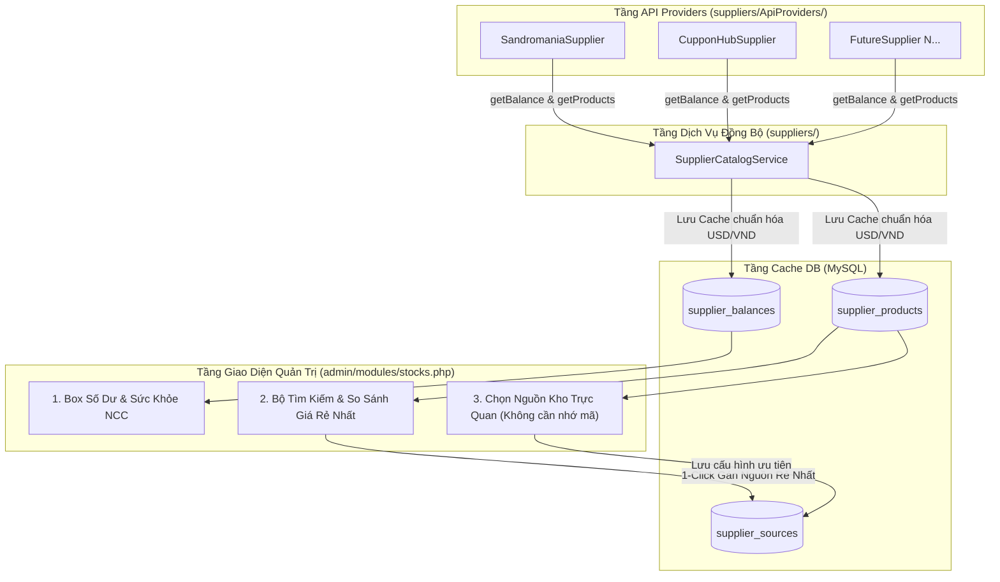

# Kế Hoạch Kiến Trúc & Tính Năng: Quản Lý Danh Mục API Providers, Số Dư, Chọn Sản Phẩm Trực Quan & Tìm Nguồn Giá Rẻ Nhất

## 1. Đánh Giá Hiện Trạng (`suppliers/` & `admin/modules/stocks.php`)

Qua kiểm tra mã nguồn hiện tại của dự án, hệ thống đã có nền tảng `SupplierInterface`, `BaseApiSupplier`, `SupplierRegistry`, `StockFulfillmentService` (xuất hàng theo `supplier_sources`) cùng 2 provider: **Sandromania** và **Cuppon'sHub**. Tuy nhiên đang tồn tại **4 khoảng trống lớn về vận hành**:

1. **Chưa hiển thị số dư & trạng thái kết nối nhà cung cấp**:
   - [`SandromaniaSupplier::getBalance()`](suppliers/ApiProviders/SandromaniaSupplier.php:12) trả về `RUB` + `USD`, [`CupponHubSupplier::getBalance()`](suppliers/ApiProviders/CupponHubSupplier.php:12) trả về `USDT`, nhưng chưa được gọi hay hiển thị ở bất kỳ đâu trên Admin. Admin không biết khi nào ví đối tác sắp hết tiền.
2. **Chưa lấy được danh sách sản phẩm (`getProducts`) từ nhà cung cấp**:
   - Cả 2 API đều trả về danh mục đầy đủ (tên, mã, giá, tồn kho, giá sỉ) qua `GET /api/v1/products` và `GET ?action=products`, nhưng `SupplierInterface` hiện chỉ có `getStock(string $remoteProductCode)` — gọi toàn bộ danh sách sản phẩm rồi bỏ đi mọi thông tin khác ngoài `stock` của 1 mã.
3. **Chọn nguồn cho kho phải tự nhớ mã sản phẩm (`remote_product_code`)**:
   - Tại [`admin/modules/stocks.php`](admin/modules/stocks.php:191), Admin đang phải gõ tay vào `<input name="primary_code">` và `<input name="backup_code">` mà không biết mã đó tên gì, giá nhập bao nhiêu hay còn bao nhiêu hàng.
4. **Chưa có công cụ tìm kiếm & so sánh giá đa nhà cung cấp**:
   - Khi mở rộng lên 3, 5, 10+ nhà cung cấp, việc mở từng tài liệu/trang web đối tác để dò giá sẽ rất mất thời gian và dễ chọn nhầm nguồn giá cao làm giảm biên lợi nhuận.

---

## 2. Kiến Trúc Tổng Thể Giải Pháp Đề Xuất

Để hệ thống **nhanh (không bị treo trang Admin khi nhiều API chậm)**, **dễ mở rộng (thêm N nhà cung cấp không sửa giao diện)** và **chuẩn Clean Architecture (tối đa 3 tầng thư mục)**, giải pháp gồm 4 trụ cột:



### Tại sao dùng bảng Cache DB (`supplier_products` & `supplier_balances`) kết hợp nút Đồng Bộ?
- Nếu gọi trực tiếp API của 5–10 nhà cung cấp mỗi lần tải trang `stocks.php`, trang web sẽ mất 5–15 giây để tải hoặc lỗi nếu 1 nhà cung cấp bị timeout.
- Lưu danh mục & số dư vào bảng cache trong MySQL giúp:
  1. **Tải trang Admin tức thì (`< 50ms`)**.
  2. **Tìm kiếm, lọc và sắp xếp giá rẻ nhất bằng SQL + JS cực nhanh** trên hàng ngàn sản phẩm của mọi nhà cung cấp.
  3. Cập nhật chủ động bất cứ lúc nào bằng nút **"🔄 Đồng bộ NCC"** (hoặc tự động làm mới nền khi dữ liệu cũ hơn 10 phút).

---

## 3. Chi Tiết Thiết Kế Kỹ Thuật

### 3.1. Mở rộng `SupplierInterface` & Chuẩn hóa Dữ liệu Sản phẩm
Cập nhật [`suppliers/SupplierInterface.php`](suppliers/SupplierInterface.php:5) bổ sung 2 phương thức chuẩn hóa:

```php
interface SupplierInterface
{
    public function key(): string;
    public function name(): string;
    public function isEnabled(): bool;

    /** @return array<string, int|float|string> */
    public function getBalance(): array;

    /**
     * Trả về danh sách sản phẩm chuẩn hóa từ nhà cung cấp.
     *
     * @return list<array{
     *     remote_code: string,
     *     name: string,
     *     price_usd: float,
     *     price_raw: string,
     *     currency: string,
     *     stock: int,
     *     available: bool,
     *     bulk_prices?: string|null
     * }>
     */
    public function getProducts(): array;

    public function getStock(string $remoteProductCode): int;

    public function deliver(string $remoteProductCode, int $quantity, string $idempotencyKey): array;
}
```

- **Quy chuẩn hóa giá (`price_usd`) để so sánh đa nhà cung cấp**:
  - **Sandromania**: Lấy `price_usd` trực tiếp từ API (`5.5`), `price_raw` hiển thị `"5.50 USD (430 RUB)"`, `remote_code` là `(string) $product['id']`, `name` là `$product['title']`.
  - **Cuppon'sHub**: Lấy giá `USDT` làm `price_usd` (`1 USDT ≈ 1 USD`), `price_raw` hiển thị `"5.20 USDT"`, `remote_code` là `(string) $product['key']`, `name` là `$product['name'] ?? $product['title']`.
  - **Nhà cung cấp tương lai (VND/RUB/EUR)**: Có thể khai báo tỷ giá quy đổi `exchange_rate_to_usd` ngay trong `config/suppliers.local.php` để mọi sản phẩm đều quy về mặt bằng chung `price_usd` và `price_vnd_est` (Giá VND ước tính).

---

### 3.2. Database Migration (`migrations/012_supplier_catalog_and_balances.sql`)
Tạo 2 bảng lưu trữ trạng thái số dư và danh mục sản phẩm của toàn bộ nhà cung cấp:

```sql
CREATE TABLE IF NOT EXISTS supplier_balances (
    provider_key VARCHAR(50) NOT NULL,
    provider_name VARCHAR(100) NOT NULL,
    balance_usd DECIMAL(15,4) NULL,
    balance_text VARCHAR(255) NOT NULL DEFAULT '',
    status ENUM('ok', 'error', 'unconfigured') NOT NULL DEFAULT 'unconfigured',
    error_message VARCHAR(255) NULL,
    synced_at DATETIME NULL,
    updated_at DATETIME NOT NULL DEFAULT CURRENT_TIMESTAMP ON UPDATE CURRENT_TIMESTAMP,
    PRIMARY KEY (provider_key)
) ENGINE=InnoDB DEFAULT CHARSET=utf8mb4 COLLATE=utf8mb4_unicode_ci;

CREATE TABLE IF NOT EXISTS supplier_products (
    id BIGINT UNSIGNED NOT NULL AUTO_INCREMENT,
    provider_key VARCHAR(50) NOT NULL,
    remote_product_code VARCHAR(100) NOT NULL,
    name VARCHAR(255) NOT NULL,
    price_usd DECIMAL(15,4) NOT NULL DEFAULT 0.0000,
    price_raw VARCHAR(100) NOT NULL DEFAULT '',
    currency VARCHAR(20) NOT NULL DEFAULT 'USD',
    stock INT NOT NULL DEFAULT 0,
    is_available TINYINT(1) NOT NULL DEFAULT 1,
    bulk_prices VARCHAR(255) NULL,
    synced_at DATETIME NOT NULL DEFAULT CURRENT_TIMESTAMP,
    PRIMARY KEY (id),
    UNIQUE KEY uq_supplier_product (provider_key, remote_product_code),
    INDEX idx_supplier_search (name),
    INDEX idx_supplier_price (is_available, stock, price_usd)
) ENGINE=InnoDB DEFAULT CHARSET=utf8mb4 COLLATE=utf8mb4_unicode_ci;
```

---

### 3.3. Dịch Vụ Đồng Bộ & So Sánh Giá (`suppliers/SupplierCatalogService.php`)
Đặt tại tầng `suppliers/` (tuân thủ giới hạn 3 tầng thư mục):
- **`syncAll(?string $onlyProviderKey = null): array`**:
  - Duyệt qua các provider trong `SupplierRegistry`.
  - Nếu chưa bật/chưa điền key -> cập nhật `status = 'unconfigured'`.
  - Nếu đã bật -> gọi `getBalance()` và `getProducts()`. Bắt ngoại lệ (`Throwable`) từng provider độc lập để **1 nhà cung cấp lỗi không làm hỏng việc đồng bộ các nhà cung cấp khác**.
  - Lưu vào `supplier_balances` và `UPSERT` vào `supplier_products`.
- **`searchAndCompare(string $keyword = '', string $providerKey = '', bool $onlyInStock = false, string $sort = 'price_asc'): array`**:
  - Truy vấn danh sách sản phẩm từ `supplier_products`.
  - Tự động đánh dấu sản phẩm có `price_usd` thấp nhất (và `stock > 0`) bằng cờ `is_cheapest = true` để UI gắn nhãn **🏆 Rẻ nhất**.

---

### 3.4. Thiết Kế Giao Diện Quản Trị Tại `admin/modules/stocks.php`

Trang **Kho hàng (`stocks.php`)** sẽ được nâng cấp thành trung tâm điều phối nguồn hàng thông minh với 3 khu vực mới cực kỳ gọn gàng, tuân thủ nghiêm ngặt quy chuẩn UI/UX trong `AGENTS.md`:

#### Khu vực 1: Bảng Giám Sát Số Dư & Trạng Thái Nhà Cung Cấp (Supplier Balance Cards)
- Hiển thị dạng lưới (`.grid`) ở đầu trang `stocks.php` kèm nút **"🔄 Đồng bộ số dư & danh mục NCC"** trên `.toolbar`:
  - Mỗi thẻ hiển thị:
    - Tên NCC (`Sandromania`, `Cuppon'sHub`...) + Badge trạng thái (`Hoạt động` xanh / `Lỗi API` đỏ / `Chưa cấu hình` xám).
    - **Số dư hiện tại**: VD `$64.14 (5,000 RUB)` hoặc `120.50 USDT`. Cảnh báo màu đỏ nếu số dư `< $5`.
    - **Tổng SP đang còn hàng**: VD `38/45 sản phẩm còn hàng`.
    - Thời gian cập nhật gần nhất (`Vừa xong` / `5 phút trước`).

#### Khu vực 2: Chọn Nguồn Cho Kho Không Cần Nhớ Mã (Smart Product Selector)
- Tại bảng **Cấu hình nguồn hàng**:
  - Thay vì ô `<input name="primary_code">` trống trơn:
    - Khi Admin chọn **Nhà cung cấp chính** (VD: `Sandromania`), ô chọn sản phẩm bên cạnh sẽ tự động nạp danh sách sản phẩm của `Sandromania` dưới dạng **Combobox có ô tìm kiếm nhanh (Searchable Picker)** hoặc `<select>` hiển thị đầy đủ:
      `[1021] ChatGPT Plus 1m CDK — $5.50 (Tồn: 15)`
    - Tương tự cho **Nhà cung cấp dự phòng**.
    - Vẫn cho phép nhập mã thủ công nếu sản phẩm mới chưa kịp đồng bộ.
  - **Hiển thị thông tin đối chiếu ngay trên dòng sản phẩm**:
    - Hiển thị giá bán lẻ của Shop bên cạnh giá vốn của Nguồn Chính & Nguồn Dự Phòng để Admin nhìn thấy ngay biên lợi nhuận và tồn kho thực tế của từng nguồn.
    - Nút **"🔍 Tìm nguồn rẻ nhất"** ngay tại mỗi dòng sản phẩm của Shop: Bấm vào sẽ tự động lọc bảng so sánh bên dưới theo tên sản phẩm đó!

#### Khu vực 3: Công Cụ Tìm Kiếm, So Sánh Giá & Gán Nhanh Nguồn Rẻ Nhất (Multi-Supplier Price Finder)
- Đặt trong một Card có thể tìm kiếm tức thì (hỗ trợ cả lọc trực tiếp bằng JS không cần tải lại trang + lọc server-side):
  - **Thanh công cụ (`.toolbar`)**:
    - Ô tìm kiếm từ khóa: VD gõ `"chatgpt"`, `"netflix"`, `"1m"`, `"capcut"`...
    - Lọc theo NCC: `Tất cả NCC` | `Sandromania` | `Cuppon'sHub`...
    - Sắp xếp: `Giá rẻ nhất trước (↑)` | `Giá cao nhất (↓)` | `Tồn kho nhiều nhất (↓)`.
    - Checkbox `.inline-check`: `Chỉ hiện SP còn hàng (stock > 0)`.
  - **Bảng kết quả so sánh**:
    | Nhà cung cấp | Mã SP | Tên sản phẩm tại NCC | Giá gốc | Giá quy đổi (USD) | Tồn kho | Đánh giá | Gán nhanh vào Kho Shop |
    | :--- | :--- | :--- | :--- | :--- | :--- | :--- | :--- |
    | **Cuppon'sHub** | `cgpt_1m` | ChatGPT Plus 1 Month | `5.10 USDT` | **$5.10** | `42` | 🏆 **Rẻ nhất** | `[Chọn SP Shop ▾] [Đặt làm Chính] [Đặt làm Phụ]` |
    | **Sandromania** | `1021` | ChatGPT plus 1m CDK | `5.50 USD (430 RUB)` | **$5.50** | `3` | `+$0.40 (+7.8%)` | `[Chọn SP Shop ▾] [Đặt làm Chính] [Đặt làm Phụ]` |
  - **Thao tác 1-Click**:
    - Admin chỉ cần gõ tên mặt hàng cần nhập -> Nhìn thấy ngay nhà cung cấp nào có nhãn **🏆 Rẻ nhất** và còn nhiều tồn kho -> Chọn sản phẩm của Shop ở dropdown và bấm **"Đặt làm Chính"** (hoặc bấm **"Đặt làm Phụ"** cho nhà cung cấp rẻ thứ 2).

---

## 4. Ý Tưởng Chuyên Gia Bổ Sung (Tối Ưu Vận Hành Lâu Dài)

1. **Tự động phát hiện lệch giá / lỗ vốn (Margin Warning)**:
   - Cho phép cấu hình tỷ giá ước tính `usd_to_vnd_rate` (mặc định `25500`) trong cài đặt hoặc `config/suppliers.local.php`.
   - Nếu giá nhập API quy đổi ra VND cao hơn hoặc sát giá bán lẻ của sản phẩm trên Shop, hệ thống hiển thị cảnh báo **`⚠️ Giá vốn cao hơn giá bán`** ngay tại trang Kho hàng để Admin kịp thời điều chỉnh giá bán hoặc đổi nhà cung cấp.
2. **Nút "Tự động tối ưu Thứ tự Chính / Dự phòng theo giá" (Auto-Optimize Priority)**:
   - Khi một sản phẩm đã được cấu hình 2 nguồn API (Chính và Dự phòng), nếu sau khi đồng bộ phát hiện **Nguồn Dự phòng đang có giá rẻ hơn Nguồn Chính và còn hàng**, hệ thống hiển thị gợi ý **"💡 Nguồn dự phòng đang rẻ hơn $0.40 — Đổi lên làm nguồn chính"** chỉ với 1 cú nhấp chuột.
3. **Kiểm tra tồn kho thực tế từ Cache kết hợp Fallback**:
   - Tại `ProductHandler.php` (Telegram Bot), hiện tại nếu sản phẩm có bật API thì tồn kho hiển thị cứng là `100`. Khi có bảng `supplier_products`, Bot có thể hiển thị **tổng tồn kho thực tế** (`Kho tay + Tồn kho API Chính + Tồn kho API Dự phòng`) giúp khách hàng thấy số lượng chính xác, và tự động báo hết hàng nếu cả kho tay lẫn các API đều về `0`!

---

## 5. Lộ Trình Triển Khai (Step-by-Step Implementation Plan)

1. **Bước 1 — Nâng cấp Tầng Suppliers (`suppliers/`)**:
   - Cập nhật [`suppliers/SupplierInterface.php`](suppliers/SupplierInterface.php) và [`suppliers/BaseApiSupplier.php`](suppliers/BaseApiSupplier.php) thêm `isEnabled()` và `getProducts()`.
   - Triển khai `getProducts()` chuẩn hóa cho [`SandromaniaSupplier.php`](suppliers/ApiProviders/SandromaniaSupplier.php) và [`CupponHubSupplier.php`](suppliers/ApiProviders/CupponHubSupplier.php).
   - Tạo [`suppliers/SupplierCatalogService.php`](suppliers/SupplierCatalogService.php) xử lý đồng bộ số dư, danh mục sản phẩm và thuật toán so sánh giá.
2. **Bước 2 — Tạo Migration Cache (`migrations/012_supplier_catalog_and_balances.sql`)**:
   - Tạo bảng `supplier_balances` và `supplier_products`.
3. **Bước 3 — Nâng cấp Giao diện Quản lý Kho (`admin/modules/stocks.php` & `admin/assets/style.css`)**:
   - Thêm khu vực hiển thị **Số dư & Trạng thái Nhà cung cấp** + Nút đồng bộ.
   - Nâng cấp bảng **Cấu hình nguồn hàng** với bộ chọn sản phẩm trực quan theo từng nhà cung cấp (hiển thị tên + mã + giá + tồn kho, có tìm kiếm nhanh, không cần nhớ mã).
   - Thêm khu vực **Tra cứu & So sánh giá đa nhà cung cấp** với nhãn **🏆 Rẻ nhất** và nút gán nhanh vào nguồn Chính / Dự phòng.
   - Đảm bảo 100% quy chuẩn CSS trong `AGENTS.md` (chiều cao control 36px đồng nhất, flexbox/grid căn thẳng hàng, responsive mobile).
4. **Bước 4 — Kiểm thử đối soát (Verification & Tests)**:
   - Viết unit/integration test kiểm tra normalize `getProducts()`, `getBalance()`, thuật toán tìm nhà cung cấp rẻ nhất và giao diện responsive trên desktop/mobile.

