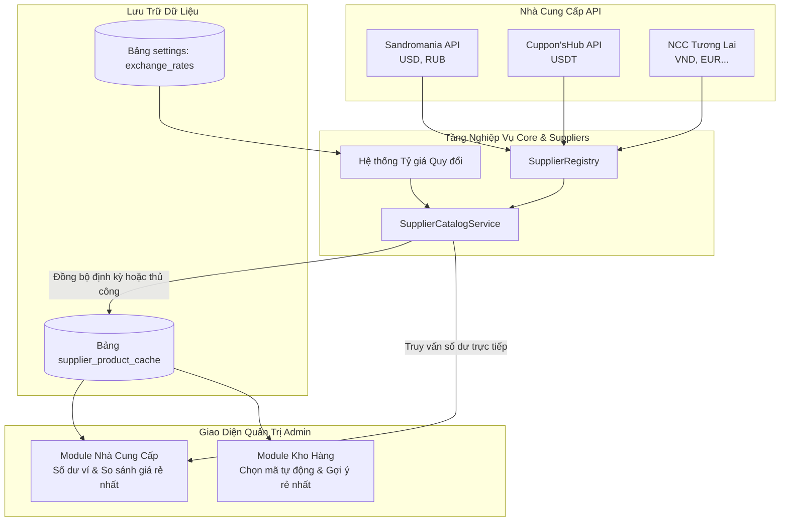

# Kế hoạch Thiết kế & Nâng cấp Hệ thống ApiProviders: Quản lý Số dư, Danh mục Sản phẩm và Tìm kiếm NCC Giá rẻ nhất

## 1. Bối cảnh & Mục tiêu

Hệ thống bot bán hàng tự động hiện đã hỗ trợ kiến trúc phân luồng nguồn hàng đa kênh qua [`suppliers/StockFulfillmentService.php`](suppliers/StockFulfillmentService.php:1) với các nhà cung cấp như [`suppliers/ApiProviders/SandromaniaSupplier.php`](suppliers/ApiProviders/SandromaniaSupplier.php:1) và [`suppliers/ApiProviders/CupponHubSupplier.php`](suppliers/ApiProviders/CupponHubSupplier.php:1). 

Tuy nhiên, việc vận hành thực tế đang gặp các hạn chế lớn:
1. **Thiếu thông tin số dư (Balance Visibility)**: Mặc dù code đã có hàm `getBalance()`, Admin chưa có giao diện trực quan để xem số dư ví tại từng nhà cung cấp (RUB, USD, USDT), dẫn đến nguy cơ hết tiền bất ngờ và đơn hàng bị lỗi (HTTP 402).
2. **Bất tiện khi cấu hình kho (Source Mapping Pain)**: Khi gắn nguồn cho kho tại [`admin/modules/stocks.php`](admin/modules/stocks.php:1), quản trị viên phải mở tài liệu hoặc gọi API ngoài để tra cứu và gõ tay mã sản phẩm (`remote_product_code`).
3. **Thiếu công cụ tìm kiếm và so sánh giá rẻ nhất (Best Price Comparison)**: Các nhà cung cấp dùng đơn vị tiền tệ khác nhau (USD, USDT, RUB). Khi số lượng nhà cung cấp tăng lên (3, 5, 10+ NCC), việc xác định nhà cung cấp nào có giá thấp nhất cho cùng một loại sản phẩm (ví dụ: ChatGPT, Gemini, Netflix, Canva...) trở nên phức tạp và tốn thời gian.

Mục tiêu của kế hoạch là chuẩn hóa toàn bộ luồng tích hợp nhà cung cấp, mang lại trải nghiệm quản trị thông minh, tự động và tối ưu hóa lợi nhuận.

---

## 2. Kiến trúc Hệ thống & Luồng Dữ liệu



---

## 3. Thiết kế Kỹ thuật Chi tiết

### 3.1. Chuẩn hóa Interface & Adapter
Cập nhật [`suppliers/SupplierInterface.php`](suppliers/SupplierInterface.php:1) để chuẩn hóa định dạng trả về danh mục sản phẩm:

```php
interface SupplierInterface
{
    public function key(): string;
    public function name(): string;
    public function isAvailable(): bool;

    /** @return array<string, int|float|string> */
    public function getBalance(): array;

    public function getStock(string $remoteProductCode): int;

    /**
     * Lấy danh mục sản phẩm chuẩn hoá từ nhà cung cấp
     * @return list<array{
     *     id: string,
     *     name: string,
     *     stock: int,
     *     price: float,
     *     currency: string,
     *     available: bool,
     *     raw?: array<string, mixed>
     * }>
     */
    public function getProducts(): array;

    public function deliver(
        string $remoteProductCode,
        int $quantity,
        string $idempotencyKey
    ): array;
}
```

- **Sandromania Adapter** ([`suppliers/ApiProviders/SandromaniaSupplier.php`](suppliers/ApiProviders/SandromaniaSupplier.php:1)):
  - Gọi `GET /api/v1/products`
  - Chuẩn hóa trường: `id` = `(string) $product['id']`, `name` = `$product['title']`, `stock` = `$product['stock']`, `price` = `(float) $product['price_usd']`, `currency` = `'USD'`, `available` = `$product['available']`.
- **Cuppon'sHub Adapter** ([`suppliers/ApiProviders/CupponHubSupplier.php`](suppliers/ApiProviders/CupponHubSupplier.php:1)):
  - Gọi `GET ?action=products`
  - Chuẩn hóa trường: `id` = `(string) $product['key']`, `name` = `$product['name']`, `stock` = `$product['stock']`, `price` = `(float) $product['price_usdt_from']`, `currency` = `'USDT'`, `available` = `$product['stock'] > 0`.
- **Sample Adapter Template** ([`suppliers/ApiProviders/SampleSupplier.php`](suppliers/ApiProviders/SampleSupplier.php:1)):
  - Cập nhật đầy đủ các phương thức mẫu để dễ dàng nhân bản cho NCC thứ 3, 4 trong tương lai.

### 3.2. Cơ sở Dữ liệu & Bảng Cache Danh mục (`supplier_product_cache`)
Tạo migration mới `migrations/012_supplier_product_cache.sql`:
- Lưu trữ danh mục sản phẩm từ các NCC sau khi được đồng bộ.
- Lưu cả giá gốc ngoại tệ (`price`, `currency`) và giá quy đổi (`price_vnd`) để phục vụ sắp xếp `ORDER BY price_vnd ASC`.
- Thiết lập Unique key `(provider_key, remote_product_code)` để `INSERT ... ON DUPLICATE KEY UPDATE`.
- Tránh việc gọi API cURL liên tục mỗi khi admin mở trang, loại bỏ nguy cơ dính rate limit (ví dụ CupponHub giới hạn 60 req/min).

### 3.3. Dịch vụ Nghiệp vụ `SupplierCatalogService`
Tạo file [`suppliers/SupplierCatalogService.php`](suppliers/SupplierCatalogService.php:1):
- `syncAllCatalogs(): array`: Duyệt qua các NCC đang kích hoạt, lấy danh mục, quy đổi giá theo tỷ giá hiện tại và lưu vào DB cache.
- `getBalances(): array`: Thu thập số dư từ tất cả NCC, xử lý lỗi từng NCC độc lập (nếu 1 bên timeout thì bên khác vẫn hiển thị).
- `searchAndCompare(string $keyword, array $filters = []): array`:
  - Tìm kiếm sản phẩm theo từ khóa trên toàn bộ các NCC.
  - Sắp xếp tăng dần theo giá quy đổi (`price_vnd`).
  - Gắn nhãn `is_cheapest = true` cho sản phẩm có giá thấp nhất còn hàng (`stock > 0`).
- `getProductsByProvider(string $providerKey): array`: Lấy danh sách sản phẩm nhanh của 1 NCC để phục vụ dropdown/autocomplete trong màn hình kho.
- `suggestBestSources(string $productName): array`: Phân tích tên sản phẩm shop, tìm các sản phẩm tương ứng từ các NCC, tự động chỉ định:
  - Nguồn chính (Primary): NCC có giá rẻ nhất còn hàng.
  - Nguồn dự phòng (Backup): NCC có giá rẻ thứ hai còn hàng.

### 3.4. Hệ thống Tỷ giá Quy đổi (Currency Normalization)
Lưu cấu hình tỷ giá trong bảng `settings`:
- `exchange_rate_usd`: Mặc định `25500` (1 USD = 25,500 VND)
- `exchange_rate_usdt`: Mặc định `25500` (1 USDT = 25,500 VND)
- `exchange_rate_rub`: Mặc định `280` (1 RUB = 280 VND)
Admin có thể xem và chỉnh sửa tỷ giá trực tiếp trên giao diện để việc so sánh giá luôn phản ánh sát thị trường.

---

## 4. Thiết kế Giao diện UI/UX Quản trị

Tuân thủ nghiêm ngặt chuẩn thiết kế trong [`AGENTS.md`](AGENTS.md:1) (đồng bộ control, box-sizing, i18n, responsive).

### 4.1. Module Mới: Quản lý Nhà Cung Cấp (`admin/modules/suppliers.php`)
Bổ sung mục **"Nhà cung cấp"** vào menu sidebar [`admin/index.php`](admin/index.php:48):
1. **Khu vực 1: Tình trạng ví & Số dư nhà cung cấp (Balance & Health Cards)**:
   - Hiển thị theo dạng Grid card hiện đại.
   - Thẻ hiển thị: Tên NCC, Huy hiệu trạng thái (Đang kết nối / Chưa bật / Lỗi), Số dư chi tiết theo từng loại tiền tệ (USD, USDT, RUB).
   - Nút "Làm mới số dư": Gọi kiểm tra lại ngay tức thì.
   - Cảnh báo trực quan (đổi màu badge sang vàng/đỏ) khi số dư thấp.
2. **Khu vực 2: Công cụ Tra cứu & So sánh Giá rẻ nhất (Best Price Finder)**:
   - Thanh tìm kiếm: Ô nhập từ khóa (ví dụ: `chatgpt`, `canva`, `gemini`), bộ lọc "Chỉ xem hàng còn trong kho", nút "Tìm kiếm".
   - Nút "Đồng bộ danh mục NCC" (Sync All): Có nhãn thời gian đồng bộ lần cuối (ví dụ: *Đồng bộ lúc 10:15*).
   - Bảng kết quả so sánh thông minh:
     - Cột: Nhà cung cấp | Mã sản phẩm | Tên sản phẩm NCC | Tồn kho | Giá gốc | Giá quy đổi VND | Đánh giá | Thao tác.
     - Dòng có giá rẻ nhất còn hàng sẽ có huy hiệu xanh lá nổi bật: **⚡ RẺ NHẤT (BEST PRICE)**.
     - Nút "Sao chép mã" hoặc "Gán nhanh vào sản phẩm shop".
3. **Khu vực 3: Bảng Tỷ giá Quy đổi tham chiếu**:
   - Form chỉnh sửa tỷ giá USD, USDT, RUB nhanh chóng.

### 4.2. Cải tiến Màn hình Kho Hàng (`admin/modules/stocks.php`)
Giải quyết triệt để yêu cầu *"chọn nguồn cho kho mà không cần phải nhớ mã sản phẩm"*:
- **Gợi ý tự động qua `<datalist>`**:
  - Khi quản trị viên chọn nhà cung cấp ở dropdown `primary_provider` hoặc `backup_provider`, ô nhập mã sản phẩm được liên kết với danh sách sản phẩm tương ứng của NCC đó.
  - Khi gõ phím, hệ thống tự động gợi ý danh sách kèm tên, tồn kho và giá (ví dụ: `1021 — ChatGPT plus 1m CDK (Kho: 3, Giá: $5.5)`).
  - Khi bấm chọn, mã sản phẩm tự động được điền vào ô mà không cần nhớ hay copy.
- **Nút "⚡ Chọn NCC rẻ nhất" (Smart Auto-Pick)**:
  - Bên cạnh mỗi sản phẩm của shop, bổ sung nút thao tác nhanh:
    Khi nhấn vào, hệ thống tự động tìm sản phẩm tương ứng ở các NCC, so sánh giá và tự động điền:
    - NCC chính = NCC rẻ nhất còn hàng.
    - NCC phụ = NCC rẻ thứ hai còn hàng.
    Quản trị viên chỉ cần kiểm tra lại và bấm "Lưu nguồn".

---

## 5. Kế hoạch Thực hiện Chi tiết

### Giai đoạn 1: Cơ sở Dữ liệu & Mở rộng Tầng NCC Core
- [ ] Tạo file migration `migrations/012_supplier_product_cache.sql`.
- [ ] Cập nhật [`suppliers/SupplierInterface.php`](suppliers/SupplierInterface.php:1) thêm `getProducts()` và `isAvailable()`.
- [ ] Cập nhật [`suppliers/BaseApiSupplier.php`](suppliers/BaseApiSupplier.php:1) hỗ trợ kiểm tra trạng thái cấu hình.
- [ ] Triển khai `getProducts()` trong [`suppliers/ApiProviders/SandromaniaSupplier.php`](suppliers/ApiProviders/SandromaniaSupplier.php:1).
- [ ] Triển khai `getProducts()` trong [`suppliers/ApiProviders/CupponHubSupplier.php`](suppliers/ApiProviders/CupponHubSupplier.php:1).
- [ ] Chuẩn hóa template [`suppliers/ApiProviders/SampleSupplier.php`](suppliers/ApiProviders/SampleSupplier.php:1) cho các NCC tương lai.

### Giai đoạn 2: Dịch vụ Quản lý Danh mục & Tỷ giá
- [ ] Tạo [`suppliers/SupplierCatalogService.php`](suppliers/SupplierCatalogService.php:1) chịu trách nhiệm:
  - Đồng bộ danh mục và ghi đè vào bảng cache DB.
  - Tra cứu số dư realtime của các NCC có xử lý biệt lập lỗi.
  - Quy đổi tiền tệ và thuật toán xác định sản phẩm giá rẻ nhất.
- [ ] Đăng ký service vào [`bootstrap.php`](bootstrap.php:1).

### Giai đoạn 3: Xây dựng Giao diện Admin Nhà Cung Cấp
- [ ] Thêm route `suppliers` vào [`admin/index.php`](admin/index.php:48) và bổ sung mục điều hướng trên sidebar.
- [ ] Viết module `admin/modules/suppliers.php`:
  - Hiển thị thẻ số dư ví & trạng thái kết nối từng NCC.
  - Công cụ tìm kiếm & bảng so sánh giá rẻ nhất trực quan.
  - Quản lý tỷ giá và nút đồng bộ danh mục.
- [ ] Thêm style CSS tương ứng vào [`admin/assets/style.css`](admin/assets/style.css:1) đảm bảo giao diện đồng bộ, chuẩn responsive theo [`AGENTS.md`](AGENTS.md:1).

### Giai đoạn 4: Cải tiến UI Chọn Nguồn Kho Hàng
- [ ] Cập nhật [`admin/modules/stocks.php`](admin/modules/stocks.php:1):
  - Tích hợp `<datalist>` sản phẩm theo từng NCC cho các ô nhập mã nguồn chính và nguồn dự phòng.
  - Bổ sung nút gợi ý tự động NCC rẻ nhất dựa trên tên sản phẩm.
- [ ] Đảm bảo giữ nguyên tính tương thích ngược với dữ liệu nguồn hàng hiện tại trong `supplier_sources`.

### Giai đoạn 5: Đa ngôn ngữ, Kiểm thử & Đánh giá Hoàn thiện
- [ ] Bổ sung đầy đủ các từ khóa giao diện vào [`languages/vi.php`](languages/vi.php:1) và [`languages/en.php`](languages/en.php:1).
- [ ] Kiểm tra khả năng xử lý lỗi khi NCC bị timeout hoặc trả về JSON không hợp lệ.
- [ ] Kiểm tra giao diện thực tế trên cả màn hình Desktop và Mobile (đảm bảo không lệch control, không tràn khung bảng).
