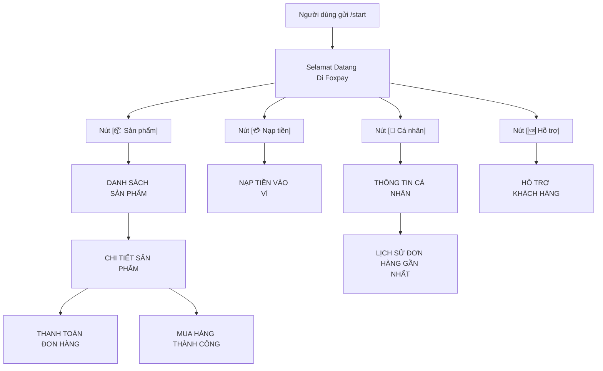

# Kế Hoạch Chuẩn Hóa Tiêu Đề Blockquote, Giao Diện /start & Hỗ Trợ HTML Telegram Cho shop_intro

Tài liệu này chi tiết hóa việc chuẩn hóa toàn bộ các tiêu đề màn hình trong Telegram Bot sang thẻ `<blockquote>` theo Telegram Bot API 7.0+ và tái cấu trúc màn hình `/start` chuẩn xác theo format Foxpay.

---

## 1. Mục Tiêu & Nguyên Tắc

1. **Chuẩn hóa thẻ hiển thị tiêu đề**:
   - Sử dụng thẻ `<blockquote>...</blockquote>` chuẩn Telegram HTML parse mode cho tiêu đề chính ở tất cả các màn hình (Menu chính, Danh sách sản phẩm, Chi tiết sản phẩm, Nạp tiền, Cá nhân, Lịch sử mua, Hỗ trợ, Thanh toán trực tiếp, Mua thành công).
   - Thẻ `<blockquote>` hiển thị vạch vertical bar nổi bật bên trái, mang lại giao diện chuyên nghiệp, phân tách nội dung rõ ràng như các bot dịch vụ cao cấp.

2. **Định dạng màn hình `/start` chuẩn Foxpay**:
   - Tiêu đề: `<blockquote>Selamat Datang Di Foxpay</blockquote>` (hoặc cấu hình linh hoạt theo `shop_name`).
   - Khối mô tả:
     ```text
     FOXPAY - gudang aplikasi digital
     untuk memenuhi semua kebutuhan
     harian anda.
     ```
   - Khối ưu điểm (Highlights):
     ```text
     Kenapa harus kami ?
     - transaksi aman ✅
     - cs fast respon ✅
     - produk berkualitas ✅
     ```
   - Khối thông tin liên hệ:
     ```text
     Tentang kami :
     owner - @foxstoreid
     channel - @foxpayid
     website - foxpay.my.id
     ```

3. **Bảo toàn dữ liệu (Data Preservation)**:
   - Không xoá dữ liệu cũ, tạo file migration `migrations/002_update_welcome_ui.sql` an toàn bằng lệnh `INSERT INTO settings ... ON DUPLICATE KEY UPDATE`.
   - Giữ nguyên cấu trúc inline keyboard tối ưu 1-roundtrip response.

---

## 2. Chi Tiết Thay Đổi Các File Handlers

### 2.1. `bot/handlers/StartHandler.php` & Hỗ Trợ HTML Telegram
- **Hỗ trợ HTML Telegram cho `shop_intro`**:
  - Hiện tại, `StartHandler.php` gọi `Helpers::escape($shopIntro)`, hàm này dùng `htmlspecialchars` biến mọi tag HTML thành chuỗi ký tự hiển thị thô (`<b>...</b>`).
  - Thay vì escape toàn bộ, xây dựng hàm `Helpers::sanitizeTelegramHtml($text)`:
    - Cho phép các thẻ hợp lệ của Telegram: `<b>`, `<strong>`, `<i>`, `<em>`, `<u>`, `<ins>`, `<s>`, `<strike>`, `<del>`, `<tg-spoiler>`, `<a>`, `<code>`, `<pre>`, `<blockquote>`.
    - Lọc bỏ các thẻ không hợp lệ tránh gây lỗi Telegram API (`<div>`, `<p>`, `<script>`,...).
  - Cơ chế tự động Fallback an toàn trong `core/Telegram.php`:
    - Nếu admin nhập sai cú pháp (như quên đóng thẻ `</b>`), Telegram trả về mã lỗi `Bad Request: can't parse entities`.
    - Hệ thống tự động bắt lỗi và gửi lại dạng text thuần loại bỏ thẻ (`strip_tags`) để tin nhắn bot không bao giờ bị nghẽn.
- **Tiêu đề**:
  ```php
  $welcomeTitle = 'Selamat Datang Di ' . ($settings['shop_name'] ?? 'Foxpay');
  $text = '<blockquote>' . Helpers::escape($welcomeTitle) . "</blockquote>\n\n";
  ```
- **Nội dung Foxpay**:
  ```php
  $intro = $settings['shop_intro'] ?? "FOXPAY - gudang aplikasi digital\nuntuk memenuhi semua kebutuhan\nharian anda.";
  $text .= Helpers::sanitizeTelegramHtml($intro) . "\n\n";
  $text .= "Kenapa harus kami ?\n";
  $text .= "- transaksi aman ✅\n";
  $text .= "- cs fast respon ✅\n";
  $text .= "- produk berkualitas ✅\n\n";
  $text .= "Tentang kami :\n";
  $text .= "owner - " . Helpers::escape($settings['owner_username'] ?? '@foxstoreid') . "\n";
  $text .= "channel - " . Helpers::escape($settings['channel_username'] ?? '@foxpayid') . "\n";
  $text .= "website - " . Helpers::escape($settings['website'] ?? 'foxpay.my.id');
  ```
- **Bàn phím Inline**:
  - Hàng 1: `[📦 Sản phẩm]` · `[💳 Nạp tiền]`
  - Hàng 2: `[👤 Cá nhân]` · `[🆘 Hỗ trợ]`

### 2.2. `bot/handlers/ProductHandler.php`
- **Màn `list()`**:
  - Cũ: `<b>DANH SÁCH SẢN PHẨM</b>\n\n`
  - Mới: `<blockquote>DANH SÁCH SẢN PHẨM</blockquote>\n\n`
- **Màn `detail()`**:
  - Cũ: `<b>CHI TIẾT SẢN PHẨM</b>\n\n...`
  - Mới: `<blockquote>CHI TIẾT SẢN PHẨM</blockquote>\n\n...`

### 2.3. `bot/handlers/DepositHandler.php`
- **Màn `show()` (Caption ảnh VietQR)**:
  - Cũ: `<b>NẠP TIỀN</b>\n\n...`
  - Mới: `<blockquote>NẠP TIỀN VÀO VÍ</blockquote>\n\nNội dung: <code>...</code>\nTối thiểu: <b>...</b>\n\nMã được giữ đến khi nạp thành công.`

### 2.4. `bot/handlers/ProfileHandler.php`
- **Màn `show()`**:
  - Cũ: `<b>CÁ NHÂN</b>\n\n...`
  - Mới: `<blockquote>THÔNG TIN CÁ NHÂN</blockquote>\n\nID: <code>...</code>\nTên: ...\nSố dư: <b>...</b>\nĐơn đã mua: ...`
- **Màn `history()`**:
  - Cũ: `<b>10 ĐƠN GẦN NHẤT</b>\n`
  - Mới: `<blockquote>LỊCH SỬ ĐƠN HÀNG GẦN NHẤT</blockquote>\n`

### 2.5. `bot/handlers/SupportHandler.php`
- **Màn `show()`**:
  - Cũ: `<b>HỖ TRỢ</b>\n\n...`
  - Mới: `<blockquote>HỖ TRỢ KHÁCH HÀNG</blockquote>\n\n...`

### 2.6. `bot/handlers/OrderHandler.php`
- **Màn VietQR Direct Payment (`buy`)**:
  - Cũ: `<b>THANH TOÁN ĐƠN HÀNG</b>\n\n...`
  - Mới: `<blockquote>THANH TOÁN ĐƠN HÀNG</blockquote>\n\nSản phẩm: ...\nSố tiền: ...\nNội dung: <code>...</code>`
- **Màn Mua hàng thành công qua ví (`purchaseWithWallet`)**:
  - Cũ: `✅ <b>Mua hàng thành công</b>\n\n...`
  - Mới: `<blockquote>MUA HÀNG THÀNH CÔNG</blockquote>\n\nMã đơn: <code>...</code>\nSản phẩm: ...\n\nThông tin nhận:\n<code>...</code>`

---

## 3. Kiến Trúc Luồng Màn Hình & Trực Quan Hóa (Mermaid)



---

## 4. Kế Hoạch Triển Khai (Action Items)

1. **Tạo Migration an toàn `migrations/002_update_welcome_ui.sql`**:
   - Cập nhật các bản ghi cấu hình mặc định trong bảng `settings`:
     - `shop_name` = `'Foxpay'`
     - `shop_intro` = `'FOXPAY - gudang aplikasi digital\nuntuk memenuhi semua kebutuhan\nharian anda.'`
     - `owner_username` = `'@foxstoreid'`
     - `channel_username` = `'@foxpayid'`
     - `website` = `'foxpay.my.id'`
   - Đồng bộ giá trị khởi tạo trong `install.sql`.

2. **Cập nhật code handlers trong thư mục `bot/handlers/`**:
   - Cập nhật `bot/handlers/StartHandler.php` theo layout chuẩn Foxpay.
   - Cập nhật các file:
     - `bot/handlers/ProductHandler.php`
     - `bot/handlers/DepositHandler.php`
     - `bot/handlers/ProfileHandler.php`
     - `bot/handlers/SupportHandler.php`
     - `bot/handlers/OrderHandler.php`
   - Đảm bảo thẻ `<blockquote>` đóng mở đúng cú pháp HTML, các biến động đều qua `Helpers::escape()`.

3. **Kiểm tra cú pháp PHP & đối soát hiển thị**:
   - Đảm bảo không phá vỡ logic tối ưu cURL và lazy loading đã triển khai.
   - Kiểm tra tính tương thích với Telegram Bot API Parse Mode HTML.
