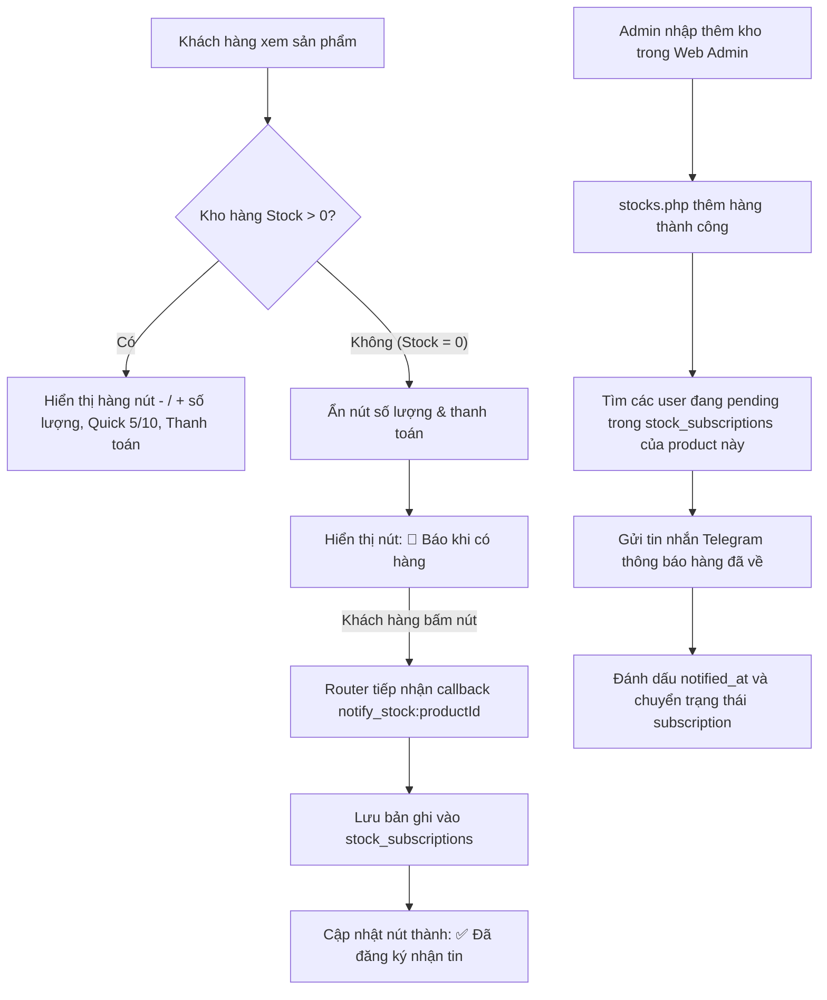

# Kế hoạch Chuẩn hóa Giao diện Web, Quy ước AGENTS.md, Giao diện Telegram & Tính năng Báo khi có hàng

## 1. Mục tiêu và Bối cảnh

Người dùng yêu cầu giải quyết 2 nhóm vấn đề:
1. **Web Admin UI & Button Styling**:
   - Các nút bấm trên giao diện web chưa đồng đều (chiều cao, padding, margin của button trong form lệch so với thẻ `<a>`). Checkbox bị nhảy dòng do style thẻ `input` chung.
   - Trình duyệt lưu cache `style.css` khiến các cập nhật CSS không hiển thị ngay.
   - Chuẩn hóa toàn bộ hệ thống button, form inline và đưa quy ước chung vào [`AGENTS.md`](AGENTS.md) (chỉ giữ quy ước chung, không đưa tính năng nghiệp vụ dùng 1 vài lần vào file này).
2. **Giao diện Chi tiết Sản phẩm Telegram & Nút Báo khi có hàng**:
   - Căn chỉnh lại cấu trúc hiển thị chi tiết sản phẩm:
     - Phần `Description`: Mỗi dòng đều có tiền tố nhánh `╰ `.
     - Phần `Order details`: Các dòng `Quantity` và `Total` đều có tiền tố nhánh `╰ `.
   - Khi `Stock = 0`:
     - Ẩn toàn bộ hàng nút chọn số lượng `[-] [Số lượng: 1] [+]`, quick pick 5/10 và nút `Thanh toán`.
     - Hiển thị nút `[ 🔔 Báo khi có hàng ]` (hoặc `[ 🔔 Thông báo khi có hàng ]`).
     - Khi khách hàng nhấn nút: lưu đăng ký nhận tin của khách hàng đối với sản phẩm đó.
     - Khi Admin nhập kho sản phẩm, hệ thống tự động gửi thông báo Telegram cho khách hàng đã đăng ký.

---

## 2. Thiết kế Kiến trúc & Luồng Xử lý



---

## 3. Chi tiết các Bước Triển khai

### Bước 1: Chuẩn hóa CSS Button, Form và Checkbox trong Web Admin
- **File**: [`admin/assets/style.css`](admin/assets/style.css)
  - Chuẩn hóa toàn bộ selector nút bấm: `button`, `.button`, `input[type="submit"]`.
    - `box-sizing: border-box;`
    - Cùng chiều cao: `height: 34px;` (hoặc `height: 36px;`).
    - `line-height: 1;`
    - `font-size: 13px; font-weight: 500; font-family: inherit;`
    - `padding: 0 14px;`
    - `border-radius: 6px;`
    - `display: inline-flex; align-items: center; justify-content: center;`
    - `vertical-align: middle;`
    - `margin: 0;` (triệt tiêu margin mặc định của `<button>`).
  - Chuẩn hóa bộ màu:
    - Primary: `#2563eb`, hover `#1d4ed8`
    - Secondary: `#64748b`, hover `#475569`
    - Danger: `#dc2626`, hover `#b91c1c`
  - Chuẩn hóa layout nhóm nút `.actions`:
    - `display: inline-flex; align-items: center; gap: 6px; flex-wrap: wrap;`
    - `.actions form { display: inline-flex; margin: 0; padding: 0; }`
    - `.actions button, .actions .button { margin: 0; height: 32px; padding: 0 12px; font-size: 13px; }`
  - Sửa lỗi checkbox:
    - Đổi selector `input` sang `input:not([type="checkbox"]):not([type="radio"]), textarea, select { width: 100%; ... }`.
    - Định nghĩa `input[type="checkbox"], input[type="radio"] { width: auto; margin: 0; cursor: pointer; }`.
    - `.inline-check`: `display: inline-flex; align-items: center; gap: 8px; margin: 10px 0 14px; cursor: pointer;`.
- **File**: [`admin/index.php`](admin/index.php)
  - Thêm cache buster động: `<link rel="stylesheet" href="assets/style.css?v=<?= filemtime(__DIR__ . '/assets/style.css') ?>">`.

---

### Bước 2: Cập nhật Quy ước Chuẩn vào `AGENTS.md`
- **File**: [`AGENTS.md`](AGENTS.md)
  - Giữ nguyên cấu trúc tinh gọn hiện tại (chỉ chứa các quy ước chuẩn chung, không đưa tính năng nghiệp vụ tạm thời vào).
  - Thêm mục `## Giao diện Web & Thành phần UI`:
    - **Tính đồng nhất của Button**: Mọi thành phần nút bấm (`<button>`, `<a class="button">`, `<input type="submit">`) phải có kích thước, chiều cao, padding, line-height và cách căn gióng (`inline-flex`, `align-items: center`) đồng nhất.
    - **Reset Margin trong Form Inline**: Các nút nằm trong nhóm thao tác (`.actions`) hoặc bọc trong `<form>` phải triệt tiêu margin (`margin: 0`) và form phải dùng `display: inline-flex` để không làm lệch layout flex cha.
    - **Loại trừ Checkbox/Radio khỏi Width 100%**: Không gán `width: 100%` cho thẻ `input` chung; luôn loại trừ `checkbox` và `radio`.
    - **Cache-Busting cho Tài nguyên Tĩnh**: Các tệp CSS/JS nhúng trong trang web Admin phải có query string version (dựa trên `filemtime` hoặc commit hash) để tránh lỗi cache trình duyệt khi triển khai.

---

### Bước 3: Migration Bảng `stock_subscriptions`
- **File**: [`migrations/005_stock_subscriptions.sql`](migrations/005_stock_subscriptions.sql)
  - Viết thuần SQL tương thích PDO (không dùng `DELIMITER`, không dùng stored procedure).
  - Cấu trúc:
    ```sql
    CREATE TABLE IF NOT EXISTS stock_subscriptions (
        id BIGINT UNSIGNED AUTO_INCREMENT PRIMARY KEY,
        user_id BIGINT UNSIGNED NOT NULL,
        product_id BIGINT UNSIGNED NOT NULL,
        status ENUM('pending', 'notified') NOT NULL DEFAULT 'pending',
        created_at DATETIME NOT NULL DEFAULT CURRENT_TIMESTAMP,
        notified_at DATETIME NULL,
        UNIQUE KEY uq_stock_sub_user_product (user_id, product_id, status),
        INDEX idx_stock_sub_pending (product_id, status),
        CONSTRAINT fk_stock_sub_user FOREIGN KEY (user_id) REFERENCES users(id) ON DELETE CASCADE,
        CONSTRAINT fk_stock_sub_product FOREIGN KEY (product_id) REFERENCES products(id) ON DELETE CASCADE
    ) ENGINE=InnoDB DEFAULT CHARSET=utf8mb4 COLLATE=utf8mb4_unicode_ci;
    ```
- **File**: [`install.sql`](install.sql)
  - Bổ sung bảng `stock_subscriptions` vào bộ cài đặt sạch để đảm bảo cài mới luôn đồng bộ.

---

### Bước 4: Định dạng Chi tiết Sản phẩm & Hiển thị Nút Báo khi có hàng
- **File**: [`bot/handlers/ProductHandler.php`](bot/handlers/ProductHandler.php)
  - **Format Text**:
    - Tách từng dòng trong `$description` và `$features`:
      - Mỗi dòng không rỗng đều có tiền tố: `'╰ ' . Helpers::escape($line)`.
    - Phần `Order details`:
      - `'╰ ' . $lang->get('quantity') . ': <b>' . $quantity . "</b>\n"`
      - `'╰ ' . $lang->get('total') . ': <b>' . Helpers::money($total) . '</b>'`
  - **Keyboard Logic**:
    - Khi `$stock > 0`: hiển thị hàng số lượng `[-] [Số lượng: X] [+]`, quick select 5/10, và nút `Thanh toán`.
    - Khi `$stock === 0`:
      - Kiểm tra xem người dùng đã đăng ký thông báo sản phẩm này chưa:
        - Nếu chưa: nút `[ 🔔 Thông báo khi có hàng ]` (callback `notify_stock:{productId}`).
        - Nếu đã đăng ký: nút `[ ✅ Đã đăng ký nhận tin ]` (callback `notify_stock:{productId}`).
      - Không hiển thị hàng `- / +` và nút `Thanh toán`.
      - Hàng điều hướng `[ ⬅ Quay lại ]` và `[ 🔄 Làm mới ]` hiển thị ở dưới cùng.
  - **Xử lý Đăng ký Thông báo**:
    - Thêm phương thức `handleNotifyStock(int $chatId, int $messageId, int $userId, int $productId, Language $lang): void`.
    - Thêm/toggle bản ghi vào `stock_subscriptions`.
    - Gửi thông báo popup hoặc cập nhật giao diện tin nhắn xác nhận đã đăng ký.

---

### Bước 5: Tiếp nhận Callback trong `Router.php`
- **File**: [`bot/Router.php`](bot/Router.php)
  - Bắt route `notify_stock:`:
    ```php
    elseif (str_starts_with($data, 'notify_stock:')) {
        $productId = (int) substr($data, 13);
        $this->products->handleNotifyStock($chatId, $messageId, (int) $user['id'], $productId, $lang);
    }
    ```

---

### Bước 6: Tự động Báo Khách Hàng khi Admin Nhập Kho
- **File**: [`admin/modules/stocks.php`](admin/modules/stocks.php)
  - Khi import thành công với `$count > 0`:
    - Truy vấn danh sách khách hàng đang có `status = 'pending'` trong `stock_subscriptions` cho sản phẩm tương ứng.
    - Gửi tin nhắn Telegram thông báo: sản phẩm vừa có hàng trở lại kèm nút mở chi tiết sản phẩm.
    - Cập nhật bản ghi `status = 'notified'`, `notified_at = NOW()`.

---

### Bước 7: Khai báo Từ điển Đa ngôn ngữ (vi, en)
- **File**: [`languages/vi.php`](languages/vi.php) & [`languages/en.php`](languages/en.php)
  - Khai báo các khóa dịch:
    - `notify_stock_button`: `🔔 Báo khi có hàng` / `🔔 Notify when in stock`
    - `notify_stock_subscribed`: `✅ Đã đăng ký nhận tin` / `✅ Subscribed`
    - `notify_stock_alert`: `Bạn sẽ nhận được thông báo ngay khi sản phẩm này có hàng trở lại!` / `You will receive a notification as soon as this product is back in stock!`
    - `notify_stock_already_alert`: `Bạn đã đăng ký nhận thông báo cho sản phẩm này rồi.` / `You have already subscribed to notifications for this product.`
    - `restock_alert_message`: `📦 Sản phẩm <b>:product</b> vừa có thêm hàng mới! Nhấn nút bên dưới để xem và đặt hàng.` / `📦 Product <b>:product</b> has just been restocked! Tap below to view and order.`
    - `view_product_button`: `🔍 Xem sản phẩm` / `🔍 View product`

---

### Bước 8: Kiểm tra An toàn & Triển khai
- Kiểm tra cú pháp PHP, tính tương thích PDO của migration `005`.
- Kiểm tra `git diff --check`.
- Đảm bảo giữ nguyên, không đụng chạm đến [`core/Helpers.php`](core/Helpers.php).
- Stage chính xác các file thuộc phạm vi nhiệm vụ, commit và push lên `origin/main`.
- Migration `005` sẽ tự động chạy thông qua [`.cpanel.yml`](.cpanel.yml:11) khi deploy lên cPanel.
