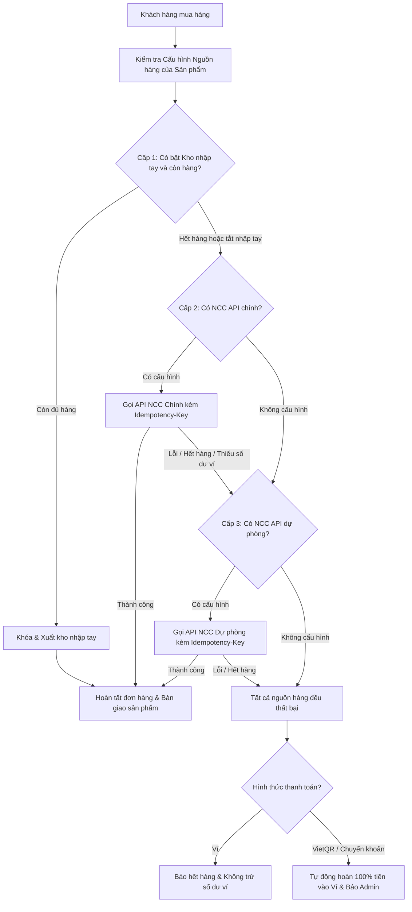

# Kế Hoạch Kiến Trúc: Sticky Sidebar Admin, Nguồn Hàng Tại Kho & Xuất Hàng Ưu Tiên 3 Cấp

## 1. Mục tiêu và Tổng quan

1. **Giao diện Admin (Aside Sidebar)**:
   - Cố định (Sticky) sidebar bên trái khi cuộn trang dài.
   - Nâng cấp trải nghiệm UX/UI: phân nhóm danh mục trực quan, trạng thái trang đang chọn (active state), scrollbar mượt mà và responsive trên thiết bị di động.
2. **Tách biệt nghiệp vụ Nguồn hàng & Kho**:
   - Chuyển việc cấu hình nguồn hàng từ trang **Sản phẩm** (`products.php`) sang trang **Kho hàng** (`stocks.php`).
   - Trang Sản phẩm chỉ quản lý thông tin bán lẻ (Tên, Mô tả đa ngữ, Giá, Thứ tự, Trạng thái).
   - Trang Kho hàng trở thành trung tâm điều phối toàn bộ nguồn cung & tồn kho.
3. **Tích hợp 2 nhà cung cấp API (Sandromania & Cuppon'sHub)**:
   - Tích hợp chuẩn hóa qua thiết kế **Provider Pattern** (`SupplierInterface`).
   - Tương lai mở rộng thêm nhà cung cấp thứ 3, 4, 5... chỉ bằng cách thêm 1 class mới mà không cần sửa core logic.
4. **Cơ chế xuất hàng ưu tiên 3 cấp (Fulfillment Waterfall)**:
   - **Cấp 1**: Kho nhập tay (Manual Stock).
   - **Cấp 2**: Nhà cung cấp chính (Primary API Supplier).
   - **Cấp 3**: Nhà cung cấp dự phòng (Backup API Supplier).
   - Tự động chuyển cấp an toàn khi cấp trước thiếu hàng hoặc lỗi API, tự động hoàn tiền nếu toàn bộ đều thất bại.

---

## 2. Sơ đồ Kiến trúc Luồng Xuất Hàng Ưu Tiên 3 Cấp



---

## 3. Chi tiết Giải pháp Kỹ thuật

### 3.1. Giao diện Admin: Sticky Sidebar & UX/UI Cải tiến
- **Layout CSS**:
  - `aside`: Cấu hình `position: sticky; top: 0; height: 100vh; overflow-y: auto; display: flex; flex-direction: column;`.
  - Tùy chỉnh thanh cuộn thanh mảnh (`scrollbar-width: thin; scrollbar-color: #374151 transparent;`).
- **Phân nhóm điều hướng (Navigation Groups)**:
  - Header: Logo icon + `TAOS Shop` + nhãn phiên bản `Admin Console`.
  - Nhóm **BÁN HÀNG**: *Tổng quan*, *Sản phẩm*, *Kho hàng*, *Đơn hàng*.
  - Nhóm **HỆ THỐNG**: *Nạp tiền*, *Khách hàng*, *Cài đặt*.
  - Footer (đẩy xuống đáy bằng `margin-top: auto`): Nút *Đăng xuất* có icon trực quan và đường kẻ phân cách tinh tế.
- **Visual State**:
  - Mục đang xem được gán class `.active` với nền màu `#2563eb`, chữ trắng, bo góc 8px.
  - Hiệu ứng hover mượt mà với chuyển màu nền.
- **Mobile Responsive**:
  - Tại breakpoint `< 768px`: Chuyển sang thanh điều hướng phía trên cuộn ngang hoặc thanh sticky gọn nhẹ, không che khuất bảng dữ liệu.

### 3.2. Cơ sở dữ liệu: Bảng `product_supplier_configs`
Tạo migration `migrations/011_product_supplier_configs.sql`:
```sql
CREATE TABLE product_supplier_configs (
    id BIGINT UNSIGNED NOT NULL AUTO_INCREMENT,
    product_id BIGINT UNSIGNED NOT NULL,
    variant_id BIGINT UNSIGNED NOT NULL,
    use_manual_stock TINYINT(1) NOT NULL DEFAULT 1,
    primary_provider VARCHAR(50) NULL,
    primary_code VARCHAR(100) NULL,
    backup_provider VARCHAR(50) NULL,
    backup_code VARCHAR(100) NULL,
    created_at DATETIME NOT NULL DEFAULT CURRENT_TIMESTAMP,
    updated_at DATETIME NOT NULL DEFAULT CURRENT_TIMESTAMP ON UPDATE CURRENT_TIMESTAMP,
    PRIMARY KEY (id),
    UNIQUE KEY uq_supplier_variant (variant_id),
    KEY idx_supplier_product (product_id),
    CONSTRAINT fk_supplier_configs_variant FOREIGN KEY (variant_id) REFERENCES variants(id) ON UPDATE RESTRICT ON DELETE CASCADE,
    CONSTRAINT fk_supplier_configs_product FOREIGN KEY (product_id) REFERENCES products(id) ON UPDATE RESTRICT ON DELETE CASCADE
) ENGINE=InnoDB DEFAULT CHARSET=utf8mb4 COLLATE=utf8mb4_unicode_ci;

-- Di chuyển dữ liệu cấu hình cũ từ variants sang bảng mới
INSERT INTO product_supplier_configs (product_id, variant_id, use_manual_stock, primary_provider, primary_code)
SELECT v.product_id, v.id,
       CASE WHEN v.supplier_type = 'manual' THEN 1 ELSE 0 END,
       CASE WHEN v.supplier_type = 'api' THEN 'sandromania' ELSE NULL END,
       v.provider_code
FROM variants v
ON DUPLICATE KEY UPDATE product_id = VALUES(product_id);
```

### 3.3. Tích hợp 2 Nhà Cung Cấp API (Provider Pattern & Mở rộng Tương lai)

#### Cấu hình bảo mật (`config/suppliers.php` và `config/suppliers.local.php`):
Credentials bảo mật cao được giữ phía server:
```php
return [
    'sandromania' => [
        'enabled' => true,
        'base_url' => 'https://api.sandromania.shop',
        'api_key' => '',    // pk_...
        'api_secret' => '', // ps_...
    ],
    'cupponhub' => [
        'enabled' => true,
        'base_url' => 'https://cupponhub.shop/reseller/api/',
        'api_key' => '',    // ch_live_...
    ],
];
```

#### Chuẩn hóa Adapter Interface:
[`suppliers/SupplierInterface.php`](suppliers/SupplierInterface.php:5):
- `public function getKey(): string;` (vd: `sandromania`, `cupponhub`)
- `public function getDisplayName(): string;` (vd: `Sandromania API`, `Cuppon'sHub API`)
- `public function getBalance(): array;` (Lấy số dư tài khoản đối tác)
- `public function getStock(string $remoteProductCode): int;` (Kiểm tra tồn kho API)
- `public function deliver(string $remoteProductCode, int $quantity, string $orderCode): array;`
  - Trả về cấu trúc thống nhất:
    `['success' => true, 'items' => [...], 'remote_order_id' => '...', 'error' => null]`

#### Triển khai cụ thể:
1. **Sandromania Supplier** (`suppliers/ApiProviders/SandromaniaSupplier.php`):
   - Chuẩn hóa HMAC-SHA256 theo tài liệu: `timestamp . "." . nonce . "." . strtoupper($method) . "." . $pathWithQuery . "." . $rawBody`.
   - Headers: `X-Api-Key`, `X-Timestamp`, `X-Nonce`, `X-Signature`, `Idempotency-Key`.
   - Đặt hàng qua `POST /api/v1/orders`. Phân tích trường `delivery_text` hoặc `delivery` thành mảng items.
2. **Cuppon'sHub Supplier** (`suppliers/ApiProviders/CupponHubSupplier.php`):
   - Headers: `X-API-Key`, `Idempotency-Key`.
   - Đặt hàng qua `POST ?action=purchase` với body `{"product": "key", "quantity": N}`.
   - Nhận mảng items từ response `order.items`.
3. **Mở rộng tương lai**:
   - Khi có nhà cung cấp mới, chỉ cần tạo file mới trong `suppliers/ApiProviders/` kế thừa `BaseApiSupplier` và implements `SupplierInterface`. Không cần chỉnh sửa bất kỳ logic lõi nào.

### 3.4. Dịch Vụ Xuất Kho Ưu Tiên 3 Cấp (`StockFulfillmentService`)
Tạo dịch vụ độc lập [`suppliers/StockFulfillmentService.php`](suppliers/StockFulfillmentService.php:1):
- Tách bạch và dùng chung cho cả 2 luồng:
  1. Mua bằng số dư ví ([`bot/handlers/OrderHandler.php`](bot/handlers/OrderHandler.php:143)).
  2. Mua bằng chuyển khoản VietQR / Hybrid ([`core/PaymentProcessor.php`](core/PaymentProcessor.php:196)).
- Trình tự thực thi:
  1. Đọc cấu hình từ `product_supplier_configs`.
  2. **Thử Cấp 1 (Kho nhập tay)** nếu bật: Lấy kho `WHERE is_sold = 0 FOR UPDATE`. Nếu đủ, xuất kho và kết thúc.
  3. **Thử Cấp 2 (NCC Chính)** nếu cấp 1 không đủ và có cấu hình NCC chính: Gửi lệnh mua API với Idempotency Key duy nhất (`taos-{orderCode}-primary`).
  4. **Thử Cấp 3 (NCC Dự phòng)** nếu cấp 2 thất bại (hết hàng, lỗi ví, timeout) và có cấu hình NCC dự phòng: Tự động chuyển sang NCC dự phòng với Idempotency Key (`taos-{orderCode}-backup`).
  5. Nếu tất cả đều không thể cung ứng: Trả về trạng thái thất bại để luồng ngoài thực hiện rollback hoặc hoàn tiền vào ví khách hàng.

### 3.5. Cải Tiến Trang Quản Lý Kho Hàng (`admin/modules/stocks.php`)
- **Phần 1: Cấu hình nguồn hàng cho từng sản phẩm**:
  - Hiển thị danh sách sản phẩm cùng các thiết lập:
    * Kho nhập tay: [Bật / Tắt]
    * Nhà cung cấp chính: [Chọn NCC] + [Mã SP đối tác]
    * Nhà cung cấp dự phòng: [Chọn NCC] + [Mã SP đối tác]
  - Thao tác lưu cấu hình nhanh chóng, trực quan.
- **Phần 2: Giám sát số dư nhà cung cấp API (Live Balance)**:
  - Hiển thị box số dư tài khoản của Sandromania (USD/RUB) và Cuppon'sHub (USDT).
  - Giúp quản trị viên phát hiện sớm khi tài khoản đối tác sắp hết tiền để kịp nạp thêm.
- **Phần 3: Nhập kho thủ công & Bảng chi tiết tồn kho**:
  - Giữ nguyên luồng nhập kho hàng loạt theo dòng cho các sản phẩm có dùng kho nhập tay.
  - Bảng lọc và quản lý các dòng kho đã bán / chưa bán.
