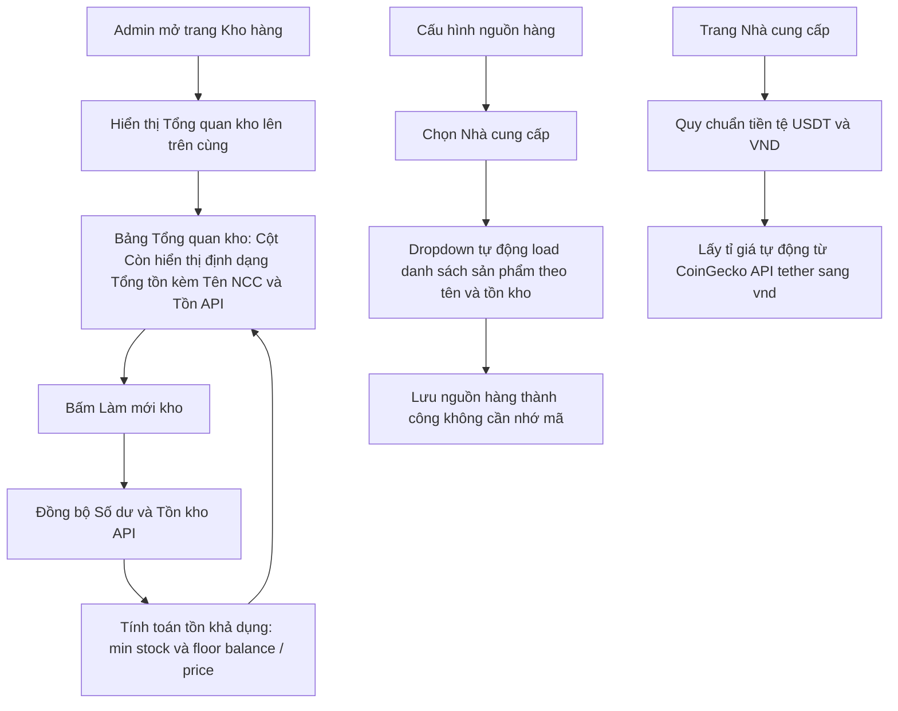

# Kế hoạch Cải tiến Kho hàng, Tồn kho Khả dụng API và Quy chuẩn Tỉ giá CoinGecko

Tài liệu này được lập theo yêu cầu cải tiến ngày 30/10/2026:
1. Đưa **Tổng quan kho** lên vị trí đầu tiên trong trang Kho hàng.
2. Cột **Còn** hiển thị định dạng trực quan: `Tổng tồn (Tên NCC: Tồn API)`, giúp nhận biết rõ tồn nhập tay và tồn API.
3. Tồn kho API được tính toán theo **tồn khả dụng thực tế** dựa trên Số dư tài khoản tại NCC chia cho Giá sản phẩm: `min(stock_ncc, floor(balance / unit_price))`.
4. Thêm nút **Làm mới kho** ngay tại trang Kho hàng để kiểm tra và cập nhật tức thì.
5. Chuyển ô nhập mã API thành **dropdown `<select>` chọn sản phẩm trực quan theo tên**.
6. Quy chuẩn hệ thống chỉ dùng 2 loại tiền tệ: **USDT** (quy ước 1 USD = 1 USDT) và **VND**. Tỉ giá tự động lấy từ CoinGecko API (`coingecko_usdt_vnd`).

---

## 1. Phân tích & Giải pháp Kiến trúc

### A. Quy chuẩn Tiền tệ & Tỉ giá CoinGecko
- **Tiền tệ chuẩn hóa**: Hệ thống chỉ dùng **USDT** và **VND**.
  - Đối với nhà cung cấp báo giá bằng USD (như Sandromania): Chuẩn hóa trực tiếp tỷ lệ 1:1 sang **USDT** (`USD = USDT`).
  - Đối với nhà cung cấp báo giá bằng USDT (như Cuppon'sHub): Giữ nguyên **USDT**.
  - Loại bỏ hoàn toàn RUB và các trường tỉ giá phụ.
- **Tỉ giá CoinGecko**:
  - API endpoint: `https://api.coingecko.com/api/v3/simple/price?ids=tether&vs_currencies=vnd`
  - Kết quả trả về: `{"tether":{"vnd": 25450}}`
  - Service hỗ trợ phương thức `fetchCoinGeckoRate(): float` có timeout 5s, tự động cập nhật vào `settings` với khóa `supplier_rate_usdt_vnd`.
  - Trên trang Quản lý NCC và trang Kho: Có nút "Cập nhật tỉ giá CoinGecko", đồng thời vẫn cho phép admin nhập sửa tay nếu muốn neo giá cố định.

### B. Công thức Tồn kho Khả dụng API (Effective Stock)
- **Vấn đề thực tế**: Nhà cung cấp có thể còn 1.000 sản phẩm trong kho của họ, nhưng nếu số dư ví của shop tại NCC chỉ còn 10 USDT và sản phẩm giá 2 USDT thì shop chỉ có thể xuất tối đa 5 sản phẩm. Nếu để bot bán quá 5 sản phẩm thì đơn hàng sẽ lỗi do thiếu tiền trong ví NCC.
- **Công thức chuẩn**:
  ```text
  effective_api_stock = min(stock_ncc, floor(balance_usdt / unit_price_usdt))
  ```
  - Nếu `unit_price <= 0` hoặc không có giá: Giữ `stock_ncc` nếu cấu hình cho phép.
  - Nếu `balance_usdt < unit_price`: Tồn khả dụng API = 0.
  - Tồn kho hiển thị cho shop = `Tồn nhập tay + Tồn khả dụng API (của nguồn chính đang kích hoạt)`.

### C. Định dạng Cột "Còn" tại Bảng Tổng quan kho
- Cột **Còn** trong bảng Tổng quan kho sẽ được format:
  - Nếu chỉ có nhập tay: `10`
  - Nếu có cả nhập tay và API: `15 (Cuppon'sHub: 5)` -> Admin hiểu ngay: 10 cái nhập tay sẵn có + 5 cái có thể mua từ Cuppon'sHub.
  - Nếu chỉ dùng API: `5 (Cuppon'sHub: 5)`
  - Nếu nguồn API hết số dư hoặc hết hàng: `10 (Cuppon'sHub: 0 - Hết số dư/Hết hàng)`

### D. Nút "Làm mới kho" tại trang Kho hàng
- Bổ sung nút hành động **Làm mới kho** ở góc trên bảng Tổng quan kho.
- Khi admin bấm: Hệ thống sẽ chạy đồng bộ số dư và danh mục của các nhà cung cấp đang kích hoạt, tính toán lại tồn khả dụng và tải lại trang ngay.

### E. Dropdown `<select>` Chọn Sản phẩm theo Tên
- Thay thế hoàn toàn ô `<input list="...">` thành thẻ `<select>` chứa danh sách sản phẩm của nhà cung cấp đã chọn.
- Nhãn hiển thị: `[Tên sản phẩm] — Tồn: [X] — [Y] USDT (Mua được: [Z])`.
- Khi admin đổi nhà cung cấp ở dropdown bên trái, danh sách sản phẩm bên phải tự động chuyển đổi theo.
- Tự động giữ mã đã lưu trước đó nếu mã đó chưa có trong catalog.
- Có tùy chọn `[Nhập mã thủ công]` nếu admin cần chỉ định mã tùy biến.

---

## 2. Sơ đồ Luồng Hoạt động (Mermaid Diagram)



---

## 3. Các Bước Triển Khai Chi Tiết

### Bước 1: Quy chuẩn Tiền tệ & Tích hợp Tỉ giá CoinGecko
- [ ] Trong `suppliers/SupplierCatalogService.php`:
  - Thêm phương thức `fetchCoinGeckoUsdtRate(): ?float` gọi API CoinGecko.
  - Cập nhật hàm tính giá quy đổi `price_vnd = unit_price * usdt_rate` (1 USD = 1 USDT).
  - Bổ sung hàm tính tồn khả dụng API: `calculateEffectiveStock(providerKey, remoteProductCode): int`.
- [ ] Trong `suppliers/ApiProviders/SandromaniaSupplier.php`:
  - Chuẩn hóa trường `currency` trả về thành `USDT`.
- [ ] Cập nhật bảng `settings`: Khóa `supplier_rate_usdt_vnd` (xóa hoặc bỏ qua các trường RUB/USD cũ).

### Bước 2: Tái cấu trúc Giao diện Kho hàng (`admin/modules/stocks.php`)
- [ ] Đẩy khối **Tổng quan kho** lên trên cùng của trang (trên cả Cấu hình nguồn hàng).
- [ ] Thêm nút **Làm mới kho** (POST action `refresh_inventory` hoặc `sync_stocks`) trên thanh công cụ của Tổng quan kho.
- [ ] Tính toán số liệu cột **Còn** kết hợp:
  - Tồn kho nhập tay: `COUNT(stocks WHERE is_sold=0)`.
  - Tồn khả dụng API từ nguồn ưu tiên (Primary / Backup).
  - Format chuỗi hiển thị: `{tổng} ({tên_ncc}: {tồn_api})`.
- [ ] Chuyển đổi phần cấu hình nguồn:
  - Thay thẻ `<input name="primary_code">` và `<input name="backup_code">` thành `<select>`.
  - Nhúng dữ liệu sản phẩm theo từng NCC vào thẻ select hoặc script JavaScript.
  - Cho phép tùy chọn "Nhập mã thủ công" hiển thị ô input khi cần.

### Bước 3: Cập nhật Trang Nhà cung cấp (`admin/modules/suppliers.php`)
- [ ] Loại bỏ form nhập tỉ giá RUB/USD rườm rà.
- [ ] Chỉ hiển thị tỉ giá **USDT → VND** kèm nút **Lấy tỉ giá từ CoinGecko**.
- [ ] Hiển thị thông tin tồn khả dụng của từng sản phẩm trong bảng catalog.

### Bước 4: Đa ngôn ngữ & Thẩm mỹ UI/UX
- [ ] Khai báo đầy đủ các khóa mới trong `languages/vi.php` và `languages/en.php`.
- [ ] Căn chỉnh CSS trong `admin/assets/style.css` đảm bảo chiều cao các nút bấm, select box và responsive trên mobile/desktop.

### Bước 5: Kiểm tra Tĩnh & Triển khai
- [ ] Chạy `git diff --check` đảm bảo không có lỗi cú pháp hay khoảng trắng thừa.
- [ ] Commit sạch, push nhánh `main` và kích hoạt workflow deploy cPanel.
- [ ] Bàn giao và nghiệm thu trực quan trên giao diện cPanel thực tế.
