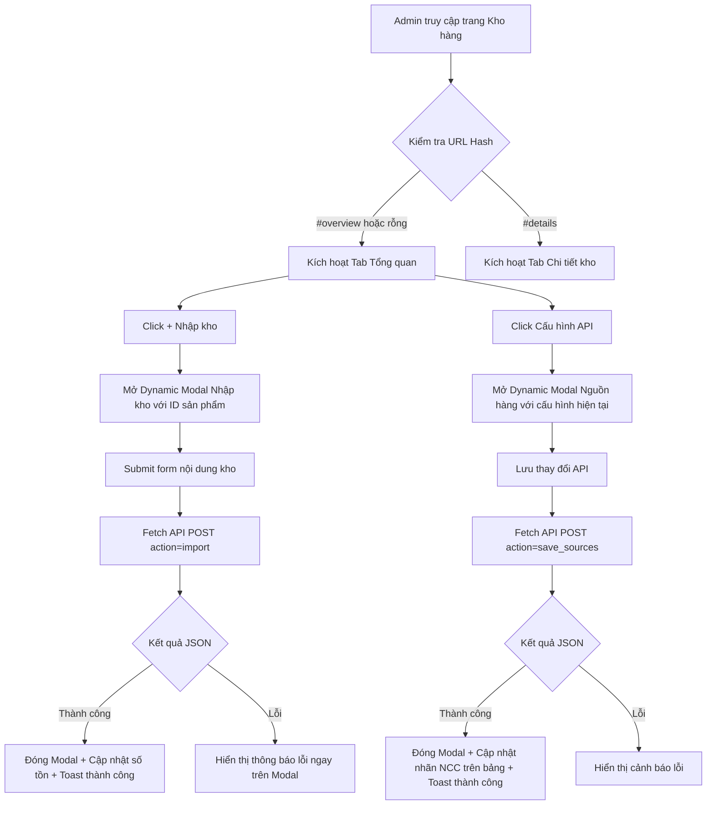

# Kế hoạch tối ưu giao diện Kho hàng: Tabs, Dynamic Modals và AJAX

Tài liệu này đề xuất và chi tiết hóa kiến trúc tái cấu trúc trang quản lý kho hàng tại [`admin/modules/stocks.php`](admin/modules/stocks.php), chuyển đổi từ bố cục tuần tự dàn trải sang mô hình 2 Tab chính, sử dụng Dynamic Modals cho việc nhập kho & cấu hình nguồn hàng, và tích hợp Fetch API (AJAX) hai chiều (dual-mode) giúp thao tác mượt mà không chớp trang.

---

## 1. Bối cảnh & Phân tích hiện trạng

### Hiện trạng
Trang [`admin/modules/stocks.php`](admin/modules/stocks.php) hiện tại bao gồm 4 khối lớn xếp chồng dọc theo trang:
1. **Tổng quan kho**: Bảng tổng quan tồn kho, số lượng đã bán và nút "Xóa kho chưa bán".
2. **Cấu hình nguồn hàng**: Bảng cấu hình nguồn hàng thủ công / API chính / API dự phòng cho từng sản phẩm. Chiếm diện tích rất lớn theo chiều dọc (đặc biệt khi danh mục có nhiều sản phẩm).
3. **Nhập kho hàng loạt**: Khung textarea cố định cùng dropdown chọn sản phẩm nhập tay.
4. **Chi tiết kho** (kèm khối sửa nếu có query param `edit`): Bảng danh sách 300 dòng item kho đã bán/chưa bán kèm bộ lọc sản phẩm và trạng thái.

### Nhược điểm hiện tại
- **Giao diện dàn trải, cuộn trang nhiều**: Khối "Cấu hình nguồn hàng" và "Nhập kho hàng loạt" làm đẩy bảng "Chi tiết kho" xuống quá sâu.
- **Tải lại toàn trang (Page Reload)**: Mọi thao tác (nhập kho, lưu nguồn hàng, xóa kho chưa bán, sửa item kho) đều gửi POST form truyền thống và reload lại toàn bộ trang qua [`redirectAdmin()`](admin/auth.php:29), gây mất vị trí cuộn trang và giảm trải nghiệm người dùng.
- **Khó tập trung theo ngữ cảnh**: Người quản trị thường thao tác theo 2 nhóm nhiệm vụ riêng biệt: (1) Quản lý số lượng & phân bổ nguồn hàng tổng quan, hoặc (2) Tra cứu / kiểm tra / xử lý sự cố từng key/tài khoản chi tiết.

---

## 2. Mục tiêu & Ý tưởng cải tiến từ chuyên gia

### 2.1. Phân chia 2 Tab nghiệp vụ rõ ràng
- **Tab 1: Tổng quan (`#overview`)**:
  - Tích hợp toàn diện các chỉ số tồn kho (Nhập tay, API nhà cung cấp, Đã bán).
  - Cột thao tác của từng dòng sản phẩm sẽ gồm 3 nút hành động tinh gọn:
    1. `+ Nhập kho`: Mở Modal nhập kho riêng cho sản phẩm đó.
    2. `⚙️ Cấu hình API`: Mở Modal cấu hình nguồn hàng (Kho thủ công, API 1, API 2) riêng cho sản phẩm đó.
    3. `🗑️ Xóa kho chưa bán`: Nút xóa tồn thủ công hiện tại kèm xác nhận an toàn.
  - Loại bỏ hoàn toàn khối bảng "Cấu hình nguồn hàng" và khối form "Nhập kho hàng loạt" cố định khỏi trang chính.

- **Tab 2: Chi tiết kho (`#details`)**:
  - Bộ lọc tìm kiếm và bảng danh sách key/tài khoản chi tiết.
  - Khối sửa dòng kho đơn lẻ cũng được đưa vào Modal chỉnh sửa nhanh hoặc giữ gọn trong tab Chi tiết kho, không làm vỡ bố cục tổng quan.

### 2.2. Ý tưởng nâng cao từ chuyên gia (Expert Recommendations)

1. **Hash Routing & Tab Persistence**:
   - Lưu trạng thái Tab vào `window.location.hash` (`#overview`, `#details`). Khi F5 tải lại trang hoặc chia sẻ liên kết, trang tự động kích hoạt đúng Tab tương ứng.
   - Thêm liên kết tắt tiện ích: Tại Tab Tổng quan, click vào số lượng tồn hoặc tên sản phẩm sẽ tự động chuyển sang Tab Chi tiết kho kèm bộ lọc đã chọn đúng sản phẩm đó (`#details?product_id=X`).

2. **Kiến trúc Dynamic Modal (Single Instance Pattern)**:
   - Thay vì render hàng chục modal ẩn trong HTML (làm phình to dung lượng DOM), chỉ tạo **duy nhất 1 Modal Nhập kho** và **1 Modal Cấu hình nguồn hàng**.
   - Khi bấm nút ở dòng sản phẩm tương ứng, Javascript sẽ nạp dữ liệu của sản phẩm đó vào modal và hiển thị.
   - Hỗ trợ đóng modal bằng phím `Escape`, click ra ngoài vùng backdrop, hoặc nút đóng `✕`.

3. **Giao thức AJAX Dual-Mode (Fetch API + Fallback)**:
   - Backend PHP tại [`admin/modules/stocks.php`](admin/modules/stocks.php) phát hiện request AJAX qua header `X-Requested-With: XMLHttpRequest` hoặc `Accept: application/json`.
   - Nếu là AJAX: Trả về JSON chuẩn `{ "success": true, "message": "...", "data": { ... } }`.
   - Nếu là Submit form truyền thống (khi JS bị tắt hoặc lỗi): Vẫn xử lý và chuyển hướng bằng [`redirectAdmin()`](admin/auth.php:29) đảm bảo an toàn tuyệt đối.
   - Giao diện client cập nhật trực tiếp số liệu tại dòng bảng tương ứng và hiển thị Toast notification nhẹ nhàng mà không cần reload trang.

4. **Đa ngôn ngữ & Tiêu chuẩn giao diện Web (AGENTS.md)**:
   - Không hardcode bất kỳ chuỗi tiếng Việt thô nào; toàn bộ nhãn nút, tiêu đề modal, thông báo lỗi được định nghĩa trong [`languages/vi.php`](languages/vi.php) và [`languages/en.php`](languages/en.php).
   - Truyền từ điển thông báo sang JavaScript qua biến toàn cục `window.STOCK_I18N`.
   - Các nút trong nhóm thao tác tuân thủ chuẩn chiều cao (32px trong table action), căn giữa flexbox, màu sắc ngữ nghĩa (`primary`, `secondary`, `danger`).

---

## 3. Sơ đồ luồng xử lý (Mermaid Workflow)

---

## 4. Kế hoạch triển khai kỹ thuật

### Bước 1: Khai báo đa ngôn ngữ (`i18n`)
Bổ sung các khóa từ điển vào cả hai tệp [`languages/vi.php`](languages/vi.php) và [`languages/en.php`](languages/en.php):
- `admin_stock_tab_overview`: "Tổng quan" / "Overview"
- `admin_stock_tab_details`: "Chi tiết kho" / "Stock items"
- `admin_stock_btn_import`: "+ Nhập kho" / "+ Add stock"
- `admin_stock_btn_config_api`: "⚙️ Cấu hình API" / "⚙️ API config"
- `admin_stock_modal_import_title`: "Nhập kho hàng loạt — :product" / "Bulk stock import — :product"
- `admin_stock_modal_config_title`: "Cấu hình nguồn hàng — :product" / "Supplier source config — :product"
- `admin_stock_import_success`: "Đã nhập :count dòng; bỏ qua :duplicate dòng trùng; đã báo :notified khách hàng."
- `admin_stock_source_save_success`: "Đã cập nhật nguồn hàng thành công."
- `admin_stock_close`: "Đóng" / "Close"
- `admin_stock_save`: "Lưu" / "Save"
- `admin_stock_toast_error`: "Có lỗi xảy ra, vui lòng thử lại."

### Bước 2: Thiết kế CSS cho Tabs, Modals & Toast (`admin/assets/style.css`)
Bổ sung các lớp CSS chuẩn hóa vào [`admin/assets/style.css`](admin/assets/style.css):
- `.stock-tabs`: Thanh điều hướng tab với layout flex, các tab buttons có trạng thái `.active` nổi bật.
- `.tab-content`: Ẩn/hiện theo tab active (`display: none` / `display: block`).
- `.modal-backdrop`: Lớp phủ nền mờ (`rgba(0,0,0,0.5)`), cố định toàn màn hình với hiệu ứng fade.
- `.modal-dialog`: Hộp thoại nổi giữa màn hình, bo góc 10px, padding 20px, responsive co giãn tối đa `92vw` trên thiết bị di động.
- `.modal-header`, `.modal-body`, `.modal-footer`: Cấu trúc phân chia rõ ràng.
- `.toast-notification`: Khung thông báo nhỏ góc phải trên màn hình, tự động biến mất sau 3 giây.
- Đảm bảo tuân thủ AGENTS.md: Mọi button và control dùng chung height, padding, flexbox căn giữa đồng nhất.

### Bước 3: Nâng cấp Backend PHP tại [`admin/modules/stocks.php`](admin/modules/stocks.php)
1. Thêm hàm kiểm tra `isAjaxRequest()` dựa vào header request.
2. Tại các nhánh xử lý `action === 'import'`, `action === 'save_sources'`, `action === 'delete_available'`, `action === 'delete'`, `action === 'update'`:
   - Nếu là AJAX: Xuất header `Content-Type: application/json; charset=utf-8` và `echo json_encode(...)` rồi `exit;`.
   - Nếu không phải AJAX: Giữ nguyên `redirectAdmin('stocks', ...)`.
3. Chuẩn bị sẵn dữ liệu JSON cho các nguồn hàng của từng sản phẩm (`$sourcesByProductJson`) để client JS nạp nhanh vào Modal cấu hình mà không cần gọi thêm request phụ.

### Bước 4: Xây dựng Giao diện & Script Client-side
1. **Markup HTML**:
   - Thanh Tab chuyển đổi giữa "Tổng quan" và "Chi tiết kho".
   - Khối Tab 1 "Tổng quan": Bảng danh sách sản phẩm với 3 nút bấm thao tác trên mỗi dòng:
     + Nút 1: `+ Nhập kho` (kèm `data-product-id`, `data-product-name`).
     + Nút 2: `⚙️ Cấu hình API` (kèm `data-product-id`, `data-product-name`).
     + Nút 3: `Xóa kho chưa bán` (xác nhận trước khi xóa).
   - Khối Tab 2 "Chi tiết kho": Bảng dữ liệu dòng kho + form lọc.
   - Dynamic Modal 1: Form nhập kho (textarea + submit).
   - Dynamic Modal 2: Form cấu hình nguồn hàng (Checkbox ưu tiên 1 + Dropdown API chính + Dropdown API dự phòng + Link so sánh NCC).
2. **Javascript tương tác**:
   - Xử lý chuyển Tab theo click và đồng bộ `location.hash`.
   - Xử lý mở/đóng Modal, binding dữ liệu sản phẩm tương ứng.
   - Xử lý gửi form qua `fetch()`, hiển thị trạng thái loading của nút submit (`disabled`), bắt lỗi kết nối và cập nhật số liệu giao diện.

---

## 5. Kế hoạch kiểm thử & Đảm bảo chất lượng

1. **Kiểm tra cú pháp PHP & Dịch thuật**:
   - Chạy `php -l admin/modules/stocks.php`.
   - Kiểm tra đối xứng đủ các key mới trong [`languages/vi.php`](languages/vi.php) và [`languages/en.php`](languages/en.php).
2. **Kiểm tra tính năng Tabs**:
   - Chuyển đổi qua lại giữa Tab Tổng quan và Tab Chi tiết kho.
   - Tải lại trang (F5) khi đang ở `#details` -> Đảm bảo mở đúng Tab Chi tiết kho.
   - Thử click liên kết xem chi tiết từ Tab Tổng quan sang Tab Chi tiết kho.
3. **Kiểm tra tính năng Modal & AJAX Nhập kho**:
   - Nhập một số dòng key mới -> Xác nhận thông báo số dòng nhập thành công, số lượng còn tại dòng sản phẩm tăng lên tương ứng mà không chớp trang.
   - Đóng modal bằng nút đóng, click nền ngoài, hoặc bấm phím Escape.
4. **Kiểm tra tính năng Modal & AJAX Cấu hình API**:
   - Mở modal cấu hình API cho một sản phẩm -> Dữ liệu nhà cung cấp và mã sản phẩm hiển thị chính xác.
   - Thay đổi API chính / dự phòng -> Bấm Lưu -> Xác nhận thông tin nguồn hàng cập nhật ngay lập tức.
5. **Kiểm tra tương thích & Responsive**:
   - Kiểm tra hiển thị trên màn hình Desktop và Mobile (Modal không bị tràn, nút bấm thẳng hàng, bảng cuộn ngang trong `.table-wrap`).
   - Kiểm tra `git diff --check` đảm bảo không có lỗi whitespace.

---

Sau khi bạn duyệt kế hoạch này, chúng ta sẽ chuyển sang **💻 Code mode** để bắt đầu triển khai từng bước.
